# Manual da Estratégia OxeBots

*Behavior Trees, arquitetura de jogo e implementação para a RoboCup Small Size League – Entry Level*

Versão 1.0 · Outubro de 2026

## Sumário


**Parte I — A partida e o ecossistema**

- Capítulo 1 — Introdução
  - 1.1 O que este manual é
  - 1.2 O desafio: jogar uma partida inteira sozinho
  - 1.3 As camadas do software
  - 1.4 Como o manual está organizado
  - 1.5 Convenções usadas
  - 1.6 Termos que merecem atenção desde já
- Capítulo 2 — A partida SSL-EL
  - 2.1 O campo, a bola e os robôs
  - 2.2 Software compartilhado: visão, árbitro e árbitros automáticos
  - 2.3 As etapas da partida
  - 2.4 Os comandos do árbitro
  - 2.5 A bola em jogo e fora de jogo
  - 2.6 Faltas e sanções que o software pode evitar
  - 2.7 A máquina de estados do jogo
  - 2.8 O que o software precisa garantir
- Capítulo 3 — Visão geral do software
  - 3.1 O workspace e seus pacotes
  - 3.2 Os processos em execução
  - 3.3 O caminho dos dados
  - 3.4 Como o sistema é iniciado
  - 3.5 O referencial de coordenadas

**Parte II — Behavior Trees**

- Capítulo 4 — Behavior Trees do zero
  - 4.1 Por que usar uma árvore de comportamento
  - 4.2 A anatomia de uma árvore
  - 4.3 O tick e os três resultados
  - 4.4 Sequence: "faça isto, depois isto, depois isto"
  - 4.5 Fallback: "tente isto; se não der, tente aquilo"
  - 4.6 O problema da reatividade e os nós reativos
  - 4.7 Parallel: fazer várias coisas ao mesmo tempo
  - 4.8 Decoradores
  - 4.9 Preempção: a razão de ser de tudo isso
  - 4.10 Ações síncronas e assíncronas
  - 4.11 Um exemplo completo, em prosa
- Capítulo 5 — BehaviorTree.CPP na prática
  - 5.1 Duas camadas: XML e C++
  - 5.2 Os tipos de nó em C++
  - 5.3 Portas: a interface de cada nó
  - 5.4 A blackboard
  - 5.5 Subárvores e reuso
  - 5.6 Nós de controle e decoradores nativos
  - 5.7 Registrando folhas na fábrica
  - 5.8 Observando e depurando

**Parte III — O sistema atual**

- Capítulo 6 — O strategy_node
  - 6.1 Parâmetros
  - 6.2 O que o nó assina e publica
  - 6.3 A blackboard: o que é escrito e por quem
  - 6.4 O registro das folhas
  - 6.5 O laço principal
  - 6.6 Resumindo
- Capítulo 7 — Do GoToPoint ao comando de roda
  - 7.1 A folha GoToPoint
  - 7.2 O objetivo do robô: RobotGoal
  - 7.3 O planejador D* Lite
  - 7.4 O controlador de movimento
  - 7.5 O modo "ponto" do rádio
  - 7.6 Os drivers de comunicação
- Capítulo 8 — Percepção, predição e geometria
  - 8.1 O game_observer_node
  - 8.2 A inversão de lado
  - 8.3 Predição: o filtro de Kalman
  - 8.4 Limitações que a estratégia precisa respeitar
- Capítulo 9 — O atacante
  - 9.1 UpdateBallPosition: o ponto de pré-chute
  - 9.2 CalculateInterception: onde a bola vai estar
  - 9.3 IsBallClose e KickBall
  - 9.4 A árvore do atacante
  - 9.5 PrecisionKick (legado)
- Capítulo 10 — O defensor e o goleiro
  - 10.1 O defensor
  - 10.2 O goleiro
  - 10.3 Blocos defensivos disponíveis, mas não usados
- Capítulo 11 — Papéis dinâmicos
  - 11.1 Por que um componente fora da árvore
  - 11.2 O custo de cada robô
  - 11.3 Evitando a troca-troca: duas histereses
  - 11.4 Como a árvore consome os papéis
  - 11.5 O que o atribuidor atual não faz
- Capítulo 12 — A árvore mestre atual
  - 12.1 Como ler a árvore
  - 12.2 As subárvores de bola parada
  - 12.3 O jogo corrido
  - 12.4 Outras árvores no diretório
- Capítulo 13 — Pontos de atenção do sistema atual
  - 13.1 Comandos que o mestre não conhece
  - 13.2 O NORMAL_START sem contexto
  - 13.3 O ramo de STOP
  - 13.4 Dados sem idade e sem vigilância
  - 13.5 Limites de velocidade e de chute
  - 13.6 O lado do campo
  - 13.7 Papéis e goleiro fixos
  - 13.8 Interromper uma ação não pára o robô
  - 13.9 Código morto e árvores sobrepostas
  - 13.10 Resumo

**Parte IV — A Master Tree de jogo completo**

- Capítulo 14 — A arquitetura de jogo completo
  - 14.1 O que uma partida inteira exige
  - 14.2 Uma árvore para o time, uma por robô, ou ambas?
  - 14.3 As camadas de decisão
  - 14.4 Quem tem a palavra final
  - 14.5 Princípios de projeto
  - 14.6 Reaproveitamento
- Capítulo 15 — GameState e o referee_state_node
  - 15.1 O problema: um número não é um estado
  - 15.2 A mensagem GameState
  - 15.3 O pipeline do nó
  - 15.4 Quando o jogo volta a "correr"
  - 15.5 Um exemplo: um pênalti a nosso favor
  - 15.6 Configuração e testes
- Capítulo 16 — A Master Tree v2
  - 16.1 A estrutura
  - 16.2 "Nosso" ou "deles": o padrão do favorecido
  - 16.3 Por que as guardas são ReactiveSequence
  - 16.4 A árvore ao longo de uma sequência de fases
  - 16.5 Efeitos colaterais e starvation
  - 16.6 Três trajetórias de verificação
- Capítulo 17 — Segurança e parada
  - 17.1 O princípio: segurança em duas camadas
  - 17.2 O SafetyGuard e o modo degradado
  - 17.3 HALT e TIMEOUT
  - 17.4 STOP
  - 17.5 O SafetyGate
  - 17.6 As folhas deste capítulo
- Capítulo 18 — Reinícios: kick-off, pênalti, free kick e ball placement
  - 18.1 Posições legais sem coordenadas literais
  - 18.2 Kick-off
  - 18.3 O cobrador: RestartKickerTree e KickOnce
  - 18.4 Pênalti
  - 18.5 Free kick
  - 18.6 Ball placement
  - 18.7 A bola em jogo
- Capítulo 19 — O jogo corrido
  - 19.1 NormalPlayTree
  - 19.2 O atacante
  - 19.3 O defensor
  - 19.4 O goleiro
  - 19.5 Degradação com menos robôs
- Capítulo 20 — Papéis, blackboard e contratos de dados
  - 20.1 Papéis ampliados
  - 20.2 A blackboard proposta
  - 20.3 A idade dos dados
  - 20.4 O lado do campo
  - 20.5 Concorrência: como evitar leituras inconsistentes
  - 20.6 Um exemplo de ponta a ponta
- Capítulo 21 — Catálogo dos nós novos e das adaptações
  - 21.1 Os 14 nós novos
  - 21.2 As adaptações
  - 21.3 O novo nó ROS 2: referee_state_node
  - 21.4 A mensagem GameState

**Parte V — Implementação**

- Capítulo 22 — Tutorial: criando uma folha de árvore
  - 22.1 Nó ROS 2 ou nó de árvore?
  - 22.2 Passo 1 — Definir o que a folha faz
  - 22.3 Passo 2 — O cabeçalho
  - 22.4 Passo 3 — A implementação
  - 22.5 Passo 4 — Registrar na fábrica
  - 22.6 Passo 5 — Incluir no build
  - 22.7 Passo 6 — Usar no XML
  - 22.8 Passo 7 — Testar
  - 22.9 Passo 8 — Simular e documentar
  - 22.10 Quando usar publisher, serviço ou ação
- Capítulo 23 — Testes e validação
  - 23.1 A pirâmide de testes
  - 23.2 Validar primeiro: o validador estático
  - 23.3 Teste de semântica da biblioteca
  - 23.4 Cenários de conformidade
  - 23.5 Critérios de aceitação globais
  - 23.6 Observabilidade para os testes
  - 23.7 Definição de pronto
- Capítulo 24 — Plano de implementação
  - 24.1 Frentes de trabalho
  - 24.2 O MVP: o que é obrigatório para jogar
  - 24.3 Dependências e o caminho crítico
  - 24.4 Cronograma de quatro semanas
  - 24.5 Riscos principais
  - 24.6 Como começar

**Apêndices — Material de referência**

- Apêndice A — Glossário
- Apêndice B — Referência de nós, mensagens e tópicos
  - B.1 Catálogo das folhas existentes
  - B.2 Mensagens principais
  - B.3 Tópicos
- Apêndice C — As regras do regulamento e onde cada uma é tratada
- Apêndice D — Os arquivos XML propostos
  - D.1 A árvore mestre (MainTreeEL)
  - D.2 Subárvores comuns: modo degradado, HALT, TIMEOUT, cobrador e recuo
  - D.3 A subárvore de STOP
  - D.4 Kick-off, pênalti e free kick
  - D.5 Ball placement do adversário
  - D.6 Ball placement nosso
  - D.7 Jogo corrido
- Apêndice E — Parâmetros e comandos de execução
  - E.1 Subindo o sistema
  - E.2 Argumentos do launch
  - E.3 Parâmetros dos nós de estratégia
  - E.4 Portas de rede
  - E.5 Parâmetros propostos (Parte IV)


---

# Parte I — A partida e o ecossistema

*Antes de falar de árvores de comportamento, é preciso entender o jogo que o software precisa jogar e a pilha de programas que transforma imagens de câmera em movimento de robô.*

# Capítulo 1 — Introdução

## 1.1 O que este manual é

Este manual descreve, de ponta a ponta, o software de estratégia do time **OxeBots** para a categoria **RoboCup Small Size League – Entry Level (SSL-EL)**: como um robô decide o que fazer, como essa decisão vira movimento e como a equipe pode evoluir esse software até uma versão capaz de disputar uma partida inteira, respeitando o regulamento do início ao fim.

Ele foi escrito para ser lido de duas maneiras. Quem está chegando agora na equipe pode lê-lo do começo ao fim e sair com uma imagem completa do sistema — do campo de futebol à última linha de C++ que manda um comando de velocidade ao robô. Quem já conhece o projeto pode usá-lo como referência: cada capítulo é razoavelmente autocontido e as tabelas dos capítulos e apêndices foram feitas para consulta rápida.

O foco está em **Behavior Trees** (árvores de comportamento), a técnica que o projeto usa para representar decisões. O manual não pressupõe que você já as conheça: o Capítulo 4 constrói o assunto do zero, com exemplos desenhados passo a passo.

## 1.2 O desafio: jogar uma partida inteira sozinho

Uma partida de SSL-EL é disputada por robôs **totalmente autônomos**: durante o jogo, nenhum humano da equipe pode digitar informação no sistema, exceto em intervalos e pedidos de tempo. O único elo entre o software e o mundo externo são dois fluxos de dados compartilhados por todas as equipes:

- as **imagens das câmeras** (SSL-Vision), que dizem onde estão a bola e todos os robôs, e
- os **comandos do árbitro** (Game Controller), que dizem em que estado o jogo está: parado, em andamento, aguardando um pênalti, em pedido de tempo e assim por diante.

A partir desses dois fluxos, cada robô precisa, várias dezenas de vezes por segundo, responder à pergunta *"o que eu devo fazer agora?"*. E a resposta depende de muita coisa ao mesmo tempo: qual é o comando do árbitro, qual é o meu papel (goleiro, atacante, defensor), onde está a bola, onde estão os outros robôs, o que o regulamento permite naquele instante.

Há uma assimetria importante aqui: errar uma jogada é aceitável, mas **violar uma regra de segurança não é**. Se o árbitro manda parar tudo (HALT), os robôs precisam parar — não importa o quão perto da bola ou do gol estejam. Boa parte da arquitetura descrita neste manual existe para que esse tipo de interrupção seja *garantida*, e não apenas provável.

## 1.3 As camadas do software

O software do OxeBots é organizado em camadas, cada uma com uma responsabilidade bem definida, como mostra a Figura 1.1.

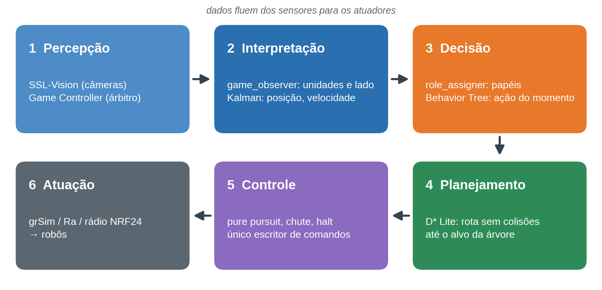

*Figura 1.1 — As camadas do software, da percepção à atuação*

1. **Percepção**: as câmeras compartilhadas e o Game Controller entregam dados brutos pela rede.
2. **Interpretação**: um observador converte esses dados para as unidades e referenciais internos (milímetros, radianos), e filtros de Kalman estimam posição, velocidade e aceleração da bola e dos robôs.
3. **Decisão**: um atribuidor de papéis escolhe quem é o atacante e quem é o defensor, e a Behavior Tree de cada robô decide a ação do momento.
4. **Planejamento**: o planejador D\* Lite calcula uma rota livre de colisões até o alvo escolhido pela árvore.
5. **Controle**: um controlador transforma a rota em velocidades de roda e é o único responsável por enviar comandos ao robô, incluindo o chute e a parada de emergência.
6. **Atuação**: um driver entrega o comando ao simulador (grSim ou ER-Force Ra) ou ao rádio dos robôs reais.

Este manual percorre essas camadas de baixo para cima ao descrever o sistema atual (Parte III) e de cima para baixo ao propor a arquitetura de jogo completo (Parte IV). A fronteira mais importante para a estratégia é entre a **decisão** e o **planejamento/controle**: a árvore diz *aonde* ir e *o que* fazer (ir a um ponto, chutar, parar); os módulos abaixo cuidam de *como* fazê-lo.

## 1.4 Como o manual está organizado

O conteúdo está dividido em cinco partes, ilustradas na Figura 1.2.

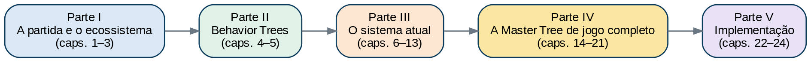

*Figura 1.2 — Mapa do manual: as cinco partes e os capítulos de cada uma*

- **Parte I — A partida e o ecossistema** (Capítulos 1 a 3). O jogo, as regras que afetam o software e a visão geral dos programas.
- **Parte II — Behavior Trees** (Capítulos 4 e 5). A teoria necessária e como a biblioteca BehaviorTree.CPP a implementa.
- **Parte III — O sistema atual** (Capítulos 6 a 13). Como cada peça funciona hoje: o nó de estratégia, o movimento, a percepção, o ataque, a defesa, os papéis e a árvore mestre — e uma lista honesta de pontos de atenção que precisam ser resolvidos antes de uma partida completa.
- **Parte IV — A Master Tree de jogo completo** (Capítulos 14 a 21). A arquitetura proposta: um estado de jogo único e confiável, uma árvore mestre com prioridades claras, uma subárvore para cada situação regulamentar, papéis dinâmicos e os contratos de dados entre as peças.
- **Parte V — Implementação** (Capítulos 22 a 24). Um tutorial para criar uma nova folha de árvore, a estratégia de testes e o plano de trabalho de quatro semanas.

Os apêndices reúnem o glossário, a referência de mensagens e tópicos ROS 2, o mapeamento das regras do regulamento para a arquitetura, os arquivos XML propostos e a referência de parâmetros e comandos de execução.

## 1.5 Convenções usadas

Ao longo do texto, algumas convenções ajudam a distinguir o que **existe hoje** do que **está proposto**:

- Trechos em `fonte monoespaçada` são nomes de arquivos, nós, tópicos, parâmetros ou código.
- Nas figuras de árvores, nós com borda laranja e o símbolo **✦** são nós **novos**, a serem criados. Os demais já existem no repositório.
- Caixas coloridas destacam informações de natureza diferente: azul para observações, verde para dicas, laranja para pontos de atenção, vermelho para riscos de segurança e roxo para exemplos.
- Unidades: posições em **milímetros**, ângulos em **radianos** e velocidades em **metros por segundo**, salvo indicação em contrário. As mensagens de ROS 2 que carregam uma pose para o planejador usam metros; a conversão é feita em um ponto único e documentado (Capítulo 7).

!!! note "Versões de referência"
    O software roda sobre **ROS 2 Jazzy** (Ubuntu 24.04, no *devcontainer* do projeto) e usa a biblioteca **BehaviorTree.CPP 4.10**. Parte da semântica detalhada dos nós de controle foi conferida no código-fonte da série 4.6; sempre que um comportamento for crítico para a segurança, o plano de testes (Capítulo 23) inclui um teste que o confirma na versão instalada.

!!! tip "Quem compila o quê"
    Por regra do time, a compilação do workspace (`./build.sh`, que chama `colcon build`) é feita por quem desenvolve, dentro do devcontainer. Os exemplos de código deste manual são escritos para serem colados no repositório; compile e teste antes de usar.

## 1.6 Termos que merecem atenção desde já

Algumas palavras do regulamento parecem sinônimas, mas não são, e confundi-las é a origem de muitos erros de estratégia:

- **Comando do árbitro**: a ordem que o Game Controller emite (HALT, STOP, NORMAL_START…).
- **Estágio da partida**: o momento do jogo no tempo (primeiro tempo, intervalo, prorrogação…).
- **Evento**: uma ocorrência registrada pelo árbitro automático, como uma falta.
- **Autorização de movimento**: se o robô pode se mover. O HALT proíbe; o STOP permite, com limite de velocidade.
- **Autorização de tocar na bola**: só existe depois que a partida é retomada por NORMAL_START, por um chute livre ou por FORCE_START.

O glossário completo está no Apêndice A.
# Capítulo 2 — A partida SSL-EL

Este capítulo apresenta o jogo do ponto de vista do software. Ele resume o que o regulamento da SSL-EL (edição de agosto de 2024) exige dos robôs e, principalmente, **traduz cada regra em uma obrigação concreta** que a estratégia precisa cumprir. Quando o texto diz "o regulamento determina", trata-se de uma exigência da liga; quando diz "o software deve", trata-se da consequência prática para o nosso código.

## 2.1 O campo, a bola e os robôs

A SSL-EL é a categoria de entrada da Small Size League. O campo é menor que o das divisões regulares: a **área de jogo mede 4,5 m × 3 m**, cercada por uma margem de 0,5 m e por uma parede de 10 cm de altura, totalizando 5,5 m × 4 m (Figura 2.1). Todas as linhas têm 1 cm de largura. A superfície é de feltro ou carpete verde.

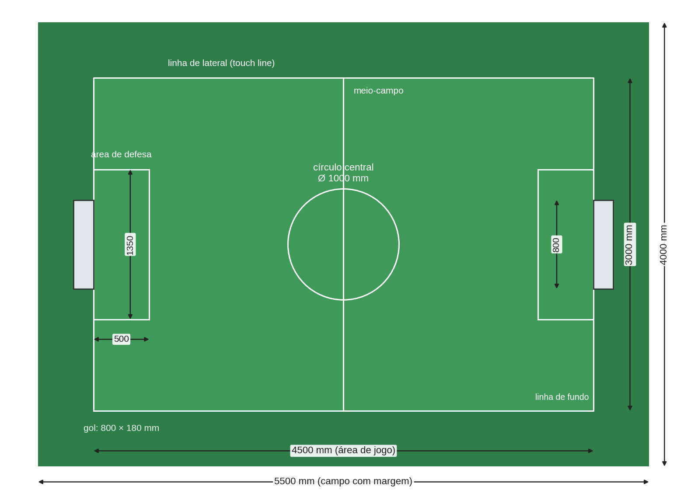

*Figura 2.1 — O campo da SSL-EL com suas dimensões (em mm)*

Os elementos do campo que mais importam para a estratégia são:

- **Linhas de lateral** (*touch lines*): as duas linhas longas.
- **Linhas de fundo** (*goal lines*): as duas linhas curtas, onde ficam os gols.
- **Linha de meio-campo**, que divide o campo em duas metades, e o **círculo central**, com 1 m de diâmetro.
- **Áreas de defesa**: retângulos de 1,35 m × 0,5 m junto a cada gol. Elas têm regras especiais de entrada, como veremos.
- **Gols**: 0,8 m de abertura e 0,18 m de profundidade.

Cada equipe tem **no máximo 3 robôs**, e um deles pode ser o goleiro. O identificador do goleiro é escolhido antes da partida e só pode ser alterado quando a bola está fora de jogo ou na metade adversária. Os robôs cabem em um cilindro de 18 cm de diâmetro por 15 cm de altura e não podem ativar nenhum dispositivo de condução de bola (*dribbler*); o chute, porém, é permitido. A bola é uma bola de golfe laranja, com 43 mm de diâmetro.

## 2.2 Software compartilhado: visão, árbitro e árbitros automáticos

Toda a liga usa a mesma infraestrutura de software, mantida pela comunidade:

- **SSL-Vision**: câmeras compartilhadas sobre o campo calculam a posição e a orientação da bola e dos robôs e as enviam por rede (multicast). As equipes não podem montar câmeras ou sensores externos próprios. Os dados reais têm ruído, atraso e falhas ocasionais de detecção — o software precisa tolerar isso.
- **Game Controller (GC)**: um programa operado por um humano (o *game controller operator*) que traduz as decisões do árbitro humano e dos **árbitros automáticos** em mensagens de rede. Ele mantém o estado do jogo, registra os eventos e serve de intermediário entre todos os participantes. É dele que vem o **comando do árbitro** que a nossa estratégia lê.
- **Árbitro automático** (*autoref*): programa que detecta infrações (bola fora do campo, faltas) e as reporta ao GC.
- **Controle remoto**: dispositivo opcional com o qual o operador do time pede timeout, troca de robô ou parada de emergência, e levanta a bandeira de contestação.

## 2.3 As etapas da partida

Uma partida regular tem dois tempos de **300 segundos de jogo** separados por um intervalo de 300 segundos. Em partidas eliminatórias empatadas há prorrogação (dois tempos de 150 s, com 120 s de intervalo) e, persistindo o empate, uma disputa de pênaltis (Figura 2.2).

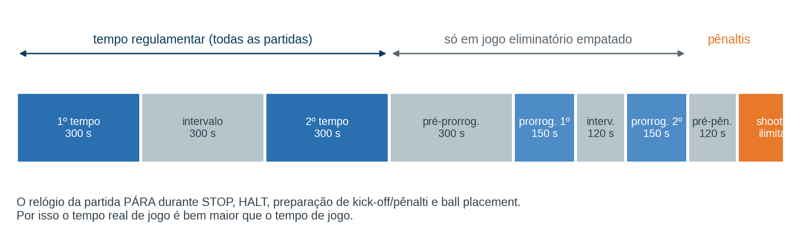

*Figura 2.2 — As etapas de uma partida SSL-EL*

Um detalhe com consequências práticas: **o relógio da partida pára** sempre que nenhuma equipe pode manipular a bola — durante STOP, HALT, a preparação de kick-off ou pênalti e o *ball placement*. Por isso uma partida de 10 minutos de jogo dura bem mais do que 10 minutos de relógio, e cada transição entre estados acontece muitas vezes por jogo. A estratégia passa uma fração enorme do tempo **não jogando**, mas posicionando-se corretamente para o próximo reinício.

Cada equipe tem direito a 4 timeouts, num total de 420 segundos (na prorrogação, 2 timeouts e 240 s). Timeouts só ocorrem com o jogo parado e, durante eles, as duas equipes podem mexer livremente no hardware e no software.

## 2.4 Os comandos do árbitro

O Game Controller comunica o estado do jogo por meio de **comandos**. Cada comando define se os robôs podem se mover, a que velocidade, se podem tocar na bola e para onde devem ir. Entender esse vocabulário é pré-requisito para tudo o que vem depois.

### 2.4.1 HALT

*"Ninguém se move."* Ao receber HALT, nenhum robô pode se mover nem manipular a bola. Existe uma **tolerância de 2 segundos** para os robôs frearem. O HALT é o comando de emergência: é usado quando algo dá errado (um robô fora de controle), quando humanos entram no campo e quando uma equipe pede substituição de robô. Ele é **sempre seguido de um STOP**, e o GC aguarda até 10 s após o HALT antes de retomar o jogo, dando tempo para as equipes se prepararem.

### 2.4.2 STOP

*"Continuem se movendo, devagar, longe da bola."* No STOP, todos os robôs precisam reduzir a velocidade para **menos de 0,75 m/s**, manter pelo menos **0,5 m de distância da bola** e não manipulá-la. O STOP é usado depois que a bola sai do campo, quando ocorre uma falta e para preparar qualquer reinício. O limite de velocidade e a distância mínima existem para que o árbitro (humano) possa colocar a bola com segurança. É suficiente que fique claro ao árbitro que o robô está fazendo o possível para respeitar a distância — se a bola se move rápido, não é razoável exigir perfeição.

### 2.4.3 BALL_PLACEMENT

Depois de uma parada, a bola precisa ser colocada na posição correta, que depende do evento ocorrido. A forma preferida é o **posicionamento automático**: os robôs de uma das equipes empurram a bola até a posição designada, sem intervenção humana (Figura 2.3, painel b). O comando BALL_PLACEMENT informa qual equipe deve colocar a bola e a posição-alvo. As regras determinam:

- O posicionamento tem **30 segundos** para ser concluído. É considerado bem-sucedido quando a bola está parada a no máximo 0,15 m do alvo e nenhum robô está perto demais dela.
- Os robôs da equipe que **não** está colocando a bola devem ficar a **no mínimo 0,5 m da linha entre a bola e o alvo** (a zona proibida tem formato de estádio). Interferir é falta.
- Na SSL-EL, uma equipe pode decidir **não** colocar a bola pelo resto do jogo (basta avisar o árbitro); nesse caso a equipe adversária ou o próprio árbitro faz o posicionamento.

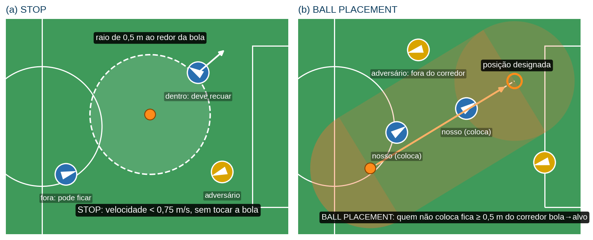

*Figura 2.3 — STOP (a) e BALL_PLACEMENT (b)*

### 2.4.4 Comandos de preparação e reinício

Para retomar o jogo, o GC emite primeiro um comando de **preparação** (os robôs vão para as posições do reinício) e depois um comando que **autoriza a jogada**. Os pares são:

| Situação | Preparação | Autorização |
|---|---|---|
| Kick-off (início de tempo, depois de um gol) | `PREPARE_KICKOFF_YELLOW/BLUE` | `NORMAL_START` |
| Pênalti | `PREPARE_PENALTY_YELLOW/BLUE` | `NORMAL_START` |
| Falta, lateral, escanteio, tiro de meta | (STOP) | `DIRECT_FREE_YELLOW/BLUE` |
| Jogo recomeça sem favorecimento | (STOP) | `FORCE_START` |

Note um ponto sutil que reaparece várias vezes neste manual: o comando **`NORMAL_START` é o mesmo** para o kick-off e para o pênalti. O que diferencia os dois é o comando de preparação que veio *antes*. Isso significa que quem lê apenas "o comando atual" não consegue saber, em `NORMAL_START`, qual reinício está acontecendo — é preciso **lembrar** o contexto.

### 2.4.5 Kick-off

A bola é colocada no centro do campo pelo árbitro humano. No comando de preparação, **todos os robôs devem estar na própria metade do campo e fora do círculo central**; apenas **um robô da equipe que bate** (o *kicker*) pode ficar dentro do círculo. Nenhum robô toca a bola até o `NORMAL_START`; depois dele o kicker pode manipulá-la, e um gol direto do kick-off é válido (Figura 2.5, painel a). Os dois tempos e as eventuais prorrogações começam com kick-off, assim como o jogo depois de cada gol (batido pela equipe que sofreu o gol).

### 2.4.6 Free kick

A posição da bola depende do evento que originou a falta, mas deve estar a pelo menos 0,2 m de qualquer linha e 1 m de qualquer área de defesa; se o evento exigir uma posição inválida, usa-se a posição válida mais próxima. Quando o `DIRECT_FREE` é emitido, os robôs da equipe favorecida podem se aproximar da bola, e **um deles** (o kicker) pode manipulá-la; os adversários continuam a **no mínimo 0,5 m da bola**. Um gol direto é válido. Throw-in (lateral), tiro de meta e escanteio são todos **mapeados para free kicks** — não existem comandos próprios para eles.

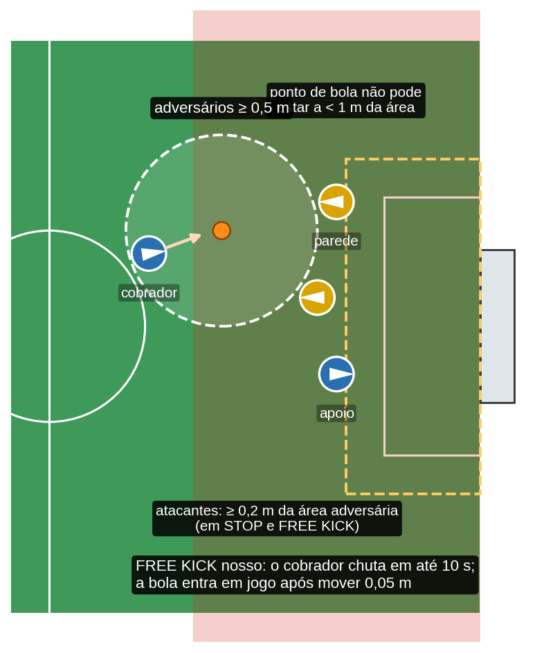

*Figura 2.4 — Free kick: o cobrador, a distância mínima dos adversários e a faixa de 0,2 m ao redor da área de defesa adversária*

### 2.4.7 Force start

Retoma o jogo imediatamente, com ambas as equipes livres para se aproximar e manipular a bola. É usado em situações sem favorecido claro — por exemplo, quando o jogo é parado sem motivo específico ou quando as duas equipes cometem falta.

### 2.4.8 Pênalti

O pênalti é o reinício mais regrado. O árbitro coloca a bola na marca de pênalti. No comando de preparação, o **goleiro defensor deve ir para a linha de gol e tocá-la**; um robô atacante pode se aproximar da bola, mas **sem tocá-la**; e todos os outros robôs, de ambas as equipes, devem ficar **1 m atrás da bola**, de modo a não interferir (Figura 2.5, painel b). No `NORMAL_START`, o atacante pode tocar a bola, que **só pode se mover em direção ao gol adversário**. O goleiro defensor fica livre para se mover quando a bola entra em jogo, e se a bola ainda estiver em jogo após 10 segundos o jogo é parado.

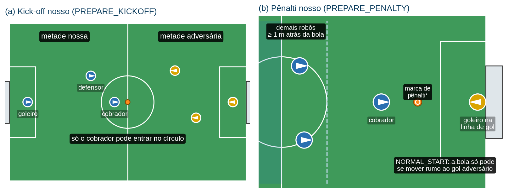

*Figura 2.5 — Kick-off (a) e pênalti (b)*

Um gol de pênalti **não** é concedido se a bola cruzar as linhas fora do gol, se o goleiro desviar a bola mudando sua direção em 90° ou mais, se o time atacante cometer qualquer falta ou se a bola ainda estiver em jogo após 10 s. Se a equipe defensora cometer qualquer falta durante o pênalti, recebe cartão vermelho e o pênalti é repetido.

## 2.5 A bola em jogo e fora de jogo

Enquanto o jogo está parado, a bola está **fora de jogo**. Ela entra **em jogo** quando: houve um FORCE_START; a bola se moveu pelo menos 0,05 m depois de um kick-off, free kick ou pênalti; ou passaram 10 segundos depois de um kick-off ou free kick. Esse critério importa para a estratégia porque define o momento em que as restrições do reinício terminam (por exemplo, a distância mínima de 0,5 m dos adversários).

Quando a bola sai do campo cruzando completamente uma linha, o jogo é parado e reiniciado com um free kick para o adversário de quem tocou nela por último, com a bola na posição prevista pelo evento (lateral: 0,2 m da linha de lateral; tiro de meta: 0,2 m da lateral e 0,5 m da linha de fundo; escanteio: 0,2 m de ambas). Um *chute sem alvo* (a bola cruza o meio-campo e depois a linha de fundo adversária, sem tocar outro robô) também é devolvido como free kick.

## 2.6 Faltas e sanções que o software pode evitar

O regulamento define dezenas de infrações. A maioria exige julgamento humano (empurrar, segurar a bola, desrespeitar árbitros). Mas várias são **objetivamente mensuráveis**, e é exatamente delas que o software deve se proteger:

| Regra | Limite | Observação |
|---|---|---|
| Velocidade do robô | ≤ 1,5 m/s no jogo | falta que não pára o jogo |
| Velocidade do robô no STOP | ≤ 0,75 m/s | 2 s de tolerância; conta uma vez por robô por parada |
| Velocidade da bola após o chute | ≤ 3 m/s (em 3D) | falta que não pára o jogo |
| Distância à bola durante free kick/kick-off do adversário | ≥ 0,5 m | o relógio do adversário é reiniciado se violado |
| Proximidade da área de defesa adversária (STOP e free kick) | ≥ 0,2 m | 2 s de tolerância |
| Tocar a bola dentro da área adversária | proibido (parcial ou total) | falta que não pára o jogo |
| Robô que não é o goleiro dentro da própria área | proibido (melhor esforço) | se tocar a bola totalmente dentro: pênalti |
| Bola retida na área de defesa | ≤ 10 s | goleiro |
| Interferência no ball placement | ≥ 0,5 m do corredor bola→alvo | +10 s no cronômetro de placement |
| Colisão | diferença de velocidade projetada ≤ 0,75 m/s | caso contrário o mais rápido comete falta |

Cada **falta** soma ao contador da equipe, e **toda terceira falta gera um cartão amarelo**. Um cartão amarelo reduz em um o número de robôs permitidos em campo por 120 segundos de jogo; a equipe tem 10 segundos para tirar um robô, e dois cartões amarelos não expirados fazem o terceiro virar vermelho (que não expira). Isso tem uma consequência direta: **o número de robôs ativos pode mudar durante a partida**, e a estratégia precisa se adaptar (veremos a degradação de papéis no Capítulo 19).

## 2.7 A máquina de estados do jogo

O Apêndice B do regulamento descreve o jogo como uma máquina de estados, reproduzida na Figura 2.6. Há três grandes famílias de estados:

- **Halted** (parado totalmente): `Halt` e `Timeout`.
- **Stopped** (parado com movimento permitido): `Stop`, `BallPlacement`, `PrepareKickoff` e `PreparePenalty`.
- **Running** (jogo): `Run`, `FreeKick`, `Kickoff` e `Penalty`.

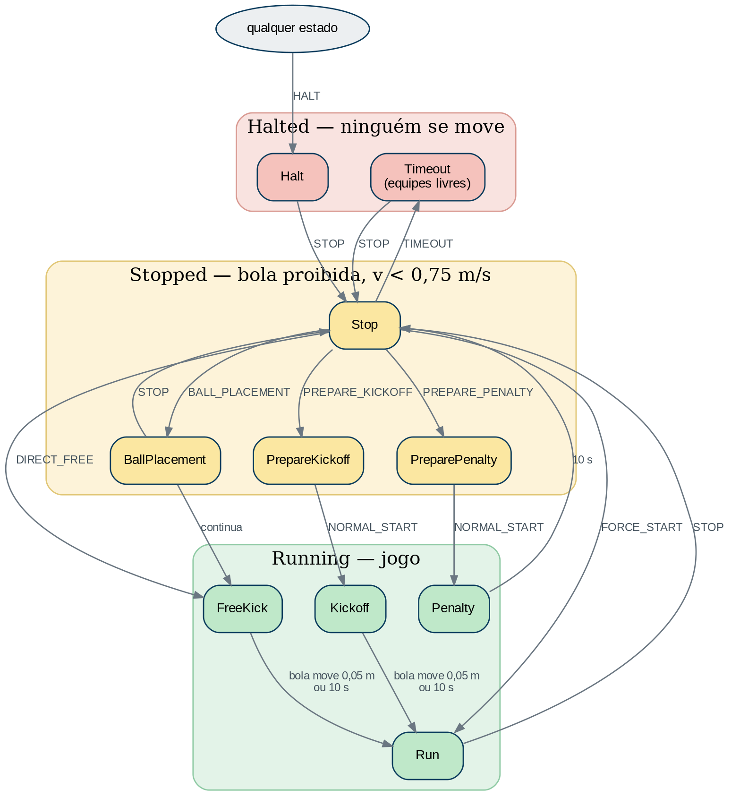

*Figura 2.6 — A máquina de estados do jogo segundo o regulamento*

Qualquer estado pode ir para `Halt` por um comando HALT. Em geral, um reinício passa por `Stop`, vai para um estado de preparação ou de posicionamento e só então entra em um estado de jogo; a bola se mover (ou 10 s) leva de `Kickoff`/`FreeKick` para `Run`.

!!! warning "Comando versus estado"
    A máquina de estados tem mais estados do que o Game Controller tem comandos. O estado `Kickoff`, por exemplo, não é um comando: ele corresponde ao comando `NORMAL_START` que chega depois de um `PREPARE_KICKOFF`. É por isso que a nossa arquitetura de jogo completo (Parte IV) introduz um **estado de jogo derivado**, a *fase*, em vez de reagir diretamente ao número do comando.

## 2.8 O que o software precisa garantir

Resumindo o capítulo em obrigações do software, uma estratégia de partida inteira precisa:

1. **Parar imediatamente** com HALT, e nunca se mover com o jogo em `Halt` ou `Timeout`.
2. **Limitar a velocidade a 0,75 m/s** e manter **0,5 m de distância da bola** durante STOP e BALL_PLACEMENT (e não interferir no corredor do posicionamento).
3. **Posicionar-se corretamente** para cada reinício, nos dois papéis possíveis (quem bate e quem defende): kick-off, pênalti e free kick.
4. **Lembrar o contexto** de `NORMAL_START` (kick-off ou pênalti).
5. **Respeitar as áreas de defesa**: nenhum robô, exceto o goleiro, na própria; nenhum robô tocando a bola na adversária.
6. **Limitar o chute a 3 m/s** e o robô a 1,5 m/s.
7. **Cuidar do goleiro**: não reter a bola por mais de 10 s na área e, no pênalti defensivo, manter-se na linha de gol.
8. **Adaptar-se** quando o número de robôs ativos mudar (cartões) ou o goleiro estiver ausente.
9. **Comportar-se com segurança** quando faltarem dados (visão ou árbitro).

Cada um desses itens reaparece, com a solução correspondente, na Parte IV. O Apêndice C relaciona cada regra do regulamento ao componente que a trata.
# Capítulo 3 — Visão geral do software

Este capítulo apresenta a pilha de software do OxeBots como um todo: quais pacotes existem, quais processos rodam durante uma partida, como os dados circulam entre eles e como tudo é iniciado. É o mapa que você deve ter na cabeça antes de entrar nos detalhes dos capítulos seguintes.

## 3.1 O workspace e seus pacotes

O código vive em um *workspace* ROS 2 (`software_ws`) que reúne vários repositórios como submódulos Git dentro da pasta `src/`. Cada submódulo é um pacote com uma responsabilidade clara:

| Pacote | O que faz |
|---|---|
| `ssl_ros_bridge` | Pontes entre a rede da liga e o ROS 2: recebe os pacotes UDP/multicast do SSL-Vision e do Game Controller (formato Protobuf) e os publica como mensagens ROS 2. Também define as mensagens `ssl_league_msgs` e contém um cliente para os serviços do GC. |
| `oxebots_interfaces` | Mensagens, serviços e o protocolo binário do rádio: `GameData`, `RobotGoal`, `RobotCmd`, `RobotMotionOverride`, `RoleAssignment` e muitas outras. É a "língua comum" de todos os nós. |
| `oxebots_observers` | O `game_observer_node`, que converte a visão para o referencial interno e publica o estado de jogo, a geometria do campo e o mapa de obstáculos; e o `field_visualizer_node`, que desenha o campo no RViz. |
| `oxebots_prediction` | O `kalman_filter_node`: filtros de Kalman dedicados para a bola (com atrito do carpete) e para os robôs. |
| `oxebots_strategy` | O coração da estratégia: o `strategy_node` (Behavior Trees), o `role_assigner_node`, o planejador `d_star_planner_node`, o controlador `movement_calculation_node`, o `trajectory_setpoint_node`, todas as folhas de árvore e todos os arquivos XML. |
| `oxebots_comms` | Drivers de atuação: `grSim_controller_node` (simulador grSim), `ra_controller_node` (simulador ER-Force Ra) e `nrf24_bridge_node` (rádio dos robôs reais). |
| `oxebots_bringup` | Arquivos de *launch* e de configuração YAML: o comando único que sobe tudo. |
| `oxebots_trajectory_analysis` | Ferramenta Python de análise de rotas (não participa do jogo). |

## 3.2 Os processos em execução

Durante uma partida rodam dois tipos de processo, como mostra a Figura 3.1.

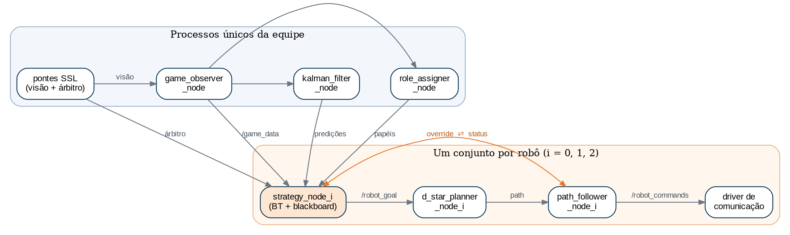

*Figura 3.1 — Os processos do sistema e os principais tópicos entre eles*

**Processos únicos da equipe.** Existe uma única instância de cada um: as pontes SSL (visão e árbitro), o observador, o filtro de Kalman, o atribuidor de papéis e o driver de comunicação. Eles produzem informação que serve a todos os robôs ao mesmo tempo.

**Um conjunto de processos por robô.** Para cada robô (identificadores 0, 1 e 2), o sistema sobe quatro processos independentes:

- `strategy_node_<i>`: a Behavior Tree do robô e sua *blackboard* (a memória compartilhada da árvore).
- `d_star_planner_node_<i>`: o planejador de rotas.
- `path_follower_node_<i>`: o controlador de movimento (executável `movement_calculation_node`).
- `trajectory_setpoint_node_<i>`: converte a velocidade comandada em um ponto-alvo futuro, usado apenas quando o rádio opera em modo "ponto".

Essa estrutura tem uma consequência importante, que será retomada muitas vezes: **cada robô tem a sua própria árvore, com a sua própria blackboard**. Não existe uma "árvore do time". A coordenação entre robôs acontece por mensagens (por exemplo, o atribuidor de papéis diz quem é o atacante) e, de forma implícita, pelo fato de todas as árvores lerem os mesmos dados do jogo.

!!! note "Tópicos compartilhados entre os robôs"
    Vários tópicos (`/robot_goal`, `/robot_motion_override`, `/robot_commands`, `/robot_motion_status`) são **compartilhados**: os três robôs publicam e assinam no mesmo nome. Cada mensagem carrega o identificador do robô e cada receptor filtra o que não é seu. Isso simplifica a configuração, mas significa que um erro de identificação (um nó que comanda o robô errado) afeta o time inteiro.

## 3.3 O caminho dos dados

A Figura 3.2 mostra, em ordem, o que acontece com a informação desde a câmera até o robô.

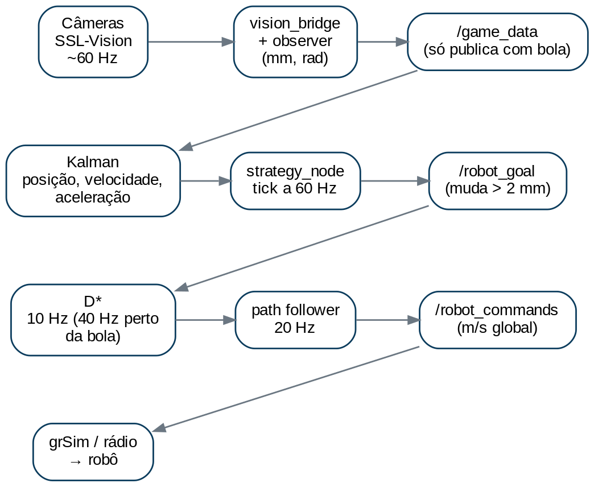

*Figura 3.2 — O caminho de uma informação, da câmera ao robô*

1. **Câmeras → observer.** O SSL-Vision publica a cerca de 60 Hz. A ponte de visão traduz o pacote para uma mensagem ROS 2 e o `game_observer_node` a converte para milímetros e radianos, escolhe a detecção de bola de maior confiança, aplica a inversão de lado quando necessária e publica `/game_data`. Um detalhe relevante: o observer **só publica quando enxerga a bola** (com confiança mínima de 0,3).
2. **`/game_data` → Kalman.** O filtro estima posição, velocidade e aceleração da bola e dos robôs e publica `ball_predicted` e `robot_predicted`.
3. **Tudo → `strategy_node`.** A árvore de cada robô lê o estado do jogo, as predições e o comando do árbitro (que ela assina diretamente do Game Controller) e decide.
4. **`/robot_goal`.** As folhas de movimento publicam um alvo. Só republicam quando o alvo muda de forma relevante (mais de 2 mm ou cerca de 1° de orientação).
5. **D\*.** O planejador, a 10 Hz (40 Hz quando a bola está a menos de 40 cm do robô), calcula uma rota e a publica como `nav_msgs/Path`.
6. **Path follower.** A cada 50 ms (20 Hz), o controlador segue a rota, aplica controle proporcional, repulsão de contato e travas de área, e publica `/robot_commands`.
7. **Driver.** O driver de comunicação entrega o comando ao simulador ou ao rádio.

Além desse caminho principal existe um **canal de exceção**: as folhas que precisam de uma ação física especial (parar, chutar, girar) enviam um `RobotMotionOverride` direto ao controlador, que o executa em lugar de seguir a rota. O Capítulo 7 detalha esse mecanismo.

## 3.4 Como o sistema é iniciado

Tudo é iniciado por um único arquivo de launch, `ssl-new.launch.py`, do pacote `oxebots_bringup`:

```bash
ros2 launch oxebots_bringup ssl-new.launch.py
```

O comportamento é controlado por argumentos. Os principais:

| Argumento | Valores | O que muda |
|---|---|---|
| `mode` | `grsim` (padrão), `ra`, `game` | Escolhe o driver de comunicação: simulador grSim, simulador ER-Force Ra, ou jogo real pelo rádio NRF24. |
| `command_mode` | `velocity` (padrão), `point` | Formato do comando enviado pelo rádio (velocidades locais ou ponto-alvo de trajetória). |
| `invert_sides` | `True`, `False` | Espelha o campo (`x = −x`, `y = −y`, `θ += π`). Por padrão é `True` apenas no modo `ra`. |
| `team_color` / `config_file` | `blue`, `yellow` / caminho | Escolhe o arquivo YAML de configuração do time. |
| `bt_xml` | nome de arquivo `.xml` | Substitui a árvore executada, sem editar o YAML. |
| `use_rviz` | `True`, `False` | Abre o RViz. |
| `match` | `True`, `False` | Sobe **os dois times** na mesma máquina, isolados por `ROS_DOMAIN_ID` (0 = azul, 1 = amarelo). |

O script `run_match.sh`, na raiz do workspace, é um atalho para uma partida simulada completa entre azul e amarelo: ele redireciona a execução para o *devcontainer* se estiver no hospedeiro e chama o launch com `match:=True`. O Apêndice E reúne os parâmetros e exemplos de comando.

### 3.4.1 A configuração em YAML

Os arquivos `match_config*.yaml` centralizam os parâmetros. Para a estratégia, os mais importantes são:

- `is_yellow_team`: a cor do time (influencia as portas do simulador e o lado em que o time defende).
- `bt_xml_path`: o arquivo da árvore principal; por padrão, `master_strategy_carry.xml`.
- `execution_rate`: a frequência do tick da árvore, 60 Hz por padrão.
- `gc_topic`: o tópico de onde vem o comando do árbitro.

## 3.5 O referencial de coordenadas

Todo o software compartilha o mesmo referencial de campo, ilustrado na Figura 3.3: origem no centro do campo, eixo x ao longo do comprimento, eixo y ao longo da largura, ângulos em radianos no sentido anti-horário a partir de +x. **Posições são mantidas em milímetros**; a conversão para metros acontece uma única vez, quando a folha de movimento monta o `RobotGoal`.

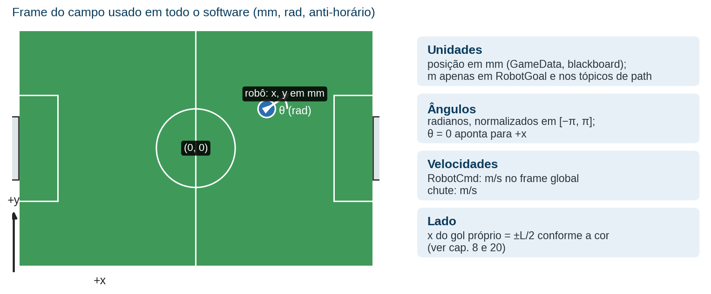

*Figura 3.3 — O referencial de campo e as unidades do software*

Um ponto exige atenção especial: o **lado do campo**. O referencial é fixo, mas o gol que cada time defende depende da cor (e do simulador). No código atual, o time amarelo defende o gol de +x e o time azul o de −x; a chave `my_goal_x` da blackboard guarda esse valor, calculado a partir da geometria do campo. O Capítulo 8 explica a inversão de lado, e o Capítulo 13 discute as armadilhas que o lado fixo cria para o jogo completo.


---

# Parte II — Behavior Trees

*A teoria necessária para ler, escrever e depurar as árvores do projeto, e a forma como a biblioteca BehaviorTree.CPP a coloca em prática.*

# Capítulo 4 — Behavior Trees do zero

Este capítulo ensina Behavior Trees (BTs) a partir do princípio, sem supor nenhum conhecimento prévio. Todos os conceitos são ilustrados com exemplos desenhados e, sempre que possível, ligados ao futebol de robôs. No capítulo seguinte veremos como a biblioteca que usamos, a BehaviorTree.CPP, implementa essas ideias.

## 4.1 Por que usar uma árvore de comportamento

Um robô de futebol precisa tomar decisões que dependem do contexto e que podem ser interrompidas a qualquer momento. Imagine o atacante perseguindo a bola quando o árbitro apita um HALT: ele precisa largar o que estava fazendo *imediatamente*, sem terminar a jogada, e voltar à ação normal quando o jogo recomeçar.

Uma abordagem clássica para esse tipo de problema é a **máquina de estados finitos** (FSM): um conjunto de estados ("indo à bola", "chutando", "parado") e de transições entre eles. As FSMs funcionam bem enquanto pequenas, mas a quantidade de transições cresce depressa: se *qualquer* estado precisa poder ir para "parado" quando chega um HALT, cada novo estado exige mais uma transição. Reutilizar um pedaço (por exemplo, "ir até um ponto") em vários contextos também é difícil, porque as transições ficam entrelaçadas com os estados.

As Behavior Trees resolvem esses dois problemas. Elas organizam o comportamento como uma **hierarquia**: comportamentos complexos são compostos de comportamentos mais simples, e a *prioridade* entre eles é dada pela posição na árvore. Os benefícios principais são:

- **Modularidade**: cada subárvore é um bloco que pode ser testado e reutilizado isoladamente.
- **Reatividade**: a árvore é reavaliada continuamente, de modo que uma condição de alta prioridade (HALT) pode interromper um comportamento em andamento.
- **Legibilidade**: o desenho da árvore é, ao mesmo tempo, a documentação do comportamento.
- **Desenvolvimento em paralelo**: duas pessoas podem trabalhar em subárvores diferentes sem se atrapalhar.

## 4.2 A anatomia de uma árvore

Uma BT é uma árvore no sentido da computação: tem uma **raiz**, **nós internos** e **folhas**. A Figura 4.1 mostra um exemplo pequeno, que lê "se o árbitro mandou parar, pare; senão, jogue (vá à bola e chute)".

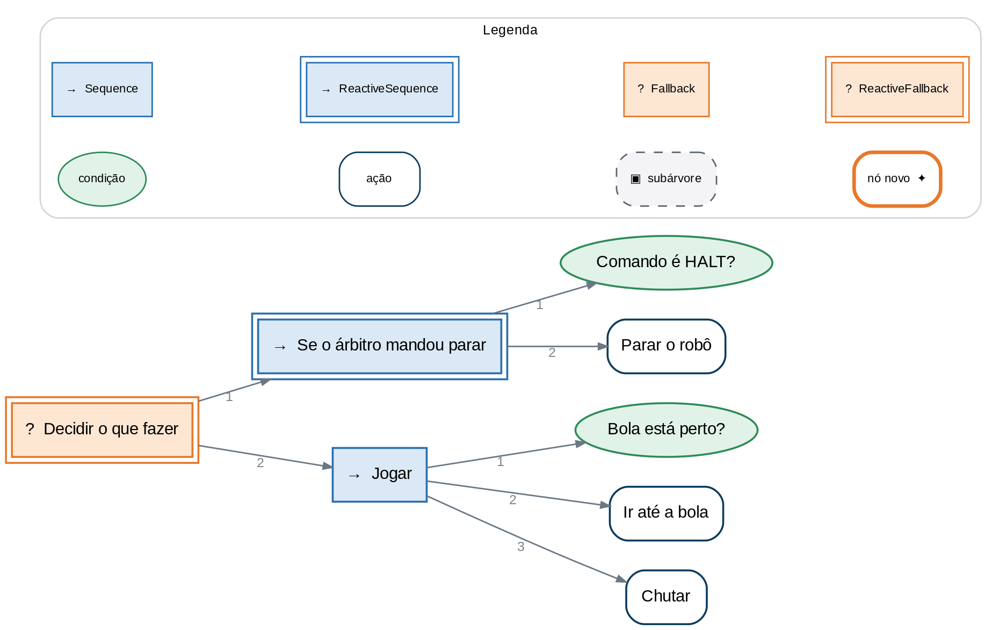

*Figura 4.1 — Uma árvore de exemplo, com a legenda de símbolos usada em todo o manual*

Os nós se dividem em quatro famílias:

- **Folhas de condição** (elipses verdes): fazem uma pergunta ao mundo e respondem sim ou não. Não alteram nada. Exemplo: "a bola está perto?".
- **Folhas de ação** (retângulos de cantos arredondados): *fazem* alguma coisa: mover o robô, chutar, parar.
- **Nós de controle** (retângulos azuis ou laranjas): têm vários filhos e decidem **qual filho executar e em que ordem**. Os mais importantes são `Sequence` (→) e `Fallback` (?).
- **Decoradores** (hexágonos): têm um único filho e modificam o seu comportamento ou o seu resultado (por exemplo, invertendo-o ou repetindo-o).

Há ainda as **subárvores** (retângulos tracejados), que apenas referenciam outra árvore pelo nome, permitindo reuso.

Nas figuras deste manual, os números pequenos nas arestas indicam a **ordem** dos filhos: o filho 1 tem prioridade sobre o 2, e assim por diante. Esta é uma regra de ouro: *em uma BT, a ordem dos irmãos é a prioridade*.

## 4.3 O tick e os três resultados

A árvore não "roda sozinha". Ela é executada por **ticks**: a cada tick, a raiz recebe um pulso, que ela propaga aos seus filhos segundo suas regras. Cada nó, ao ser "ticado", faz o seu trabalho e devolve um de três resultados:

| Resultado | Significado |
|---|---|
| **SUCCESS** | A tarefa foi concluída com êxito (ou a condição é verdadeira). |
| **FAILURE** | A tarefa não pôde ser concluída (ou a condição é falsa). |
| **RUNNING** | A tarefa ainda está em andamento; precisa de mais ticks. |

O terceiro resultado é o que permite comportamentos que duram no tempo. "Ir até um ponto" não termina em um tick: ela devolve RUNNING a cada tick enquanto o robô se desloca e só devolve SUCCESS quando ele chega. No nosso sistema, a árvore recebe um tick **60 vezes por segundo**.

!!! note "Ticks e tempo"
    Um tick não é uma unidade de tempo, e sim um *pulso de decisão*. Entre dois ticks, nada acontece na árvore; apenas os dados do mundo (mensagens ROS 2) são atualizados em outra linha de execução. A latência de reação a um evento é, portanto, de no máximo um período de tick (cerca de 17 ms a 60 Hz) mais o tempo de processamento do próprio tick.

## 4.4 Sequence: "faça isto, depois isto, depois isto"

O nó `Sequence` executa os filhos **em ordem**, um de cada vez. Se um filho devolve FAILURE, a sequência inteira falha imediatamente. Se devolve RUNNING, a sequência devolve RUNNING e **retoma exatamente naquele filho** no próximo tick. Só quando todos os filhos devolvem SUCCESS a sequência devolve SUCCESS.

Pense na sequência como um "E" lógico com passos: *A e depois B e depois C*. É a escolha natural para roteiros que precisam ser completados em ordem — por exemplo, "ir ao ponto de pré-chute → alinhar → chutar".

A Figura 4.2 mostra a execução em dois ticks. No tick 1, A tem sucesso e B fica em andamento; C ainda não é executado. No tick 2, a sequência **não repete A**: ela retoma em B (que agora conclui) e passa para C.

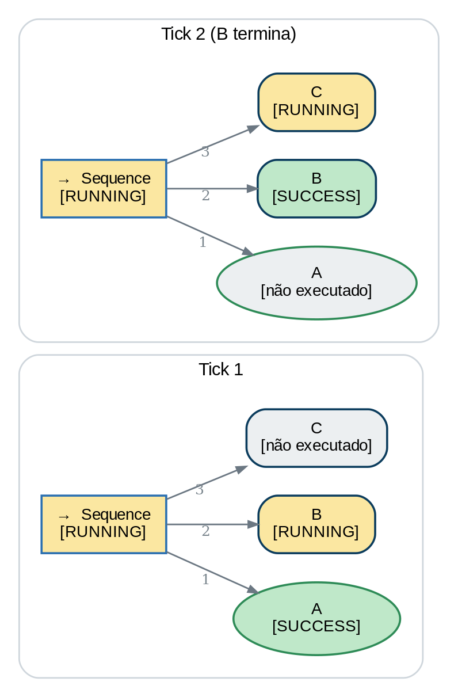

*Figura 4.2 — Sequence: no segundo tick o nó retoma de onde parou, sem reavaliar o primeiro filho*

Repare no detalhe da figura: "não executado" para A no tick 2. Essa **memória** da sequência é útil (não se reinicia o que já foi feito), mas tem um preço, que veremos adiante: uma condição colocada como primeiro filho **não é reavaliada** enquanto um filho posterior está em andamento.

## 4.5 Fallback: "tente isto; se não der, tente aquilo"

O `Fallback` (também chamado *Selector*) é o oposto da sequência: tenta os filhos **em ordem** até um ter sucesso. Se um filho devolve SUCCESS, o fallback devolve SUCCESS imediatamente e não olha os demais. Se devolve FAILURE, passa ao próximo. Se todos falham, falha. Se um devolve RUNNING, devolve RUNNING e retoma nele.

É um "OU" lógico com ordem de preferência: *A, senão B, senão C*. Serve para **escolher entre alternativas por prioridade**: "se a bola está perto, chute; senão, aproxime-se; senão, fique parado". Na prática, é o nó que implementa os "ramos" de uma árvore mestre: cada filho é um cenário, e o primeiro cuja condição vale é o escolhido.

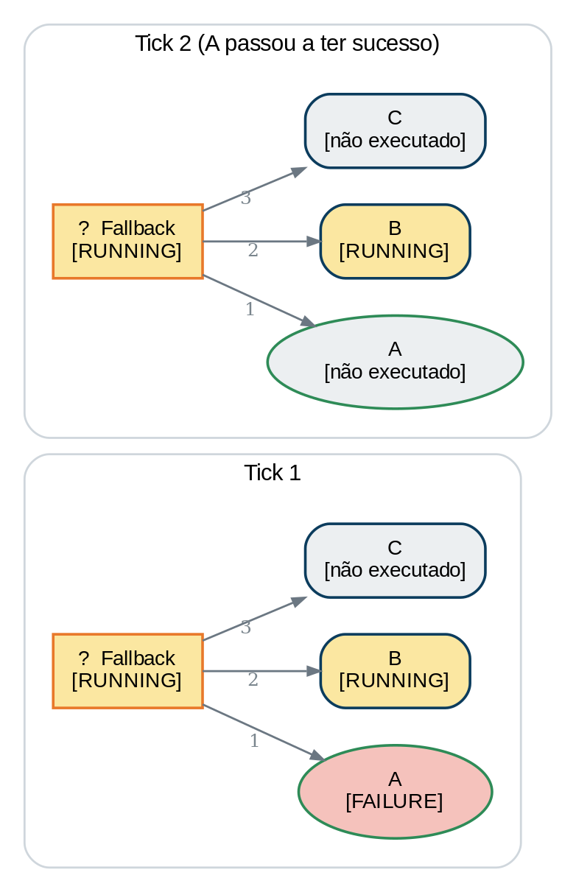

*Figura 4.3 — Fallback: tenta os filhos em ordem até um conseguir*

## 4.6 O problema da reatividade e os nós reativos

Agora a pergunta decisiva para o futebol de robôs. Considere um `Fallback` cujo primeiro filho é "o árbitro mandou HALT? → pare" e cujo segundo filho é "jogar". O jogo normal é uma ação longa (RUNNING). O que acontece quando o HALT chega no meio do jogo?

Com o `Fallback` comum, **nada**: ele memorizou que o filho 2 está em andamento e, no próximo tick, retoma direto nele, sem nunca olhar de novo para o filho 1. O robô ignora o HALT. Esse é exatamente o tipo de erro que as variantes **reativas** existem para evitar.

!!! danger "Sequence e Fallback comuns têm memória"
    Em um `Sequence` ou `Fallback` comum, os filhos anteriores ao que está em andamento **não são reavaliados**. Usar um deles como raiz da árvore de jogo significa que HALT e STOP podem passar despercebidos durante ações longas.

### 4.6.1 ReactiveFallback

O `ReactiveFallback` **recomeça do primeiro filho a cada tick**. Se um filho de maior prioridade passa a ter sucesso (ou a estar em andamento), os filhos de menor prioridade que estavam em execução são **interrompidos** (recebem `halt`). Por isso ele é o nó escolhido para a raiz das nossas árvores mestres: a cada tick, a árvore reavalia as prioridades de cima para baixo.

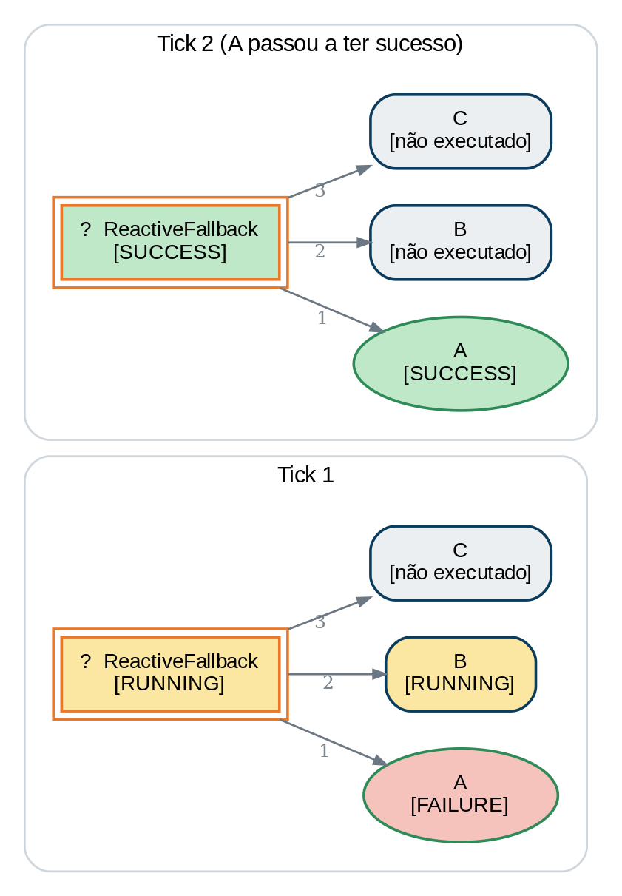

*Figura 4.4 — ReactiveFallback: o filho A passa a ter sucesso e B é interrompido*

### 4.6.2 ReactiveSequence

O `ReactiveSequence` também **recomeça do primeiro filho a cada tick**. Ele é a versão da sequência para *guardas*: um primeiro filho que é uma condição ("sou o atacante?") é reavaliado a cada tick; se deixar de valer, a sequência falha e os filhos seguintes são interrompidos. A Figura 4.5 mostra a diferença em relação ao `Sequence` da figura anterior: no tick 2, A é reavaliado, falha, e B é interrompido.

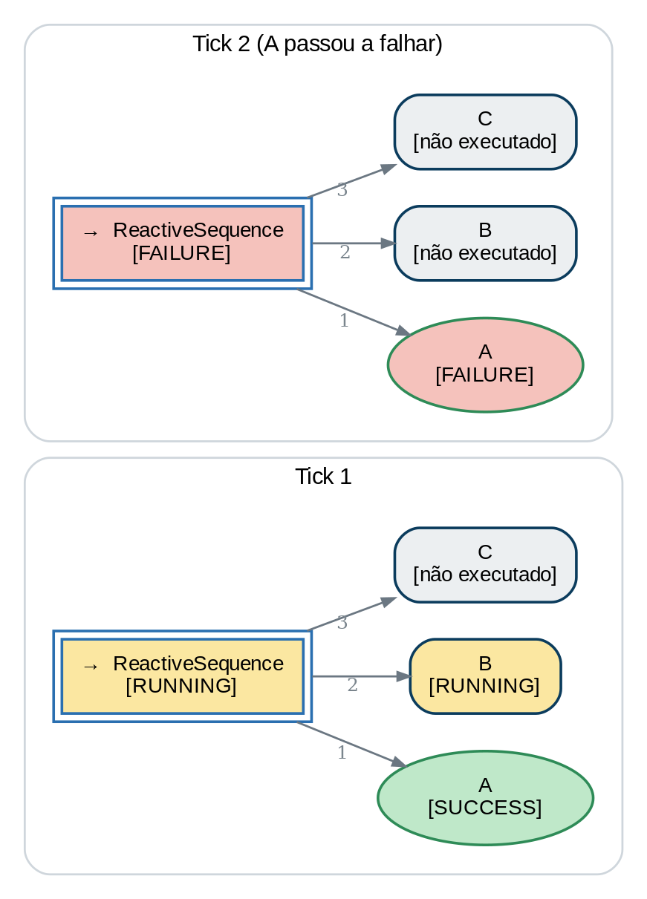

*Figura 4.5 — ReactiveSequence: a condição A é reavaliada a cada tick*

O preço da reatividade é que **os filhos anteriores ao que está em andamento devem ser rápidos e sem efeito colateral** — eles são executados de novo todo tick. Por isso, nos nós reativos usamos como "guardas" apenas condições e ações síncronas e baratas. A biblioteca também espera que, em um `ReactiveSequence`, só um filho seja assíncrono (de longa duração).

## 4.7 Parallel: fazer várias coisas ao mesmo tempo

O `Parallel` ticka **todos** os filhos a cada tick, sem esperar um terminar para começar o outro. Dois parâmetros definem quando ele termina: `success_count` (quantos filhos precisam ter sucesso para o `Parallel` ter sucesso) e `failure_count` (quantas falhas bastam para ele falhar). Ao decidir, ele interrompe os filhos que ainda estavam em andamento.

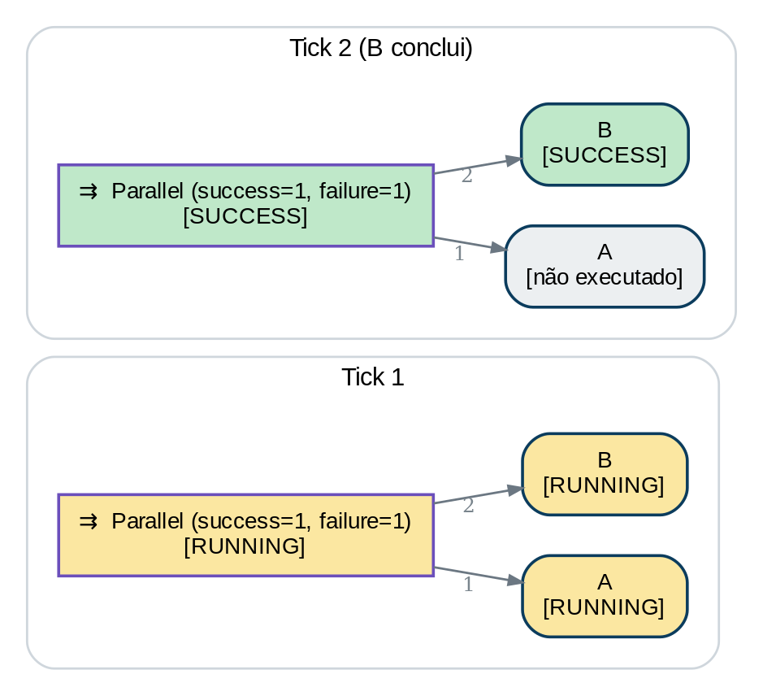

*Figura 4.6 — Parallel com success_count=1: quando B conclui, A é interrompido*

O `Parallel` serve para ações genuinamente independentes (por exemplo, "mover" e "vigiar a bola"). Cuidado: filhos que já concluíram **não são reexecutados** enquanto o `Parallel` está ativo, de modo que uma condição que passou fica "congelada" como verdadeira. Em muitas das árvores do projeto, o padrão `Parallel(success=1, failure=1)` é usado para "persiga a bola e, assim que estiver perto, chute".

## 4.8 Decoradores

Os decoradores modificam o comportamento de um único filho. Os mais usados (Figura 4.7):

- **`Inverter`**: troca SUCCESS por FAILURE e vice-versa (RUNNING passa). Serve para negar condições: `Inverter(IsBallInOurHalf)` significa "a bola *não* está na nossa metade". Note que **não** é o mesmo que "reativo" nem que "reverso".
- **`RetryUntilSuccessful(n)`**: se o filho falha, tenta de novo, até `n` vezes (`-1` = sem limite). Usado como "espere até que a condição seja verdadeira".
- **`Repeat(n)`**: se o filho tem sucesso, repete, `n` vezes (`-1` = sem limite).
- **`Timeout(ms)`**: se o filho não terminar no prazo, interrompe-o e devolve FAILURE.
- **`Delay(ms)`**: espera um tempo antes de executar o filho (usado como "cooldown").
- **`ForceSuccess` / `ForceFailure`**: forçam o resultado, escondendo o do filho. Úteis, mas perigosos: escondem falhas.

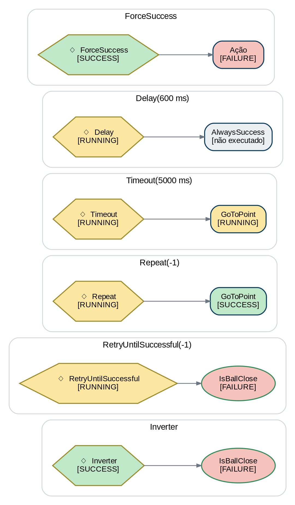

*Figura 4.7 — Os decoradores mais usados e um exemplo de cada*

## 4.9 Preempção: a razão de ser de tudo isso

Juntando as peças, podemos agora acompanhar o cenário que motivou o capítulo: o atacante em jogo e o HALT que chega. A árvore tem um `ReactiveFallback` na raiz, com o ramo de HALT em primeiro lugar e o do atacante depois, como na Figura 4.8.

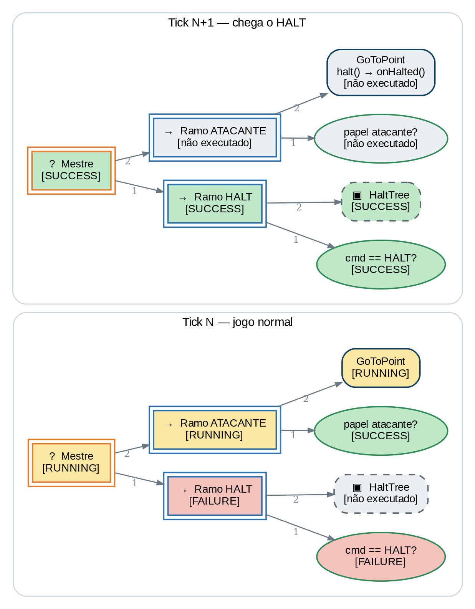

*Figura 4.8 — Preempção: o ramo de HALT passa a ter sucesso e o movimento em andamento é interrompido*

- No **tick N**, a condição "o comando é HALT?" falha; o fallback passa ao ramo do atacante, que está em andamento (`GoToPoint` devolve RUNNING).
- No **tick N+1**, o comando virou HALT. O `ReactiveFallback` recomeça do primeiro filho: a condição agora vale, a subárvore de parada tem sucesso e o fallback devolve SUCCESS. Os filhos de prioridade menor, que estavam em andamento, recebem `halt()` — a folha `GoToPoint` é avisada de que foi interrompida e pode fazer sua limpeza.

Essa interrupção é a **preempção**. Ela acontece em no máximo um tick e não depende de a ação interrompida "colaborar": é a estrutura da árvore que a garante.

!!! tip "Regra prática para escolher o nó"
    - Precisa que uma condição seja **reavaliada a cada tick**? Use `ReactiveSequence`.
    - Precisa escolher entre alternativas **com preempção por prioridade**? Use `ReactiveFallback`.
    - Roteiro de passos que **deve ser completado em ordem, sem reavaliar**? Use `Sequence`.
    - Ações independentes simultâneas? Use `Parallel`.

## 4.10 Ações síncronas e assíncronas

Uma última distinção, essencial para escrever folhas corretas:

- Uma ação **síncrona** faz seu trabalho e devolve SUCCESS ou FAILURE no mesmo tick. Condições são sempre síncronas.
- Uma ação **assíncrona** (ou *stateful*) pode devolver RUNNING e continuar nos ticks seguintes. Ela precisa saber o que fazer se for **interrompida** (`halt`), para não deixar o robô em um estado indevido.

A regra de ouro: **nunca bloqueie dentro de um tick**. Esperar uma resposta de rede, dormir ou fazer um cálculo demorado dentro de uma folha congela a árvore inteira e, com ela, a capacidade de reagir a um HALT. Quando algo demora, a folha deve devolver RUNNING e voltar no tick seguinte.

## 4.11 Um exemplo completo, em prosa

Para fixar, leia a árvore da Figura 4.1 como se fosse um programa:

1. O `ReactiveFallback` raiz tenta o filho 1: um `ReactiveSequence` que verifica "o comando é HALT?".
2. Se for, executa "parar o robô" e a raiz devolve SUCCESS — fim do tick.
3. Se não for, o filho 1 falha e o fallback tenta o filho 2: uma `Sequence` chamada "Jogar".
4. A sequência verifica "a bola está perto?". Se não, falha, e a raiz falha (nenhuma alternativa serviu).
5. Se estiver perto, ela executa "ir até a bola" (RUNNING por vários ticks) e, ao chegar, "chutar".
6. A cada novo tick, a raiz volta ao passo 1: se o HALT chegar a qualquer momento, o passo 2 assume e a sequência "Jogar" é interrompida.

Esse é todo o modelo mental necessário. No próximo capítulo vemos como ele é escrito em XML e implementado em C++.
# Capítulo 5 — BehaviorTree.CPP na prática

O projeto usa a biblioteca **BehaviorTree.CPP** (versão 4.x, mantida por Davide Faconti) para executar as árvores. Este capítulo mostra como os conceitos do capítulo anterior aparecem em código: o formato XML das árvores, os tipos de nós em C++, as portas e a blackboard, as subárvores e as ferramentas de depuração. Documentação oficial: <https://www.behaviortree.dev>.

## 5.1 Duas camadas: XML e C++

Na BehaviorTree.CPP, uma árvore tem duas partes bem separadas:

1. A **estrutura** da árvore, escrita em **XML**: quais nós existem, em que ordem e com que parâmetros.
2. A **implementação** de cada nó folha, escrita em **C++**: o que "ir até um ponto" ou "a bola está perto?" realmente faz.

A ligação entre as duas é a **fábrica** (`BT::BehaviorTreeFactory`): em C++, cada classe de nó é *registrada* na fábrica com um nome (`"GoToPoint"`); no XML, esse nome é usado como se fosse uma tag. Ao carregar o XML, a fábrica instancia a classe correspondente a cada tag.

Um arquivo XML mínimo do projeto tem esta forma:

```xml
<root BTCPP_format="4" main_tree_to_execute="MainTreeCarry">
  <BehaviorTree ID="MainTreeCarry">
    <ReactiveFallback name="MasterStrategy">
      <Sequence name="HaltBranch">
        <CheckGCCommand expected="0"/>
        <SubTree ID="HaltSubTree" _autoremap="true"/>
      </Sequence>
      <!-- ... demais ramos ... -->
      <Halt reason="idle"/>
    </ReactiveFallback>
  </BehaviorTree>
</root>
```

Cada `<BehaviorTree ID="...">` define uma árvore com um nome. O atributo `main_tree_to_execute` indica qual delas é a raiz da execução. Os elementos internos são os nós: `ReactiveFallback`, `Sequence`, `SubTree` e `Halt` aparecem aqui; os dois últimos mais `CheckGCCommand` são folhas ou referências cujos nomes foram registrados em C++.

## 5.2 Os tipos de nó em C++

Para criar uma nova folha, herda-se de uma de três classes da biblioteca, conforme a natureza do nó:

- **`BT::ConditionNode`**: condição síncrona. Implementa `tick()`, que devolve SUCCESS ou FAILURE (nunca RUNNING). Exemplo no projeto: `IsBallCloseCondition`.
- **`BT::SyncActionNode`**: ação síncrona. Também implementa `tick()` e termina no mesmo tick. Exemplos: `KeepDistance`, `AimAt`, `ShadowBall`.
- **`BT::StatefulActionNode`**: ação assíncrona. Implementa três métodos — `onStart()`, `onRunning()` e `onHalted()` — e pode devolver RUNNING. É o tipo mais usado para movimento e chute: `GoToPointNode`, `KickBallNode`, `GoalkeeperNode`.

O ciclo de vida de uma `StatefulActionNode` está na Figura 5.1:

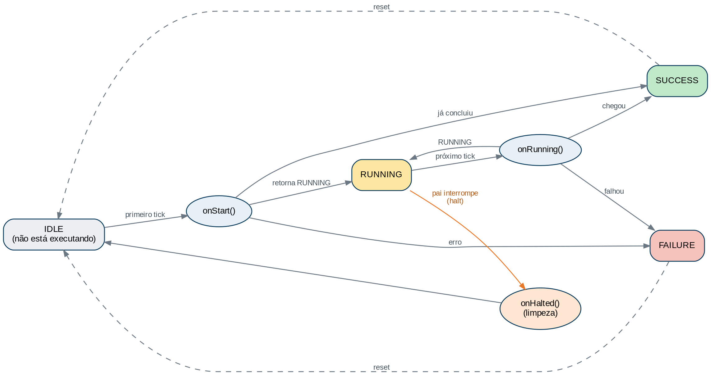

*Figura 5.1 — O ciclo de vida de uma ação assíncrona (StatefulActionNode)*

- No **primeiro tick** depois de ficar inativa, a biblioteca chama `onStart()`. Ali a folha lê suas portas, prepara o estado e começa a tarefa. Se já puder concluir, devolve SUCCESS/FAILURE; caso contrário, RUNNING.
- Nos **ticks seguintes**, enquanto estiver em RUNNING, chama `onRunning()`.
- Se o **pai interrompe** a folha (por exemplo, porque um ramo de maior prioridade assumiu), a biblioteca chama `onHalted()`. É a oportunidade de **limpar**: liberar um override, parar de publicar, zerar um temporizador.
- Quando termina (SUCCESS ou FAILURE), a folha volta a IDLE e o ciclo recomeça no próximo `onStart()`.

!!! warning "onHalted() precisa ser rápido e idempotente"
    `onHalted()` pode ser chamado várias vezes e a qualquer momento. Ele não deve bloquear nem depender de que a tarefa tenha de fato começado. Várias folhas do projeto o usam para devolver o controle ao controlador de movimento (`KickBallNode::onHalted` libera o override de chute).

## 5.3 Portas: a interface de cada nó

Cada folha declara suas **portas**, que são os parâmetros que o XML pode passar e as saídas que ela pode produzir. A declaração é feita em um método estático `providedPorts()`:

```cpp
BT::PortsList GoToPointNode::providedPorts() {
  return { BT::InputPort<unsigned int>("robot_id"),
           BT::InputPort<double>("x"),
           BT::InputPort<double>("y"),
           BT::InputPort<double>("tolerance", -1.0, "Tolerância para sucesso"),
           BT::InputPort<std::string>("planner", "dstar", "dstar | straight_line") };
}
```

Há portas de **entrada** (`InputPort`), de **saída** (`OutputPort`) e de entrada-e-saída. Uma entrada pode ter **valor padrão** (o segundo argumento acima). No XML, os valores são passados como atributos:

```xml
<GoToPoint robot_id="{robot_id}" x="1000" y="0" tolerance="80" planner="straight_line"/>
```

Um valor pode ser um **literal** (`x="1000"`) ou uma **referência à blackboard** entre chaves (`robot_id="{robot_id}"`). No segundo caso, o valor é lido da blackboard no momento em que a folha o pede com `getInput`. As portas de saída funcionam ao contrário: `ball_x="{ball_x}"` em uma saída significa "escreva o valor na chave `ball_x`".

!!! warning "Porta sem atributo e sem padrão = erro"
    Se uma porta de entrada não tem valor padrão e o XML **não** a menciona, `getInput` **falha**. A biblioteca *não* tenta ler, por conta própria, uma chave da blackboard com o mesmo nome da porta. Esse é um erro fácil de cometer e silencioso: a folha costuma devolver FAILURE e o ramo inteiro falha. Duas folhas do projeto (`KeepDistance`, `AimAt`) exigem as portas `robot_x`/`robot_y` e, em vários XML, elas não são passadas — voltaremos a isso no Capítulo 13. Quando faz sentido, declare o padrão como uma referência: `InputPort<double>("robot_x", "{robot_x}", ...)`.

## 5.4 A blackboard

A **blackboard** é um dicionário compartilhado entre os nós de uma árvore: chaves de texto associadas a valores de qualquer tipo. É a memória da árvore. Ela serve para passar informação entre nós (um nó escreve `pkx`, outro lê) e para injetar dados do mundo (o `strategy_node` escreve `ball_x`, `gc_command` etc. a partir das mensagens ROS 2).

Duas propriedades merecem atenção:

- **Escopo de subárvores.** Cada `SubTree` tem a sua **própria blackboard**, separada da do pai. Para compartilhar valores, as chaves precisam ser *remapeadas*. Há duas formas: explícita (`<SubTree ID="X" bola_x="{ball_x}"/>`) ou automática (`_autoremap="true"`), que copia, com o mesmo nome, as chaves que **já existem** na blackboard do pai. Chaves novas criadas dentro da subárvore ficam só nela.
- **Raiz.** As folhas podem acessar a blackboard **raiz** com `config().blackboard->rootBlackboard()`, atravessando todas as subárvores. É o que o projeto faz para ler `my_goal_x`, `robot_id` e a geometria do campo de dentro de qualquer subárvore.

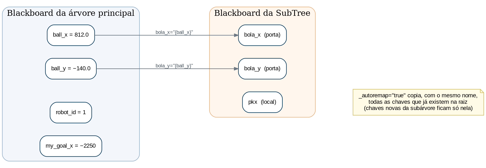

*Figura 5.2 — A blackboard da árvore principal e a da subárvore, ligadas por remapeamento*

!!! note "Quem escreve na blackboard?"
    No projeto, a blackboard é escrita por duas fontes: (1) as **callbacks ROS 2** do `strategy_node` (dados do jogo, árbitro, geometria, papéis), que rodam em outra *thread*; e (2) as **folhas** (por exemplo, `UpdateBallPosition` escreve `pkx`, `pky`). Como leitura e escrita acontecem em *threads* diferentes, valores relacionados (`ball_x` e `ball_y`) podem ser lidos em instantes diferentes. O Capítulo 20 propõe uma forma de evitar isso.

## 5.5 Subárvores e reuso

Uma subárvore é uma `<BehaviorTree>` com outro `ID`, referenciada por `<SubTree ID="...">`. Para que uma subárvore de **outro arquivo** seja encontrada, ela precisa estar registrada na fábrica. O `strategy_node` faz isso de forma abrangente: antes de criar a árvore principal, ele registra **todos os arquivos `.xml`** do diretório `behavior_trees/` (exceto o da árvore principal). Isso é prático, mas implica que os `ID` precisam ser **únicos entre todos os arquivos** — algo que hoje não é verdade para alguns legados (Capítulo 13).

## 5.6 Nós de controle e decoradores nativos

A biblioteca já traz os nós vistos no Capítulo 4: `Sequence`, `ReactiveSequence`, `Fallback`, `ReactiveFallback`, `Parallel`, `Inverter`, `RetryUntilSuccessful`, `Repeat`, `Timeout`, `Delay`, `ForceSuccess`, `ForceFailure`, `AlwaysSuccess`, `AlwaysFailure`, `Sleep`. Existem ainda variantes (`SequenceWithMemory`, `IfThenElse`, `WhileDoElse`, `Switch`, `TryCatch`, `ParallelAll`) e scripts embutidos (`Script`, pré-condições), pouco usados aqui.

Uma observação sobre `RetryUntilSuccessful` com `num_attempts="-1"` — um padrão muito usado no projeto para "espere até a bola estar perto". Na implementação da série 4.x, quando o filho falha e a árvore foi configurada com o mecanismo de *wake-up*, o decorador devolve RUNNING depois de **uma** tentativa por tick (em vez de repetir o filho em laço apertado no mesmo tick). O efeito é um *polling* de uma tentativa por tick, o que é exatamente o desejado. O plano de testes (Capítulo 23) inclui um teste que confirma esse comportamento na versão instalada.

## 5.7 Registrando folhas na fábrica

No `strategy_node`, o registro é feito em `init()`. Folhas que precisam falar com o ROS 2 recebem o nó ROS do processo como argumento extra:

```cpp
factory_.registerNodeType<oxebots_strategy::GoToPointNode>("GoToPoint", shared_from_this());
factory_.registerNodeType<oxebots_strategy::KeepDistance>("KeepDistance");
```

Para condições e ações triviais, a biblioteca aceita *lambdas*:

```cpp
factory_.registerSimpleCondition("CheckGCCommand", [&](BT::TreeNode& node) {
    int expected, current;
    if (!node.getInput("expected", expected)) return BT::NodeStatus::FAILURE;
    if (!blackboard_->get("gc_command", current)) return BT::NodeStatus::FAILURE;
    return (current == expected) ? BT::NodeStatus::SUCCESS : BT::NodeStatus::FAILURE;
}, { BT::InputPort<int>("expected") });
```

!!! note "Não existe plugin"
    As folhas são compiladas **dentro** do executável `strategy_node`; não há carregamento dinâmico de plugins. Ao criar uma folha nova, o arquivo `.cpp` precisa ser incluído na lista de fontes do `add_executable(strategy_node ...)` do `CMakeLists.txt`.

## 5.8 Observando e depurando

Duas ferramentas ajudam a entender o que a árvore está fazendo:

- **Groot2**: o `strategy_node` inicia um `Groot2Publisher` em uma porta por robô (1667 + id para o time azul, 1677 + id para o amarelo). O Groot2 se conecta a essa porta e mostra a árvore ao vivo, com o ramo ativo destacado.
- **Logs**: as folhas usam `RCLCPP_*` (e o `Halt` registra, a cada 2 s, por que o robô está parado). A BehaviorTree.CPP também oferece *loggers* (`StdCoutLogger`, `FileLogger`) que podem ser ligados para registrar cada transição de estado de cada nó.

Para depurar um erro de criação de árvore, as mensagens costumam ser autoexplicativas: *"Node not registered"* indica que a tag do XML não tem um `registerNodeType`; *"getInput() failed ... does not contain the key"* indica uma porta de entrada sem atributo e sem padrão.


---

# Parte III — O sistema atual

*Como cada peça do sistema funciona hoje, do nó de estratégia ao movimento, da percepção ao ataque, da defesa aos papéis, e uma lista honesta dos pontos que precisam de atenção.*

# Capítulo 6 — O strategy_node

O `strategy_node` é o processo que hospeda a Behavior Tree de um robô. Ele faz três coisas: mantém a **blackboard** sempre atualizada com o que o mundo informa, **registra** todas as folhas e subárvores na fábrica e **ticka** a árvore a 60 Hz. Este capítulo percorre o seu código na ordem em que ele acontece. O arquivo é `oxebots_strategy/src/strategy_node.cpp`.

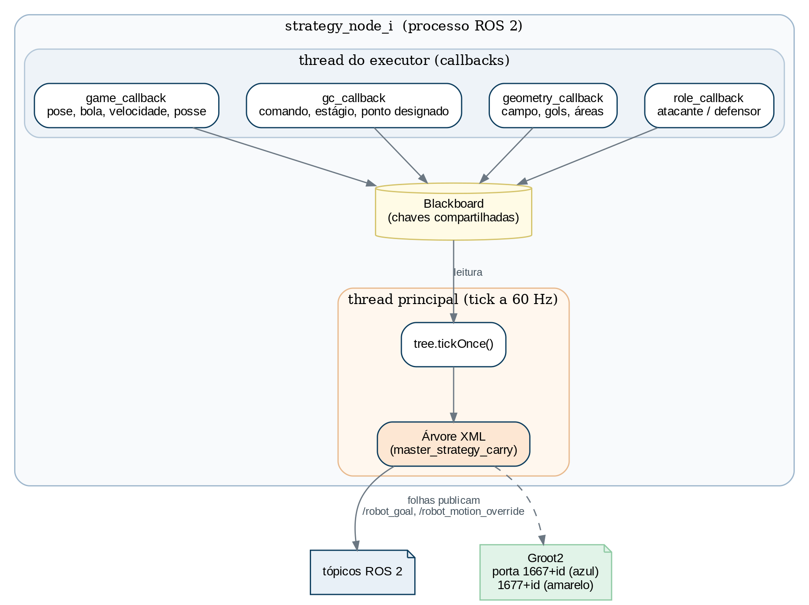

*Figura 6.1 — A estrutura interna de um strategy_node: duas linhas de execução compartilham a blackboard*

## 6.1 Parâmetros

O nó declara os seguintes parâmetros ROS 2 (valores padrão entre parênteses; os YAMLs de `oxebots_bringup` sobrescrevem alguns):

| Parâmetro | Padrão | Significado |
|---|---|---|
| `bt_xml_path` | `""` | Arquivo da árvore. Vazio: usa `master_strategy.xml`. Só o nome (sem `/`): procura em `behavior_trees/` do pacote. |
| `is_yellow_team` | `false` | Cor do time. |
| `invert_sides` | `false` | Espelhamento do campo (simulador Ra). A cor "efetiva" é `is_yellow_team` XOR `invert_sides`. |
| `robot_id` | `1` | Identificador do robô que este processo controla. |
| `execution_rate` | `60.0` | Frequência do tick (Hz). |
| `gc_topic` | `/gc_multicast_bridge/referee_messages` | Tópico do comando do árbitro. |
| `possession_distance` | `220.0` | Distância (mm) usada para decidir se o adversário "tem a bola". |

Cada robô é iniciado por `strategy.launch.py` com o seu próprio `robot_id` (0, 1, 2) e o mesmo arquivo de configuração.

## 6.2 O que o nó assina e publica

| Direção | Tópico | Tipo | Para quê |
|---|---|---|---|
| assina | `/role_assignment` | `RoleAssignment` | quem é atacante e quem é defensor |
| assina | `game_data` | `GameData` | poses de robôs e posição da bola |
| assina | `gc_topic` | `ssl_league_msgs/Referee` | comando, estágio e ponto designado do árbitro |
| assina | `/field_geometry` | `SSLGeometryData` (transient_local) | dimensões do campo |
| publica | `/robot_motion_override` | `RobotMotionOverride` | pedido de parada (usado pela ação `Halt`) |

As **folhas** (`GoToPoint`, `KickBall`, `Goalkeeper`…) criam seus próprios publicadores e assinantes **usando este mesmo nó ROS 2** (ele é passado a elas no registro). Por isso o `strategy_node` é, ao mesmo tempo, o "dono" de várias dezenas de publicadores — um por uso de folha no XML.

## 6.3 A blackboard: o que é escrito e por quem

Em `setup_blackboard()`, antes de qualquer dado chegar, o nó cria as chaves com valores iniciais. Em seguida, quatro *callbacks* a mantêm atualizada:

### 6.3.1 Dados do jogo (`game_callback`)

A cada `GameData`, o nó:

- escreve a pose do próprio robô (`robot_x`, `robot_y`, `robot_yaw`);
- calcula a **velocidade da bola** por diferença finita entre duas leituras consecutivas (`ball_vx`, `ball_vy`) — uma estimativa ruidosa, usada pelo defensor;
- escreve a bola como `ball_x`, `ball_y`, `ball` (`Pose2D`) e `ball_vel` (`Vector2D`);
- calcula `opponent_controlling` (**posse do adversário**): verdadeiro quando o robô adversário mais próximo da bola está a menos de `possession_distance` e **pelo menos 30 mm mais perto** do que o aliado mais próximo.

### 6.3.2 Comando do árbitro (`gc_callback`)

A cada mensagem do GC, o nó escreve `gc_command` (inteiro cru), `gc_stage` e o ponto designado (`designated_x`, `designated_y`, em mm). Ele também calcula `is_free_kick`, verdadeiro quando o comando é `DIRECT_FREE` (8 ou 9) **para a nossa cor**. Nenhum outro tipo de comando é pré-processado: as árvores comparam `gc_command` com números.

### 6.3.3 Geometria (`geometry_callback`)

Com a geometria oficial, o nó escreve `field_length`, `field_width`, `penalty_area_depth/width`, `goal_width`, `center_circle_radius` e, importante, `my_goal_x` e `opponent_goal_x`. O gol próprio é calculado pela cor efetiva: **amarelo defende +x, azul defende −x** (`my_goal_x = ±field_length/2`).

### 6.3.4 Papéis (`role_callback`)

Escreve `attacker_id` e `defender_id` e `is_attacker`. Antes da primeira mensagem do atribuidor de papéis, os valores iniciais são `attacker_id = 2` e `defender_id = 1`.

!!! note "O tick só começa com dados"
    O laço principal só ticka a árvore quando já chegaram pelo menos um `GameData` **e** a geometria do campo. Enquanto isso, loga a cada 5 s que está aguardando. O comando do árbitro, porém, **não** é pré-requisito: se ele nunca chegar, `gc_command` permanece `-1` e a árvore cai no ramo de jogo normal (veja o Capítulo 13).

## 6.4 O registro das folhas

No método `init()`, o nó:

1. resolve o caminho da árvore (`bt_xml_path`);
2. configura o contexto de controle usado pelas folhas defensivas (`configureDefenderController`);
3. registra as **29 folhas**: 18 classes de movimento/estratégia (`GoToPoint`, `KickBall`, `AlignToBall`, `UpdateBallPosition`, `CalculateInterception`, `IsBallClose`, `Goalkeeper`, `PrecisionKick`, `GoalLineDefend`, `IsBallInArea`, `IsBallInOurHalf`, `LateralClear`, `PositionBisector`, `SmotherSave`, `CalculateKickOffPose`, `KeepDistance`, `AimAt`, `HasLineOfSight`), 5 de defesa (`IsBallInOpponentField`, `IsOpponentControllingBall`, `ShadowBall`, `MarkOpponent`, `GoToClamped`), 5 condições simples em *lambda* (`IsValueTrue`, `IsThisNodeID`, `IsMyRole`, `CheckGCCommand`, `IsRobotId`) e a ação `Halt`;
4. registra **todos os outros arquivos `.xml`** do diretório como subárvores (falhas viram apenas aviso no log);
5. cria a árvore principal a partir do arquivo escolhido, com a blackboard do robô;
6. inicia o publicador do Groot2 (porta 1667 + id no azul, 1677 + id no amarelo).

O catálogo completo de folhas, com portas e comportamento, é o Capítulo 7 e o Apêndice B.

### 6.4.1 A ação `Halt`

Registrada como *lambda*, a ação `Halt` é a forma padrão de "deixar o robô parado". Ela publica um `RobotMotionOverride` com `MODE_HALT` para o controlador, registra (a cada 2 s) o motivo (`reason`) e **devolve sempre SUCCESS**. Como o override expira em 200 ms se não for renovado, `Halt` precisa ser ticada **a cada tick** para manter o robô parado — o que acontece naturalmente, porque ela é folha síncrona dentro de um ramo reativo.

## 6.5 O laço principal

O `main()` cria um executor multithread para as *callbacks* do ROS 2 em uma *thread* separada, e o laço de tick roda na *thread* principal:

```cpp
while (rclcpp::ok()) {
  if (has_data_ && has_geometry_) tree_.tickOnce();
  rate.sleep();   // 60 Hz
}
```

O resultado dessa arquitetura de duas linhas de execução (figura acima) é que a árvore sempre lê dados "do último instante", mas **sem garantia de consistência entre chaves** e **sem informação de idade**: se a visão parar de publicar, os valores na blackboard simplesmente deixam de mudar — a árvore não percebe. Esse ponto é o tema central do Capítulo 17.

## 6.6 Resumindo

O `strategy_node` é um adaptador fino: converte mensagens ROS 2 em chaves de blackboard, expõe as folhas à árvore e ticka. Toda a inteligência está nos arquivos XML e nas folhas. Para estender o comportamento — por exemplo, para a Master Tree de jogo completo — as mudanças naturais são: trocar a leitura direta do árbitro por um estado de jogo pré-processado, ler a idade dos dados e passar a registrar as folhas novas.
# Capítulo 7 — Do GoToPoint ao comando de roda

Mover um robô parece simples — "vá até aquele ponto" —, mas entre essa frase na árvore e o comando de velocidade no rádio existem várias etapas, cada uma com uma responsabilidade e com sua própria forma de falhar. Este capítulo percorre o caminho completo, esquematizado na Figura 7.1.

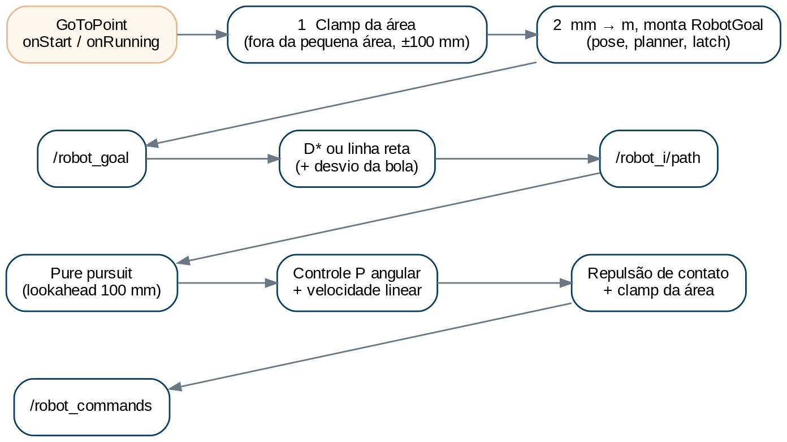

*Figura 7.1 — As etapas entre a folha GoToPoint e o comando enviado ao robô*

## 7.1 A folha GoToPoint

`GoToPoint` é a folha mais usada do projeto (93 usos em 25 arquivos XML) e a principal "porta de entrada" do movimento. É uma ação assíncrona (*stateful*) que **pede** ao resto do sistema que leve o robô a um ponto, e depois **observa** se ele chegou.

### 7.1.1 Portas

| Porta | Tipo | Padrão | O que faz |
|---|---|---|---|
| `robot_id` | `unsigned int` | — | Robô a comandar. Se diferente do robô desta instância, a folha **devolve SUCCESS sem fazer nada**. |
| `x`, `y` | `double` (mm) | — | Alvo, no referencial do campo. |
| `face_x`, `face_y` | `double` (mm) | ausentes | Ponto para onde o robô deve **olhar** ao chegar (a bola, um companheiro, o gol). Devem ser passados **juntos**. Sem eles, o robô olha para o gol adversário. |
| `tolerance` | `double` (mm) | −1,0 | Raio de chegada. **Se ≤ 0, a folha nunca devolve SUCCESS** (e o controlador não "trava" o robô perto do alvo). |
| `planner` | `string` | `"dstar"` | `"dstar"` (desvia de obstáculos) ou `"straight_line"` (reta). Qualquer outro valor usa o D\*. |
| `ball_contact_threshold_mm` | `double` | −1,0 | Se > 0, a folha **falha** se a bola chegar a menos desse valor do robô por mais de 150 ms — força a árvore a recalcular. |
| `ignore_area` | `bool` | `false` | Desliga a restrição de áreas de defesa (usado nos desafios técnicos). |
| `ball_side_check` | `bool` | `false` | Se verdadeiro, **falha** se o robô estiver, a menos de 600 mm da bola, do lado do gol (isto é, "na frente" da bola) por mais de 150 ms. |

### 7.1.2 Ciclo de vida

**`onStart`** — ao ser ativada:
1. verifica se o `robot_id` pedido é o do próprio processo (senão, SUCCESS imediato);
2. lê `x` e `y`;
3. **aplica a restrição de área** (ver adiante);
4. calcula o ângulo de orientação desejado (para `face_*`, ou para o gol adversário);
5. publica um `RobotGoal` e devolve RUNNING.

**`onRunning`** — a cada tick:
1. relê `x` e `y` (eles podem mudar na blackboard) e, se o alvo se moveu mais de **2 mm** ou o ângulo de orientação mais de cerca de **1°**, **republica** o objetivo; caso contrário, não publica nada (o último objetivo continua valendo);
2. avalia os gatilhos de falha (`ball_contact_threshold_mm`, `ball_side_check`);
3. se `tolerance > 0`, verifica se **chegou**: distância menor que `tolerance` *e* erro de orientação menor que 0,15 rad (≈ 8,5°). Só então devolve SUCCESS;
4. senão, devolve RUNNING.

**`onHalted`** — **vazio**. A folha não cancela o objetivo ao ser interrompida. Isso é relevante: quando um ramo de maior prioridade assume, o `RobotGoal` anterior continua publicado e o controlador segue tentando alcançá-lo até que alguém publique outro objetivo ou um override de parada. No Capítulo 13 discutimos a consequência; no Capítulo 21 propomos a correção.

!!! note "O que significa SUCCESS aqui"
    `GoToPoint` devolve SUCCESS quando a **posição e a orientação** estão dentro da tolerância. Se o robô chega ao ponto mas não consegue alinhar com o `face_*` (por exemplo, porque o alvo de orientação está longe e instável), a folha continua RUNNING indefinidamente, sem erro. Há um log a cada segundo com a distância e o erro angular para facilitar o diagnóstico.

### 7.1.3 A restrição de áreas

Antes de publicar, `GoToPoint` **corrige o alvo** para que o robô não seja mandado a lugares proibidos (Figura 7.2):

- Todos os robôs, inclusive o goleiro, são impedidos de ir para a **área de defesa adversária**.
- Os robôs que **não** são o goleiro são impedidos de ir para a **área de defesa própria**; o goleiro, ao contrário, tem o alvo **limitado a ficar dentro** da própria área.
- A margem usada é de 100 mm além da linha da área.

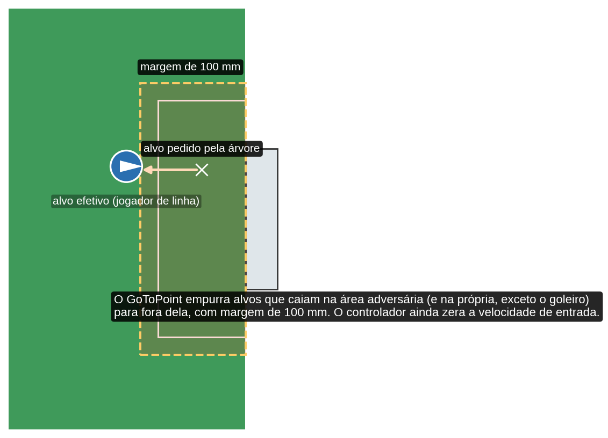

*Figura 7.2 — O alvo pedido pela árvore é empurrado para fora da área de defesa, com margem de 100 mm*

Esse mecanismo existe em **três camadas** independentes, o que dá segurança, mas também pode surpreender: (1) `GoToPoint` corrige o alvo; (2) o planejador D\* constrói uma "parede" no mapa e também corrige o alvo; (3) o controlador zera a componente de velocidade que levaria o robô para dentro da área. A opção `ignore_area=true` só desliga a camada 1.

## 7.2 O objetivo do robô: RobotGoal

A comunicação entre a árvore e o resto do sistema é a mensagem `RobotGoal`, publicada em `/robot_goal` com QoS `transient_local` (guarda o último valor):

- `robot_id`: de quem é o objetivo;
- `pose`: posição em **metros** e orientação como quaternion (a conversão de mm para m acontece aqui);
- `planner_type`: `PLANNER_DSTAR` (0), `PLANNER_ASTAR` (1, hoje equivalente ao D\*) ou `PLANNER_STRAIGHT_LINE` (2);
- `disable_arrival_latch`: verdadeiro quando `tolerance ≤ 0`; instrui o controlador a **nunca** "travar" o robô por estar perto do alvo.

## 7.3 O planejador D\* Lite

O `d_star_planner_node_<i>` calcula, a partir do objetivo, uma **rota livre de colisões**. Ele trabalha sobre uma **grade de ocupação** publicada pelo `game_observer_node` no tópico `/map`: uma grade de células de 5 cm que cobre o campo com 60 cm de margem, onde cada robô (aliado ou adversário, inflado em 150 mm) é marcado como obstáculo.

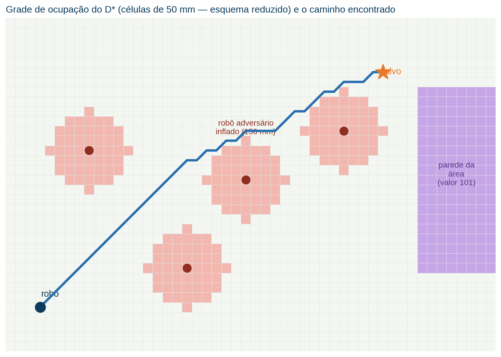

*Figura 7.3 — Esquema da grade do D\*: obstáculos inflados, a "parede" da área de defesa e o caminho encontrado*

Além do mapa, o planejador considera como **obstáculos dinâmicos** os aliados (raio de segurança de 0,20 m) e a **bola** (raio de 0,15 m — menor, para não bloquear o ponto de captura do atacante, que fica logo atrás da bola). A parede das áreas de defesa é desenhada no mapa com um valor especial (101), para que o planejador nunca a atravesse.

Pontos de funcionamento relevantes:

- **Replanejamento incremental**: se o objetivo é o mesmo, o D\* Lite apenas atualiza a rota quando o mapa muda — é a razão de ele ser eficiente.
- **Taxa**: 10 Hz normalmente; sobe para 40 Hz quando a bola está a menos de 0,4 m do robô, para que o caminho se atualize rápido o bastante para contornar a bola em vez de empurrá-la.
- **Falha**: se não encontra caminho, publica uma **rota vazia**, o que faz o controlador parar o robô.
- **Chegada**: quando o robô está a menos de 5 cm do alvo, publica uma rota vazia e descarta o objetivo.

### 7.3.1 O modo linha reta

Quando `planner="straight_line"`, o planejador **ignora a grade** e interpola pontos a cada 10 cm entre o robô e o alvo. Há um único cuidado: se a bola estiver a menos de 0,20 m dessa reta (e não perto do próprio alvo), é inserido um ponto de desvio lateral. Esse modo é usado nos trechos finais do ataque, quando o robô *quer* chegar perto da bola; mas atenção: ele **não desvia de adversários nem de aliados**.

## 7.4 O controlador de movimento

O `movement_calculation_node` (por robô, no processo `path_follower_node_<i>`) é o **único** escritor autorizado do tópico `/robot_commands`. A cada 50 ms ele decide o que o robô faz, em ordem de prioridade (veja a Figura 7.4):

1. **HALT**: velocidades zero.
2. **KICK**: executa a máquina de chute.
3. **ALIGN**: gira no lugar até olhar para a bola ou para um ângulo.
4. **Nenhum override**: segue a rota do D\*.

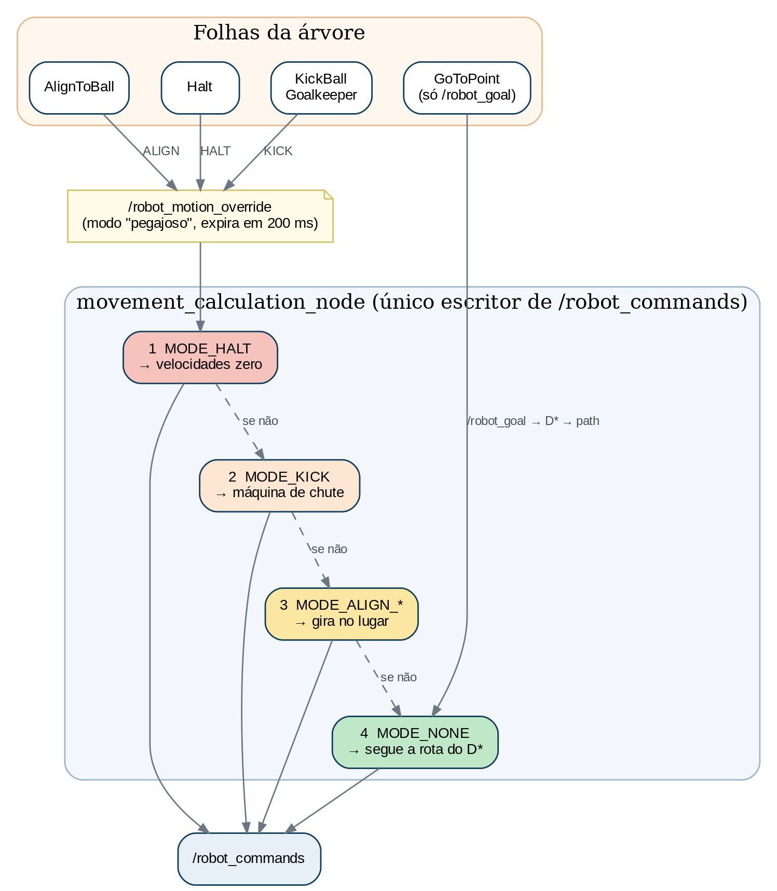

*Figura 7.4 — A decisão do controlador: o override ativo (se houver) tem prioridade sobre o seguimento de rota*

### 7.4.1 Seguindo a rota: pure pursuit

O seguimento de rota usa o método **pure pursuit** omnidirecional (Figura 7.5): o controlador procura, ao longo da rota, o primeiro ponto a mais de **100 mm** do robô (*lookahead*) e aponta a velocidade linear para ele. O módulo da velocidade é proporcional à distância até esse ponto (ganho 2,0), limitado por `max_linear_speed` (**1,0 m/s por padrão** no código). A orientação segue um controle proporcional (ganho 3,0, saturação em 4,0 rad/s, tolerância de 0,1 rad) em direção ao ângulo pedido pelo `RobotGoal` ou, na falta dele, ao ângulo da própria rota.

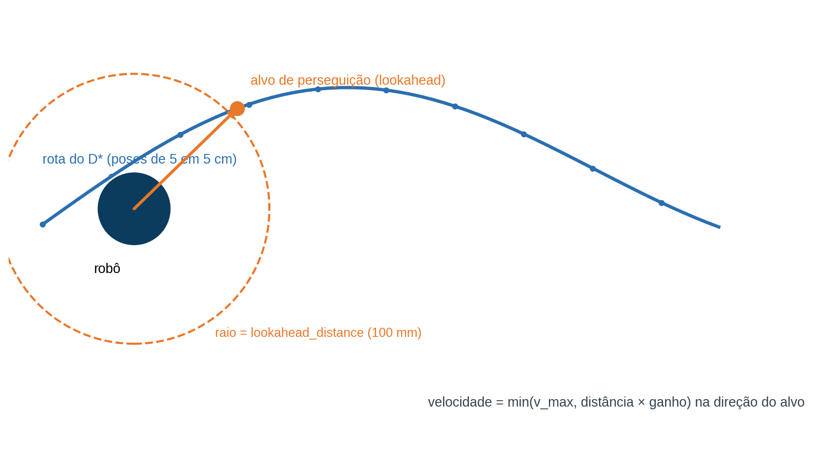

*Figura 7.5 — Pure pursuit: o robô persegue um ponto da rota a uma distância fixa (lookahead)*

Alguns refinamentos importantes:

- **Prioridade ao alinhamento perto do alvo.** A menos de 100 mm do objetivo, a velocidade linear é multiplicada por `cos(erro angular)`: o robô gira antes de avançar, evitando empurrar a bola desalinhado.
- **Trava de chegada.** A menos de 10 mm do alvo final, o robô para e solta o controle angular, a menos que `disable_arrival_latch` esteja ativo (`tolerance ≤ 0`).
- **Repulsão de contato.** Só no modo D\*: se o robô chega a menos de 100 mm da bola (e só "desarma" a 130 mm), a velocidade é substituída por um afastamento proporcional. É uma proteção contra empurrar a bola acidentalmente.
- **Clamp de área.** Ao final, as componentes de velocidade que entrariam na área de defesa proibida são zeradas.

!!! warning "Não há limite de velocidade por fase de jogo"
    O único teto de velocidade é `max_linear_speed`, fixo. Em STOP o regulamento exige menos de 0,75 m/s, e o controlador atual **não** aplica esse limite. A proposta do Capítulo 17 (SafetyGate) resolve isso.

### 7.4.2 O canal de override

Algumas ações não são "seguir uma rota" — são ações físicas especiais. Em vez de escreverem direto em `/robot_commands` (o que criaria uma disputa entre várias fontes), as folhas enviam um **pedido de modo** ao controlador por `/robot_motion_override`:

| Modo | Quem pede | Efeito |
|---|---|---|
| `MODE_HALT` | `Halt` | velocidades zero |
| `MODE_KICK` | `KickBall`, `Goalkeeper` | máquina de chute |
| `MODE_ALIGN_TO_BALL` / `MODE_ALIGN_TO_ANGLE` | `AlignToBall` | gira no lugar |
| `MODE_NONE` | qualquer folha, ao terminar | volta ao seguimento de rota |

O override é **"pegajoso"**: continua valendo até a folha liberá-lo (`MODE_NONE`). Como proteção contra uma folha que pare de enviar, o controlador o considera expirado após **200 ms** sem renovação. Isso tem duas consequências: ações que precisam do override devem **reenviá-lo a cada tick** (é o que `KickBall` e `Halt` fazem), e, se a árvore deixar de ticar, o robô **volta a seguir a última rota** em até 200 ms — e não para.

O controlador responde com `RobotMotionStatus` (`aligned`, `kick_fire_count`, modo ativo), que as folhas leem para decidir SUCCESS.

### 7.4.3 A máquina de chute

O chute é uma pequena máquina de estados dentro do controlador (Figura 7.6). Ao receber `MODE_KICK` com o controlador ocioso e fora do tempo de espera, ele entra em **FIRING** por 200 ms: publica o `kick_speed` pedido e avança a 0,5 m/s **na direção em que o robô está olhando**, garantindo o contato. Ao fim da janela, incrementa `kick_fire_count` e entra em *cooldown* de 600 ms com o robô parado. A folha `KickBall` guarda o contador no início e devolve SUCCESS quando ele sobe; como cada tick reenvia o pedido, o cooldown evita que o chute vire uma "metralhadora".

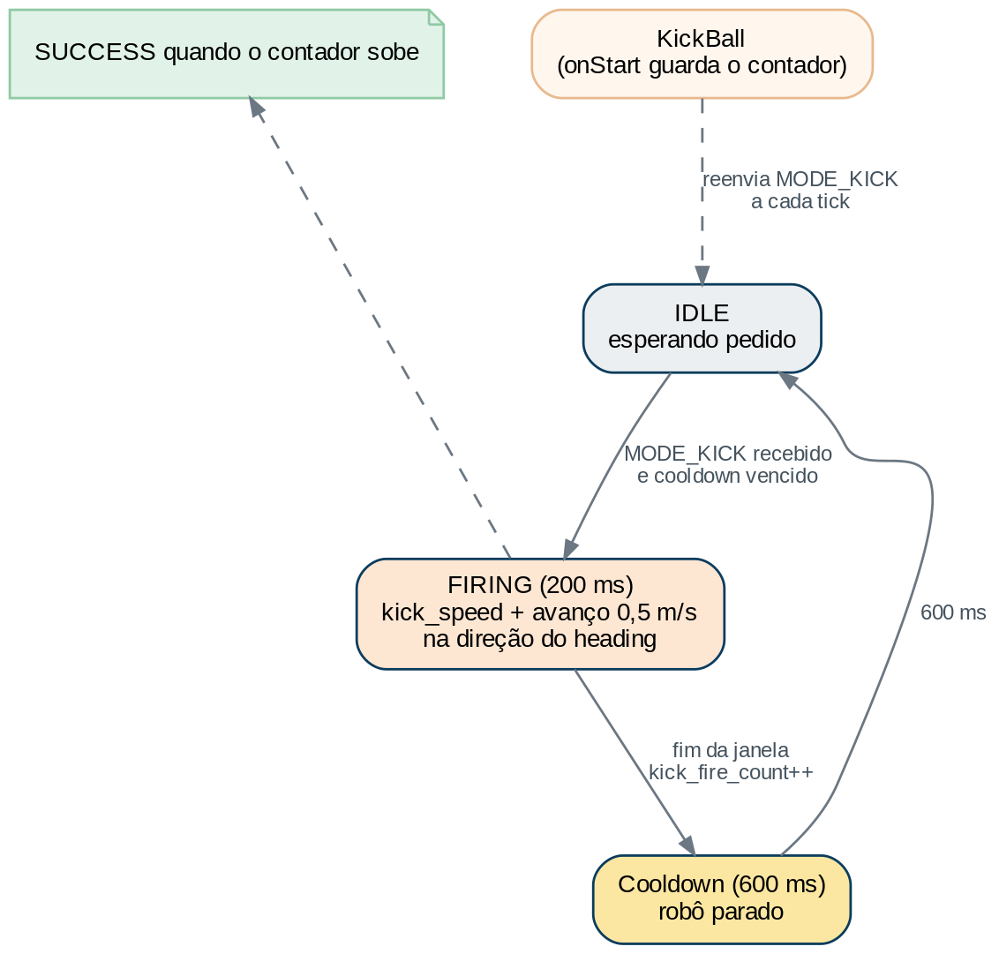

*Figura 7.6 — A máquina de chute do controlador*

!!! tip "O chute é limitado em 3 m/s"
    `KickBall` limita `kick_speed` a 3,0 m/s antes de pedir o chute, o que atende ao limite de velocidade de bola da SSL-EL. Mesmo que o XML peça 6,5 (como em `master_strategy_carry.xml`), o valor efetivo é 3,0.

## 7.5 O modo "ponto" do rádio

Para os robôs reais, o rádio NRF24 pode operar em dois formatos (`command_mode`): **velocidade** (o rádio envia as velocidades locais) ou **ponto** (o rádio envia um alvo cinemático e o robô fecha o laço localmente). No modo ponto, o `trajectory_setpoint_node_<i>` observa os comandos de velocidade e a predição do Kalman e publica `RobotTrajectorySetpoint`: um ponto futuro à frente do robô (velocidade × período de publicação × um fator de segurança, limitado por um teto), a velocidade desejada nesse ponto, o ângulo-alvo e a pose atual de referência. O firmware usa a pose de referência para corrigir o erro.

## 7.6 Os drivers de comunicação

O último passo é o driver, escolhido por `mode`: o `grSim_controller_node` traduz `RobotCmd` para o protocolo do grSim (UDP); o `ra_controller_node` converte as velocidades globais em locais para o ER-Force Ra; e o `nrf24_bridge_node` serializa os comandos no protocolo binário do rádio (definido em `ssl_robot_protocol.bitproto`) e publica a telemetria dos robôs (bateria, erros) em `/robot_telemetry`.
# Capítulo 8 — Percepção, predição e geometria

Toda decisão da árvore parte de uma imagem do mundo. Este capítulo descreve como o software constrói essa imagem — o que o observador faz com os dados da visão, como o filtro de Kalman estima velocidades, como o campo é descrito e como o "lado" do campo é tratado — e quais são as limitações que a estratégia precisa levar em conta.

## 8.1 O game_observer_node

O `game_observer_node` (pacote `oxebots_observers`) é o **tradutor central**: recebe as mensagens da ponte de visão e produz o que o resto do sistema consome.

### 8.1.1 Entradas e saídas

| Entrada | Saída |
|---|---|
| `ssl_vision_bridge/vision_messages` (`VisionWrapper`) | `/game_data` (`GameData`): robôs aliados e adversários e bola, em mm |
| `gc_multicast_bridge/referee_messages` (`Referee`) | `/field_geometry` (`SSLGeometryData`, `transient_local`): dimensões do campo |
| | `/map` (`OccupancyGrid`, `transient_local`): grade de obstáculos para o D\* |
| | `ball_data` (`BallPosition`) e `robot_data` (`RobotPosition`): entrada do Kalman |

(O observer também assina o comando do árbitro, mas hoje apenas o registra em log.)

### 8.1.2 O que ele faz com cada detecção

- **Unidades e orientação.** Converte metros para milímetros e o quaternion para o ângulo de guinada (*yaw*).
- **Aliados e adversários.** Conforme `is_yellow_team`, as detecções de robôs amarelos e azuis são separadas em "aliados" e "adversários". Os robôs são guardados em um mapa por identificador: cada nova detecção **atualiza** o identificador, sem apagar os outros.
- **Melhor bola.** Quando há várias bolas candidatas, usa a de maior confiança, e **só aceita** a detecção se a confiança for de pelo menos **0,3** (`min_ball_confidence`; o próprio código comenta que esse valor é um ponto de partida e deve ser calibrado com dados reais). Detecções piores são descartadas e a última posição boa é mantida.
- **Inversão de lado**, quando `invert_sides` está ativo (veja adiante).
- **Publicação.** O `GameData` é publicado **sempre que há uma bola aceita**. Em outras palavras: se a bola desaparece (oclusão, falha de visão), o observer *deixa de publicar* — inclusive a posição dos robôs.

### 8.1.3 A geometria do campo

O observer converte a geometria recebida (`geometry[0]`) para milímetros e a publica. Como alguns simuladores (grSim) não preenchem a profundidade e a largura da área de defesa nem o raio do círculo central, o observer os **deduz** das linhas do campo e, em último caso, usa os valores regulamentares: para campos de até 5500 mm, área de **500 × 1350 mm** (SSL-EL) e círculo de 500 mm de raio. Assim, as árvores não precisam de números mágicos: tudo vem de `/field_geometry` e é copiado para a blackboard pelo `strategy_node`.

### 8.1.4 A grade de obstáculos

A cada atualização, o observer constrói uma `OccupancyGrid` de resolução 0,05 m (`map_resolution`), com margem de 0,6 m ao redor do campo, marcando cada robô — aliado ou adversário — como um quadrado de raio `robot_inflation_radius` (150 mm). A grade é a única fonte de obstáculos "estáticos" do D\* (a bola e os aliados são tratados também como obstáculos dinâmicos pelo próprio planejador).

## 8.2 A inversão de lado

Alguns simuladores (como o ER-Force Ra) colocam o time em lados do campo opostos aos esperados pelo software. Para não duplicar lógica, o observer pode **espelhar tudo** quando `invert_sides` está ativo: cada posição passa de `(x, y)` para `(−x, −y)` e cada ângulo de `θ` para `θ + π` (Figura 8.1).

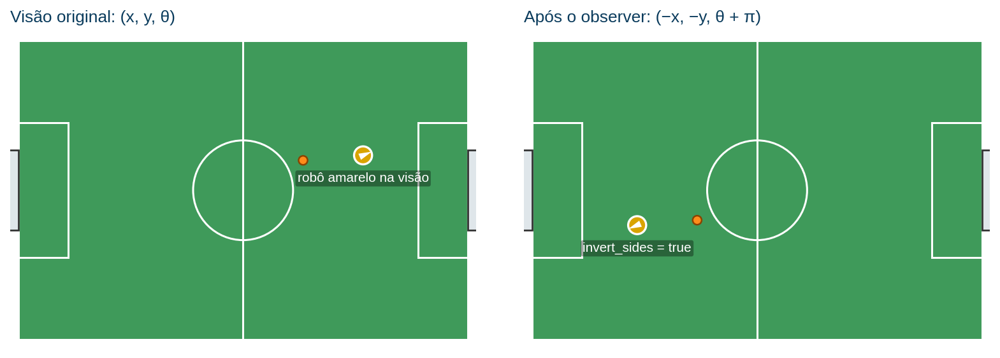

*Figura 8.1 — A inversão de lado: posições são espelhadas pelo centro e ângulos giram 180°*

Por padrão, `invert_sides` é verdadeiro apenas em `mode:=ra`. É preciso distinguir dois conceitos que o código mistura em um só:

- **Cor do time** (`is_yellow_team`): decide quem é aliado e quem é adversário na visão e quais portas do simulador usar.
- **Espelhamento de coordenadas** (`invert_sides`): decide se o referencial é espelhado.

A blackboard guarda `is_yellow` como a **cor efetiva** (`is_yellow_team` XOR `invert_sides`) e calcula `my_goal_x` a partir dela. O efeito prático: independentemente de o simulador espelhar ou não, o gol que a estratégia chama de "meu" é `+L/2` para a cor efetiva amarela e `−L/2` para a azul.

## 8.3 Predição: o filtro de Kalman

Os dados da visão chegam com ruído e sem velocidade. O `kalman_filter_node` (`oxebots_prediction`) resolve isso com filtros **dedicados**:

- **Bola**: modelo de 4 estados (posição e velocidade em x e y) com **atrito do carpete** (aceleração de frenagem configurável, 800 mm/s² por padrão) e detecção de chute (limiar de 80 mm), para reiniciar a estimativa quando a bola é chutada.
- **Robôs**: modelo cinemático de 6 estados (posição, velocidade e orientação com sua taxa).

A saída é publicada em `ball_predicted` (`BallPrediction`: posição, velocidade e aceleração) e `robot_predicted` (`RobotPrediction`). O principal consumidor é a folha `CalculateInterception` (Capítulo 9), que usa velocidade e aceleração para prever onde a bola estará. O `trajectory_setpoint_node` também usa a predição dos robôs.

!!! note "Predição do Kalman × diferença finita"
    O defensor não usa o Kalman: o `strategy_node` calcula a velocidade da bola por **diferença finita** entre duas leituras consecutivas de `/game_data` (`ball_vel`). É uma estimativa bem mais ruidosa que a do filtro. Unificar as duas fontes é uma melhoria natural (Capítulo 19).

## 8.4 Limitações que a estratégia precisa respeitar

Reunindo o que vimos, a imagem do mundo que chega à árvore tem quatro limitações que não podem ser esquecidas:

1. **Sem carimbo de tempo.** `GameData` não carrega *timestamp*: não há como saber quão velha é uma leitura. Se a visão cair, a árvore continua a "ver" os últimos valores.
2. **Sem expiração de robôs.** Um robô que deixa de ser detectado permanece no mapa de aliados ou adversários com a última pose conhecida.
3. **Publicação condicionada à bola.** Sem bola aceita, nada é publicado.
4. **Leitura não atômica.** Valores relacionados na blackboard são atualizados e lidos em instantes ligeiramente diferentes.

Cada uma delas tem uma correção proposta na Parte IV, e a mais importante — o carimbo de tempo — é pré-requisito para a **supervisão de segurança** da Master Tree.
# Capítulo 9 — O atacante

O atacante é o robô que disputa e conduz a bola. Sua lógica é a mais elaborada do sistema e reúne, em um só ramo, quase todas as técnicas vistas até aqui: preparação de dados, predição, movimento com planejamento, movimento em linha reta, verificação de condições e chute. Este capítulo explica **como** o atacante decide, começando pelas folhas que preparam os dados e terminando pela árvore completa.

## 9.1 UpdateBallPosition: o ponto de pré-chute

`UpdateBallPosition` é uma ação cujo trabalho é **preparar dados para o resto do ramo**; ela sempre devolve SUCCESS quando tem dados. A cada tick ela:

- lê a posição real da bola e escreve `ball_x`, `ball_y` e `ball_in_enemy_half` (`ball_x > 0`);
- calcula o **ponto de pré-chute** (`pre_kick_x`, `pre_kick_y`): um ponto sobre a reta que liga o gol alvo à bola, **400 mm atrás da bola** (do lado oposto ao gol);
- decide se o robô está **pronto para chutar** (`is_ready_to_kick`), usando uma histerese: para *entrar* no estado "pronto", o robô precisa estar a menos de 150 mm do ponto de pré-chute; para *permanecer* pronto, basta estar a menos de 600 mm. Em ambos os casos, é preciso estar do lado certo da bola (produto escalar positivo), isto é, atrás dela em relação ao gol.

A histerese evita que a decisão oscile quando o robô está na fronteira: sem ela, o estado "pronto" ligaria e desligaria a cada tick, e o robô hesitaria.

## 9.2 CalculateInterception: onde a bola vai estar

Perseguir a posição *atual* da bola faz o robô sempre chegar atrasado quando ela se move. `CalculateInterception` calcula, em vez disso, **onde interceptá-la**, com um algoritmo de busca simples e robusto.

### 9.2.1 A busca pelo ponto de interceptação

O nó assina as predições do Kalman (`ball_predicted`, `robot_predicted`) e, para instantes `t` de 0,05 s a 3 s (passos de 0,05 s), faz duas perguntas:

1. *Onde a bola estará em `t`?* Usa o movimento com aceleração (a bola desacelera pelo atrito do carpete) e, se ela já parou antes de `t`, considera o ponto final.
2. *Consigo chegar lá em `t`?* Calcula o tempo de deslocamento do robô até aquele ponto com um perfil trapezoidal de velocidade (aceleração máxima de 2000 mm/s², velocidade máxima de 1500 mm/s), levando em conta a velocidade atual do robô na direção do alvo (se ele está indo para o lado contrário, primeiro precisa frear).

O **primeiro `t` em que o robô consegue chegar a tempo** define o ponto de interceptação. Se nenhum serve, o alvo é o ponto onde a bola para.

Um cuidado importante: com a bola parada, o ruído do filtro (alguns cm/s) seria amplificado por essa busca de até 3 s, fazendo o ponto "pular" a cada tick. Por isso há uma **banda-morta**: se a velocidade da bola é menor que 150 mm/s, a velocidade e a aceleração são zeradas e o ponto de interceptação passa a ser a própria posição da bola.

### 9.2.2 Os pontos de saída

A partir do ponto de interceptação, o nó calcula uma família de pontos, todos sobre a reta bola–gol, ilustrados na Figura 9.1:

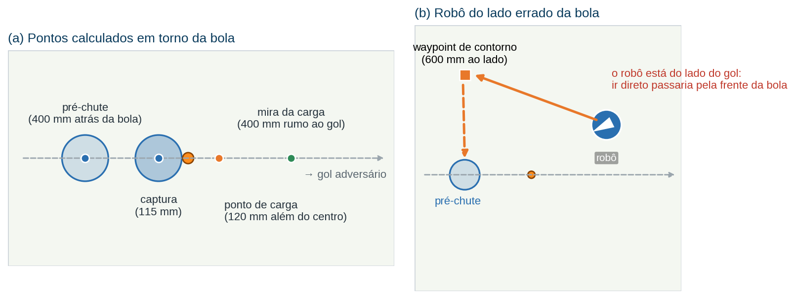

*Figura 9.1 — Os pontos calculados em torno da bola (a) e o contorno quando o robô está do lado errado (b)*

| Saída | Onde fica | Para que serve |
|---|---|---|
| `intercept_x/y` | onde interceptar a bola | alvo da aproximação "pura" |
| `intercept_pk_x/y` | 400 mm atrás do ponto de interceptação | pré-chute: de onde o robô arranca já alinhado |
| `intercept_pk_safe_x/y` | igual ao pré-chute, **ou** um ponto de contorno lateral | alvo da fase 1 |
| `intercept_capture_x/y` | 115 mm atrás da bola | **captura**: ponto onde o robô encosta alinhado |
| `intercept_carry_x/y` | 120 mm **além** do centro da bola, do lado do gol | **carga**: alvo de condução (ver abaixo) |
| `intercept_carry_face_x/y` | 400 mm à frente da bola, rumo ao gol | para onde o robô **olha** ao conduzir |
| `is_ready_to_kick` | — | mesma histerese de prontidão |

O **ponto de contorno** (`pk_safe`) merece atenção. O planejador D\* evita colidir com a bola, mas não tem noção de *por qual lado* contorná-la para chegar *atrás* dela. Se o robô já está do lado do gol, ir direto ao pré-chute o faria passar pela frente da bola. Então, enquanto o robô está do lado errado, o alvo é um ponto deslocado **600 mm lateralmente** (perpendicular à reta bola–gol, do lado em que o robô já está), forçando o D\* a rodear a bola. Uma histerese de 80 mm evita que o contorno ligue e desligue na fronteira.

O ponto de **carga** ficar *além* da bola é deliberado: como a velocidade do controlador é proporcional à distância ao alvo, mirar além do ponto de contato mantém uma velocidade de empurrão mais alta com o mesmo controlador proporcional. Já o ponto de **mira** da carga é recalculado a cada tick sobre a posição bruta da bola (e não sobre a predição), para evitar que o alvo de orientação deslize para a frente da bola durante o empurrão.

## 9.3 IsBallClose e KickBall

- **`IsBallClose`** é uma condição: verdadeira se a distância do robô à bola (da posição **real**, não da predita) é menor que `distance_threshold` e, se `angle_threshold_deg > 0`, se o desvio entre a frente do robô e a bola é menor que esse ângulo. A checagem de ângulo existe porque estar "perto" não basta: a bola pode estar ao alcance em distância e fora do cone de contato do chutador — o que produzia chutes inconsistentes.
- **`KickBall`** pede o chute ao controlador (`MODE_KICK`, no máximo 3 m/s) e devolve SUCCESS quando o controlador conta um chute concluído (Capítulo 7).

## 9.4 A árvore do atacante

O ramo `AttackerRole` do mestre atual, `master_strategy_carry.xml`, é uma `ReactiveSequence` com a condição de papel e um laço (Figura 9.2):

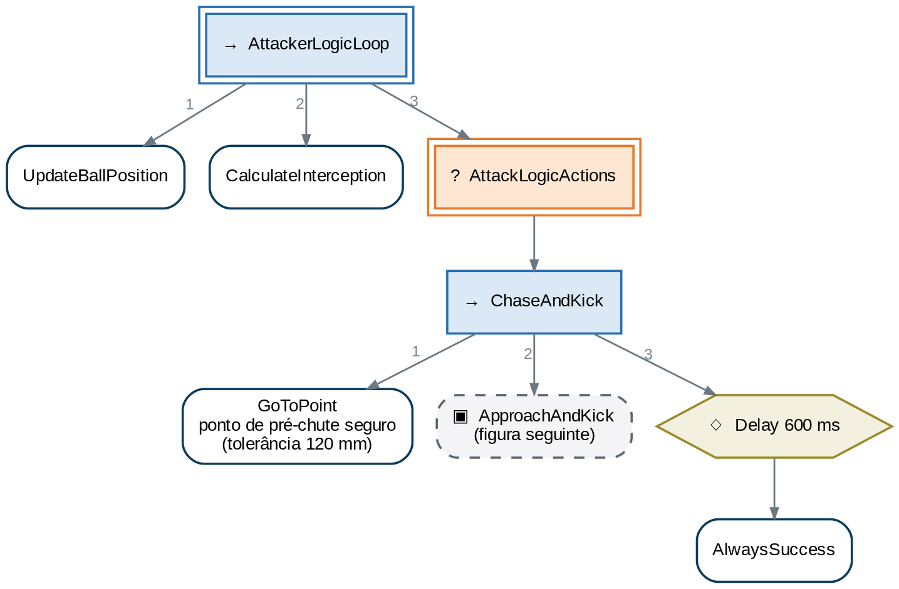

*Figura 9.2 — O laço do atacante: preparar dados, calcular a interceptação e executar ChaseAndKick*

1. A guarda `IsMyRole = attacker` é reavaliada a cada tick: se o atribuidor de papéis troca o atacante, o ramo é interrompido.
2. O laço `AttackerLogicLoop` (uma `ReactiveSequence` dentro de um `RetryUntilSuccessful(-1)`) executa `UpdateBallPosition`, `CalculateInterception` e a árvore de ações a **cada tick**, de modo que os pontos de saída estão sempre atualizados.
3. `ChaseAndKick` é uma `Sequence` com três passos:
   - **Fase 1 — aproximação.** `GoToPoint` até o ponto de pré-chute seguro (tolerância de 120 mm), com o planejador D\* e `ball_contact_threshold_mm=150`: se a bola chegar perto demais no caminho, a folha **falha de propósito**, o que obriga a árvore a recalcular tudo a partir da posição real da bola.
   - **Fase 2 — `ApproachAndKick`**, descrita a seguir.
   - **Cooldown.** Um `Delay` de 600 ms (com `AlwaysSuccess`) impede que o atacante reinicie o ciclo imediatamente após um chute.

### 9.4.1 ApproachAndKick: três comportamentos por prioridade

`ApproachAndKick` é um `ReactiveFallback` (Figura 9.3): a cada tick, tenta primeiro o comportamento de maior prioridade.

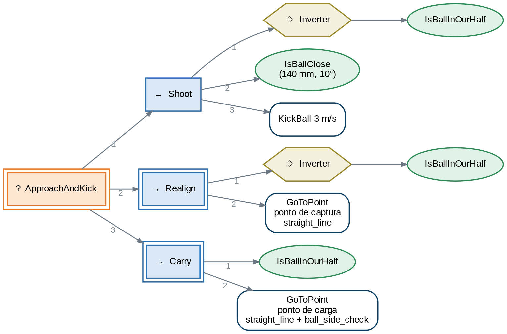

*Figura 9.3 — ApproachAndKick: chutar, realinhar ou conduzir*

1. **Shoot** (chutar): vale quando a bola **não** está na nossa metade, o robô está perto (140 mm) e alinhado (10°). Executa `KickBall`.
2. **Realign** (realinhar): quando a bola está na metade adversária mas o robô ainda não está em posição de chute, ele vai ao **ponto de captura** em linha reta, olhando para a mira. É uma `ReactiveSequence`: se a condição `Inverter(IsBallInOurHalf)` deixar de valer, o comportamento é interrompido.
3. **Carry** (conduzir): quando a bola está **na nossa metade**, em vez de chutar, o robô a **conduz** em direção à metade adversária, empurrando-a até o ponto de carga, em linha reta e com `ball_side_check=true` (se o robô acabar do lado errado da bola, a folha falha e tudo recomeça pela fase 1).

A figura abaixo resume as quatro fases em termos de geometria:

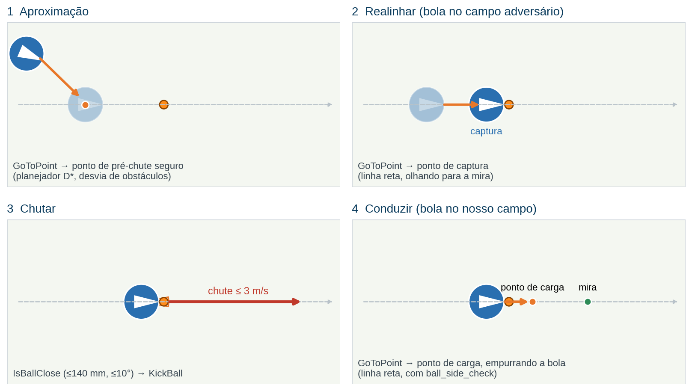

*Figura 9.4 — As quatro fases do atacante em torno da bola*

!!! note "Como a árvore 'recomeça do zero'"
    Muitas folhas de movimento do atacante usam *falhas intencionais* (`ball_contact_threshold_mm`, `ball_side_check`) como mecanismo de recuperação: quando a situação física muda de modo que o plano em curso deixa de fazer sentido, o `GoToPoint` falha, a falha sobe pela `Sequence` e pelo `ReactiveFallback`, o `RetryUntilSuccessful` reinicia o laço, e `CalculateInterception` recomputa os pontos com a posição real da bola. É uma forma de "replanejar" usando apenas a semântica da árvore.

### 9.4.2 Sobre `IsBallInOurHalf`

A condição usa o `my_goal_x` da blackboard para saber de que lado fica "a nossa metade" e adota uma **histerese de 100 mm** em torno do meio-campo, com memória do último estado, para a decisão não oscilar com a bola sobre a linha central. (Atenção: como tem memória interna, o estado da condição não é limpo entre ativações.)

## 9.5 PrecisionKick (legado)

Existe uma folha anterior, `PrecisionKick`, que gira, avança e chuta sozinha, publicando comandos de velocidade diretamente. Ela aparece apenas em árvores antigas e **não** em `master_strategy_carry.xml`. Duas razões a tornam inadequada para o jogo completo: ela escreve direto em `/robot_commands` (disputando o canal com o controlador) e **não limita** a velocidade do chute. O Capítulo 21 recomenda aposentá-la em favor de `KickOnce`.
# Capítulo 10 — O defensor e o goleiro

Enquanto o atacante ataca a bola, os outros robôs protegem o gol. Este capítulo descreve os dois comportamentos defensivos do sistema atual: o **defensor** (um robô de linha) e o **goleiro**.

## 10.1 O defensor

A árvore do defensor, `defender_tree.xml`, é pequena e declarativa (Figura 10.1). Ela só é executada pelo robô que o atribuidor de papéis nomeou defensor (`IsMyRole = defender`) e decide, por prioridade, entre dois cenários:

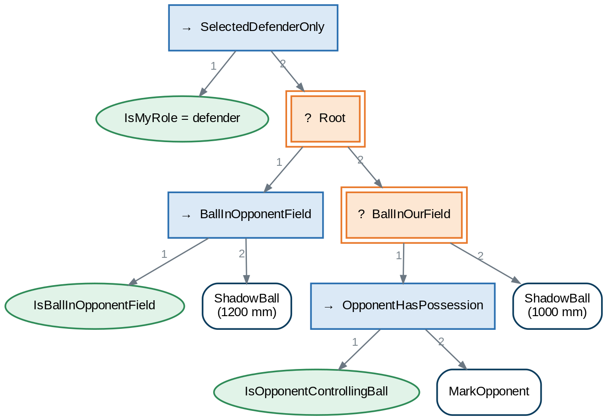

*Figura 10.1 — A árvore do defensor*

1. **Bola no campo adversário** (`IsBallInOpponentField`): o defensor faz `ShadowBall` — acompanha a bola prevista a uma distância fixa, **atrás** dela, no rumo do próprio gol, sem nunca cruzar o meio-campo (distância padrão de 1200 mm).
2. **Bola no nosso campo**: subdivide-se em
   - **o adversário tem a posse** (`IsOpponentControllingBall`): `MarkOpponent` — posiciona-se na linha entre a bola e o gol, a 400 mm da bola, bloqueando o chute;
   - **caso contrário**: volta a fazer `ShadowBall`, agora com distância de 1000 mm, para cobrir o goleiro em vez de brigar pela bola.

Note a escolha de projeto: o defensor **não disputa a bola**. Quem faz isso é o atacante. O defensor é uma "sombra" que ocupa a posição defensiva correta.

### 10.1.1 ShadowBall

`ShadowBall` é uma ação síncrona que, a cada tick, calcula um alvo e o publica como `RobotGoal`. O cálculo (Figura 10.2, painel a):

1. **Bola prevista**: posição atual somada à velocidade × `predict_time` (0,3 s).
2. **Alvo em x**: a posição prevista deslocada de `follow_distance` **na direção do próprio gol**. Esse valor é então limitado entre a linha do meio-campo (−180 mm, do nosso lado) e a **borda da área de defesa mais 200 mm**, de modo que o defensor nunca entre na área.
3. **Alvo em y**: o y previsto da bola, limitado a ±`y_limit` (900 mm).
4. **Orientação**: o robô olha para a bola.

### 10.1.2 MarkOpponent

`MarkOpponent` (Figura 10.2, painel b) traça a linha da bola ao centro do próprio gol e coloca o alvo sobre ela, a `block_distance` (400 mm) da bola, com o mesmo limite de área e |y| ≤ 1200 mm. O defensor fica entre o chutador e o gol.

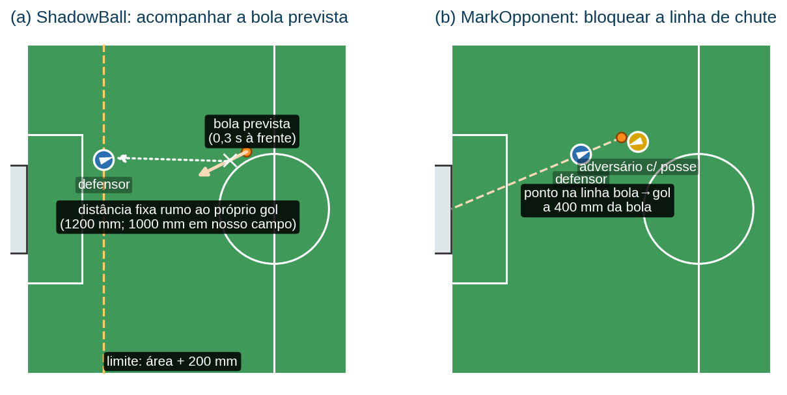

*Figura 10.2 — ShadowBall (a) e MarkOpponent (b)*

### 10.1.3 Limitações de projeto

- As duas ações são **síncronas**: devolvem SUCCESS no mesmo tick em que publicam o alvo. Isso as torna baratas, mas significa que **não têm `onHalted`**: ao serem interrompidas por um ramo de maior prioridade, o último alvo continua valendo no controlador.
- A velocidade da bola vem da **diferença finita** do `strategy_node`, mais ruidosa que a predição do Kalman.
- Há um terceiro nó defensivo, `GoToClamped`, que vai a um ponto limitado fora da área, registrado mas ainda não usado em nenhum XML.

## 10.2 O goleiro

O goleiro é o único robô que pode (e deve) entrar na própria área, e o único que, por regra, pode reter a bola ali — por até 10 segundos. A árvore `goalkeeper_tree.xml` é mínima (Figura 10.3): se `robot_id == 0`, executa a folha `Goalkeeper`; caso contrário, o robô fica parado.

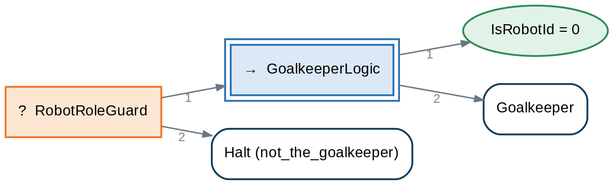

*Figura 10.3 — A árvore do goleiro*

Toda a lógica está na folha `Goalkeeper` (`goalkeeper_node.cpp`), uma ação assíncrona que **nunca termina** (devolve sempre RUNNING) e a cada tick escolhe entre dois estados (Figura 10.4):

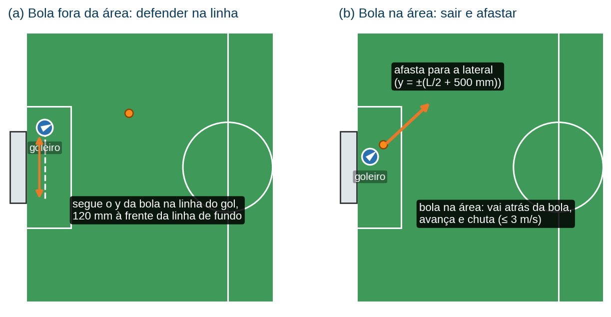

*Figura 10.4 — Os dois estados do goleiro*

### 10.2.1 Estado 2 — bola fora da área: defender na linha

Enquanto a bola está fora da área de defesa, o goleiro fica **na linha do gol, 120 mm à frente da linha de fundo**, e acompanha o `y` da bola, limitado a `±(largura do gol/2 − 50 mm)`. O robô olha para a bola. Usa o planejador de linha reta, sem desvio de obstáculos.

### 10.2.2 Estado 1 — bola na área: sair e afastar

Quando a bola entra na área (com margem zero), o goleiro vai buscá-la e a **afasta para a lateral**:

1. Escolhe o lado do afastamento pelo sinal do `y` da bola e calcula a direção do chute: da bola até o ponto `(0, ±(largura/2 + 500 mm))`.
2. Se ainda não está **atrás da bola** em relação a essa direção (ou está a mais de 250 mm dela), navega, com o D\*, até um **ponto de pré-chute 200 mm atrás da bola**, dentro da área.
3. Quando já está atrás e a menos de 250 mm, avança em linha reta até **60 mm além da bola** e, se estiver a menos de 180 mm e alinhado (erro de ângulo < 0,45 rad), pede o **chute** por `MODE_KICK` (no máximo 3 m/s).

Em todos os casos, o alvo é limitado a ficar **dentro da área de defesa**.

!!! warning "O que o goleiro atual ainda não faz"
    A folha não conhece o estado de jogo: ela se comporta do mesmo jeito em qualquer fase. Em particular, **não há tratamento do pênalti** (o goleiro defensor precisa tocar a linha de gol até a bola entrar em jogo) nem **limite de 10 segundos** para a bola retida na área. Além disso, a identidade do goleiro é fixa (`robot_id == 0`) e a folha devolve RUNNING mesmo sem dados, em vez de falhar. O Capítulo 19 propõe essas correções.

## 10.3 Blocos defensivos disponíveis, mas não usados

O repositório traz outras folhas defensivas já implementadas e registradas, mas ainda sem uso em nenhuma árvore: `GoalLineDefend` (acompanha o y da bola na linha de gol), `PositionBisector` (posiciona-se na bissetriz entre a bola e as traves, ponderando 80% bissetriz e 20% bola), `SmotherSave` (vai direto à bola para "abafar") e `LateralClear` (afasta a bola para a lateral). São bons pontos de partida para um goleiro mais elaborado.
# Capítulo 11 — Papéis dinâmicos

Com três robôs, o time precisa decidir **quem faz o quê**: um é goleiro, e dos outros dois um ataca e o outro defende. Essa divisão não é fixa: quem está mais perto da bola, e bem posicionado para ela, deveria atacar, e isso muda o tempo todo. O sistema resolve isso com um componente separado das árvores, o `role_assigner_node`. Este capítulo explica como ele decide, como evita trocas desnecessárias e como a árvore consome o resultado.

## 11.1 Por que um componente fora da árvore

Poderia-se pensar em decidir o papel dentro de cada árvore, olhando a distância à bola. Mas haveria um problema: cada robô tem a **sua** árvore e a sua visão do mundo; sem coordenação, dois robôs poderiam concluir ao mesmo tempo que "eu sou o atacante" — ou nenhum. A decisão de papel é **coletiva**: precisa de uma comparação entre todos os robôs. Por isso ela é tomada em **um único processo**, que olha o time inteiro e publica o resultado.

## 11.2 O custo de cada robô

O `role_assigner_node` assina `/game_data` e, a cada mensagem, calcula um **custo** para cada robô de linha (o goleiro, identificado por `goalkeeper_id`, não participa). Quanto **menor** o custo, mais apto o robô é a atacar:

> **custo = w1 · r + w2 · (1 − cos θ)**

- `r` é a distância do robô à bola, em **metros**.
- `θ` é o ângulo entre a **direção em que o robô está indo** (ou, se está quase parado, para onde está virado) e a direção da bola. Um robô que já se move em direção à bola tem `cos θ ≈ 1` e custo de alinhamento nulo.
- `w1 = 2,0` e `w2 = 1,0` são os pesos padrão: a distância pesa o dobro do alinhamento.

A velocidade do robô é estimada por diferença finita entre duas mensagens consecutivas; se o módulo for menor que 50 mm/s, usa-se a orientação do chassi.

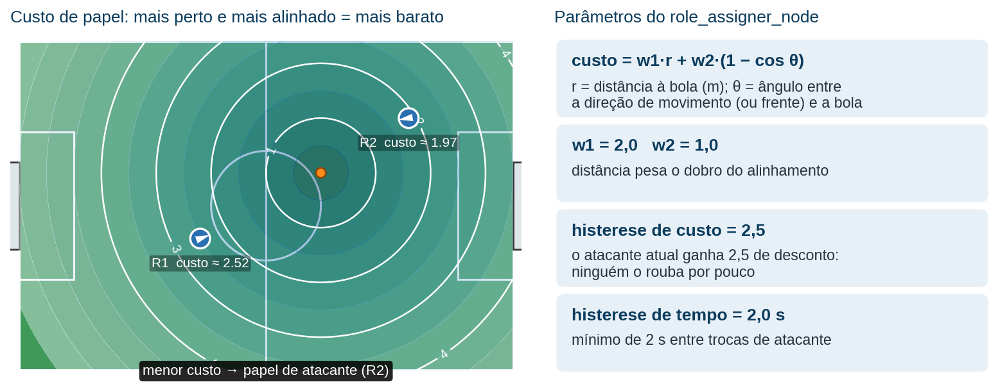

*Figura 11.1 — O custo de papel: mais perto e mais alinhado significa mais barato*

A figura mostra o mapa de custo para uma bola em (500, 300): os círculos concêntricos são curvas de igual custo de distância, e os dois robôs recebem custos diferentes pela combinação de distância e alinhamento. O de menor custo é nomeado atacante; o outro, defensor. Com um único robô de linha, ele é o atacante e o papel de defensor é atribuído ao próprio identificador do goleiro (um "fallback" sem efeito real).

## 11.3 Evitando a troca-troca: duas histereses

Se a escolha fosse simplesmente "o menor custo agora", o papel oscilaria sempre que dois robôs tivessem custos parecidos: cada oscilação interrompe e recomeça a árvore do robô, e o time perderia tempo e ficaria imprevisível. O atribuidor usa duas proteções:

1. **Histerese de custo (2,5).** O atacante atual recebe um **desconto de 2,5** no custo. Um concorrente só o "rouba" se, mesmo com esse desconto, tiver custo menor — isto é, se for *nitidamente* melhor.
2. **Histerese de tempo (2,0 s).** Mesmo que o concorrente seja nitidamente melhor, a troca só acontece se já passaram pelo menos **2 segundos** da última troca. Durante esse intervalo, o papel anterior é mantido.

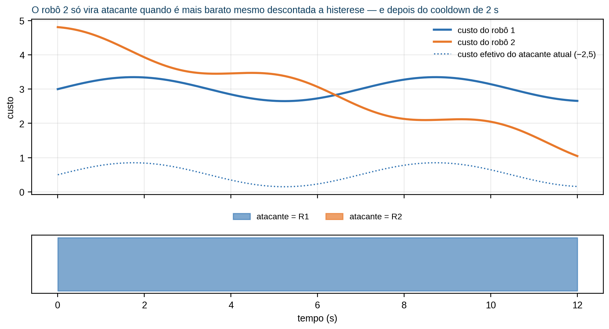

*Figura 11.2 — Evolução dos custos de dois robôs: a troca de atacante só acontece quando o concorrente supera o desconto e o tempo mínimo passou*

A Figura 11.2 ilustra o efeito com uma simulação da mesma regra: o robô 2 começa com custo maior e vai melhorando; a linha pontilhada mostra o custo efetivo do atacante atual (descontados 2,5). O robô 2 só assume quando sua curva cruza a pontilhada **e** o cooldown de 2 s permite. Os parâmetros (`w1`, `w2`, `hysteresis`, `time_hysteresis`) podem ser ajustados no YAML.

## 11.4 Como a árvore consome os papéis

O atribuidor publica `RoleAssignment { attacker_id, defender_id }` em `/role_assignment`. No `strategy_node`, a *callback* `role_callback` copia os dois valores para as chaves `attacker_id` e `defender_id` da blackboard. As árvores então os usam por meio da condição `IsMyRole`, que compara o `robot_id` do processo com o identificador do papel pedido (`attacker` ou `defender`). Como `IsMyRole` está como guarda em `ReactiveSequence`, **quando o papel muda, o ramo antigo é interrompido no tick seguinte** e o novo é iniciado — e a ação interrompida recebe `halt`.

O goleiro, por sua vez, **não** vem do atribuidor: as árvores o identificam por `IsRobotId robot_id="0"` (o identificador 0 é fixo no código), em paralelo ao parâmetro `goalkeeper_id` do atribuidor, que só serve para excluí-lo do sorteio.

## 11.5 O que o atribuidor atual não faz

O mecanismo atual cumpre bem o papel de escolher o atacante em jogo corrido, mas não foi pensado para uma partida completa. As lacunas, que a Parte IV preenche, são:

- **Não conhece o estado de jogo.** Em um kick-off ou pênalti, quem bate deveria ser escolhido por critério próprio e **mantido** durante o reinício; hoje a escolha continua sendo a do custo à bola, que pode mudar no meio da preparação.
- **O goleiro é fixo.** O regulamento permite escolher qualquer identificador (e até ficar sem goleiro) e o Game Controller informa o goleiro de cada time.
- **Não considera o número de robôs ativos.** Cartões e robôs removidos mudam quantos robôs podem jogar, mas o atribuidor só enxerga quem aparece na visão (e, como visto no Capítulo 8, um robô que some da visão continua "presente").
- **Não há exclusividade formal.** A garantia de que dois robôs não ocupam o mesmo papel depende apenas de o atribuidor publicar uma mensagem coerente; as árvores não verificam a "idade" do papel.
- **Valores iniciais fixos.** Até a primeira mensagem do atribuidor, o `strategy_node` assume `attacker_id = 2` e `defender_id = 1`.
# Capítulo 12 — A árvore mestre atual

Neste capítulo juntamos as peças. A árvore que o time executa hoje é `master_strategy_carry.xml` (ID `MainTreeCarry`), configurada como padrão nos arquivos YAML. Ela organiza todo o comportamento em um único `ReactiveFallback` de ramos por prioridade (Figura 12.1).

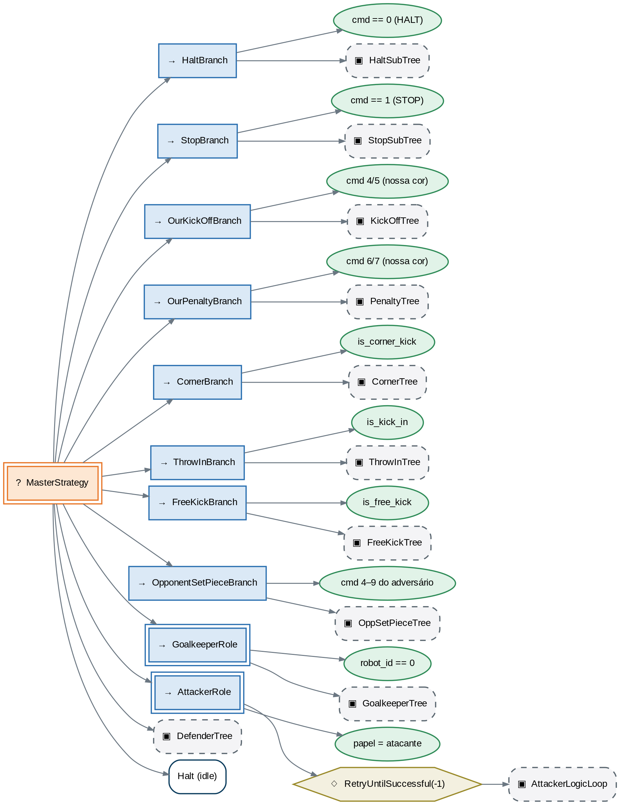

*Figura 12.1 — A árvore mestre atual, ramo a ramo*

## 12.1 Como ler a árvore

A raiz, `MasterStrategy`, é um `ReactiveFallback`: a cada tick, os ramos são tentados **de cima para baixo**, e o primeiro que tiver sucesso (ou estiver em andamento) é o escolhido; os de baixo são interrompidos. A ordem dos ramos é, portanto, a **prioridade**:

| # | Ramo | Condição | Ação |
|---|---|---|---|
| 1 | `HaltBranch` | comando = 0 (HALT) | `HaltSubTree` |
| 2 | `StopBranch` | comando = 1 (STOP) | `StopSubTree` |
| 3 | `OurKickOffBranch` | comando 4 (se amarelos) ou 5 (se azuis) | `KickOffTree` |
| 4 | `OurPenaltyBranch` | comando 6 (se amarelos) ou 7 (se azuis) | `PenaltyTree` |
| 5 | `CornerBranch` | flag `is_corner_kick` | `CornerTree` |
| 6 | `ThrowInBranch` | flag `is_kick_in` | `ThrowInTree` |
| 7 | `FreeKickBranch` | flag `is_free_kick` | `FreeKickTree` |
| 8 | `OpponentSetPieceBranch` | comando do adversário (kick-off 4/5, pênalti 6/7, falta 8/9) ou flag `is_opponent_foul` | `OppSetPieceTree` |
| 9 | `GoalkeeperRole` | `robot_id == 0` | `GoalkeeperTree` |
| 10 | `AttackerRole` | papel = atacante | laço do atacante (Capítulo 9) |
| 11 | (defensor) | papel = defensor | `DefenderTree` |
| 12 | `Halt (idle)` | — | parar o robô |

Os ramos 1 a 8 tratam **bolas paradas e comandos do árbitro**; os ramos 9 a 11 tratam o **jogo corrido**, distribuindo o trabalho pelos papéis; o ramo 12 é a rede de segurança: se nenhum outro serve, o robô fica parado.

Uma observação sobre a **seleção de cor**: os ramos de kick-off e pênalti usam `is_yellow` (a cor efetiva) para escolher entre os comandos "amarelo" e "azul". Por exemplo, `OurKickOffBranch` aceita `cmd == 4` se somos amarelos e `cmd == 5` se somos azuis. O ramo do adversário usa os comandos *complementares*.

## 12.2 As subárvores de bola parada

### 12.2.1 HaltSubTree e StopSubTree

`HaltSubTree` é uma única ação `Halt`. `StopSubTree` é uma `ReactiveSequence` que atualiza a posição da bola e chama a folha `KeepDistance` com 550 mm (0,5 m do regulamento mais 5 cm de margem), como mostra a figura a seguir. Esse ramo é crítico e merece a leitura do Capítulo 13.

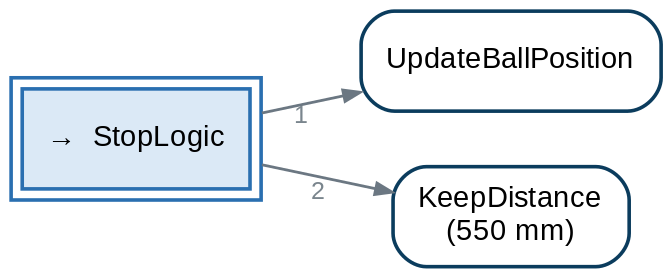

*Figura 12.2 — A árvore de STOP atual*

### 12.2.2 KickOffTree

O kick-off do nosso time distribui três papéis com um `Fallback` (Figura 12.3):

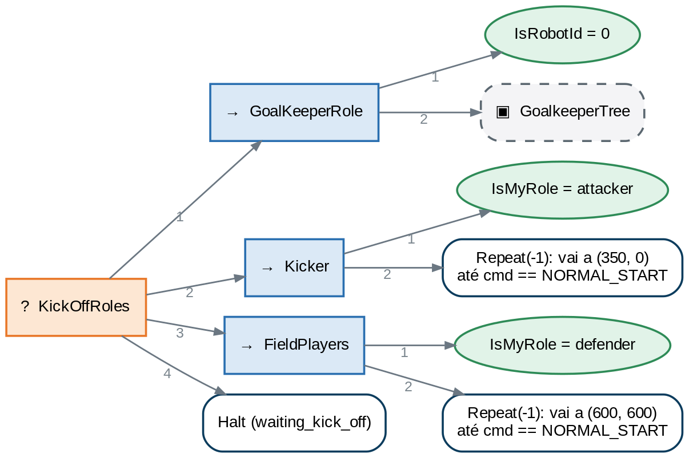

*Figura 12.3 — A árvore de kick-off atual: posições fixas por papel*

- o **goleiro** (`robot_id == 0`) executa `GoalkeeperTree`;
- o **atacante** vai a `(350, 0)` — dentro do círculo central, como é permitido ao cobrador — e **espera** até o comando virar `NORMAL_START` (o `Repeat` com um `Inverter(CheckGCCommand 2)` é o mecanismo de espera);
- o **defensor** vai a `(600, 600)` pela mesma lógica;
- qualquer outro robô fica parado (`Halt waiting_kick_off`).

As coordenadas são **literais no XML**, um ponto a que voltaremos: elas só são válidas para um dos lados do campo.

### 12.2.3 PenaltyTree

A árvore de pênalti do nosso time tem um `Fallback` com três ramos: o atacante (cobrador), o goleiro (que executa `Goalkeeper`) e os demais (`Halt`). O cobrador tem uma `ReactiveFallback` interna com duas ações: **"executar o pênalti"** (quando o comando é `NORMAL_START`: vai à bola e chuta) e **"preparar"** (vai ao ponto de pré-chute e aguarda). Há uma sutileza importante sobre a primeira: ela só roda se o comando for 2 *enquanto o ramo do pênalti está ativo* — e o ramo do mestre só é ativado com o comando de preparação (6 ou 7). Veja a discussão no Capítulo 13.

### 12.2.4 FreeKickTree

Na falta a nosso favor, o goleiro continua na meta, o **cobrador** (atacante) vai ao ponto de pré-chute e, em seguida, em paralelo, **avança à bola** e **chuta** (um `Parallel(success=1, failure=1)` combina `GoToPoint` à bola e "espere `IsBallClose` e então `KickBall`"). O **suporte** (defensor) mantém-se a 650 mm da bola se ela chegar a menos de 600 mm, ou vai a uma posição fixa.

### 12.2.5 OppSetPieceTree

Quando a bola parada é do adversário, o objetivo é **recuar sem cometer falta**: o goleiro defende normalmente; o defensor e o atacante vão a posições táticas fixas, mas — se a bola chegar a menos de 600 mm — recuam para 650 mm dela com `KeepDistance`.

### 12.2.6 CornerTree, ThrowInTree e KickInTree

Árvores específicas para escanteio e lateral. Dependem de flags (`is_corner_kick`, `is_kick_in`) que **ninguém escreve** hoje — e, como vimos no Capítulo 2, escanteios e laterais chegam como `DIRECT_FREE`. Na prática, são código sem uso.

## 12.3 O jogo corrido

Se nenhum ramo de bola parada se aplica, o mestre cai nos três ramos de papel:

1. **Goleiro**: `ReactiveSequence(IsRobotId 0, GoalkeeperTree)`.
2. **Atacante**: o laço descrito no Capítulo 9.
3. **Defensor**: a `DefenderTree` (Capítulo 10).
4. **Parado** (`Halt idle`): robôs sem papel, ou se tudo falhar.

Observe que, neste desenho, "jogo corrido" não é uma condição verificada: é o que **sobra** quando nenhum outro ramo casa. Esse "default" é elegante, mas tem uma consequência importante, que o próximo capítulo explora: qualquer comando que o mestre *não conhece* cai, silenciosamente, no jogo corrido.

## 12.4 Outras árvores no diretório

O diretório `behavior_trees/` contém muito mais do que a árvore mestre:

- **Versões anteriores do mestre**: `master_strategy.xml` (só para o time amarelo) e `game_manager.xml` (um seletor com `Fallback`, sem preempção).
- **Árvores de jogo simplificadas**: `simple_attack.xml`, `attack_logic.xml`, `test_attack.xml`, `normal_play.xml`.
- **Posicionamento inicial**: `start_game_left.xml`, `start_game_right.xml`.
- **Árvores de teste**: `test_prediction.xml`, `test_roles.xml`, `test_tree.xml`.
- **Desafios técnicos** (`kick_technical_challenge1-4.xml`, `placement_technical_challenge_*.xml`): roteiros específicos, um por robô, escritos para as provas técnicas do campeonato. Usam `IsThisNodeID`, `AimAt`, `Sleep` e `ignore_area`.

Como o `strategy_node` registra **todos** os `.xml` do diretório, esses arquivos coexistem na mesma fábrica — o que exige IDs únicos, e vários legados têm o mesmo `MainTree`.
# Capítulo 13 — Pontos de atenção do sistema atual

O sistema atual já faz muita coisa bem: percebe o jogo, planeja rotas, ataca, defende e executa várias bolas paradas em simulação. Mas ele foi construído de forma incremental, desafio a desafio, e algumas decisões que funcionam em um cenário controlado deixam de funcionar quando se pensa em uma **partida inteira**, com todos os comandos do árbitro, os dois lados do campo e falhas de comunicação. Este capítulo reúne esses pontos. O objetivo não é criticar, e sim mapear com precisão o que precisa ser resolvido — cada ponto aponta o capítulo da Parte IV que o resolve.

## 13.1 Comandos que o mestre não conhece

Como vimos no Capítulo 12, o jogo corrido é o **destino padrão** do mestre: se nenhum ramo de bola parada casa, o robô joga. Isso é cômodo, mas significa que um comando sem ramo é tratado como se o jogo estivesse rolando.

Hoje, dois comandos regulamentares **não têm ramo nenhum**:

- **`TIMEOUT_YELLOW/BLUE` (12/13).** Durante um timeout, os robôs deveriam ficar parados. Em vez disso, o mestre os põe para jogar: o atacante persegue a bola.
- **`BALL_PLACEMENT_YELLOW/BLUE` (16/17).** Durante o posicionamento da bola, o jogo continua *parado* e tocar na bola é falta. Mas o mestre também trata esse comando como jogo corrido: o atacante vai à bola e tenta chutá-la, e o robô pode ficar dentro do corredor proibido.

Há ainda os comandos legados (`INDIRECT_FREE` 10/11 e `GOAL` 14/15), que não aparecem nas versões modernas do Game Controller, mas cairiam no mesmo destino.

**Solução:** cada comando passa a ter uma fase de jogo explícita e um ramo próprio (Capítulos 15, 16 e 18).

## 13.2 O NORMAL_START sem contexto

`NORMAL_START` é o comando que **autoriza** tanto o kick-off quanto o pênalti. O mestre atual só ativa o ramo do kick-off com `cmd == 4/5` e o do pênalti com `cmd == 6/7` — isto é, **com o comando de preparação**. Quando chega o `NORMAL_START`, o comando muda para 2, **nenhum** desses ramos casa mais, e o robô cai no jogo corrido (Figura 13.1).

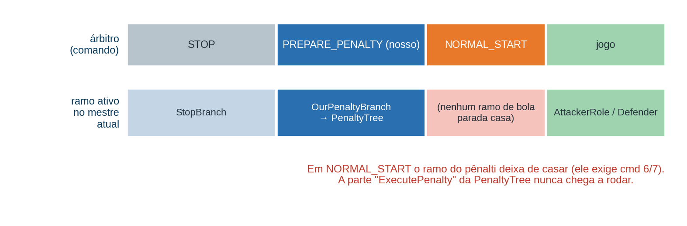

*Figura 13.1 — Linha do tempo de um pênalti nosso: ao chegar o NORMAL_START, nenhum ramo de bola parada casa*

Consequências práticas:

- A parte `ExecutePenalty` da `PenaltyTree`, que só roda com `cmd == 2`, **nunca é alcançada** pelo mestre: o ramo pai não está ativo nesse comando.
- No kick-off, a transição "funciona" por acaso: as árvores de espera (`Repeat` com `Inverter(CheckGCCommand 2)`) terminam quando o comando vira 2 e o jogo corrido assume, com o atacante indo à bola.
- No pênalti, porém, o jogo corrido faz com que **todos** os robôs, inclusive os que deveriam permanecer 1 m atrás da bola, entrem em ação, o que viola as regras de posicionamento.

**Solução:** guardar o **contexto do reinício** (kick-off ou pênalti, e a quem favorece) quando chega o comando de preparação, e derivar fases `KICKOFF` e `PENALTY` para o `NORMAL_START` (Capítulo 15).

## 13.3 O ramo de STOP

O `StopSubTree` (Figura 12.2, do capítulo anterior) contém uma `ReactiveSequence` com `UpdateBallPosition` e `KeepDistance` (550 mm). A intenção é nítida: manter o robô a 0,5 m da bola. Mas a implementação tem dois problemas que, juntos, impedem o efeito:

1. **Portas obrigatórias não informadas.** `KeepDistance` declara as entradas `robot_x` e `robot_y` **sem valor padrão**, e o XML não as passa. Como vimos no Capítulo 5, a biblioteca não busca por conta própria uma chave com o mesmo nome na blackboard; `getInput` falha e a folha devolve **FAILURE** (conferido nas fontes da série 4.6 da biblioteca).
2. **As saídas não são usadas.** Mesmo que `KeepDistance` funcionasse, ela só **calcula** um ponto de recuo (`target_x`, `target_y`) e não move o robô; nenhum XML conecta essas saídas a um `GoToPoint`.

O efeito em cascata é sério: a `ReactiveSequence` do STOP falha, o `StopBranch` falha, e o mestre segue para os ramos de baixo — o jogo corrido — **durante o STOP**. O mesmo padrão aparece em `free_kick.xml` e `opp_set_piece.xml` (quatro usos de `KeepDistance` ao todo), e a folha `AimAt` dos desafios técnicos sofre do mesmo problema de portas.

!!! warning "Vale confirmar com um teste"
    A análise acima decorre do código e da semântica da biblioteca. Como o time registrou os desafios técnicos como concluídos, convém executar `Desafio1` com o Groot2 e confirmar o comportamento na versão instalada (4.10). O plano de testes (Capítulo 23) inclui um *validador estático* de XML que detecta automaticamente portas obrigatórias não informadas.

**Solução:** uma `StopTree` que de fato move o robô (`ComputeLegalSlot` + `GoToPoint`, ou `HoldPosition`) e uma `KeepDistance` corrigida (Capítulos 17 e 21).

## 13.4 Dados sem idade e sem vigilância

Como vimos nos Capítulos 6, 7 e 8, a imagem do mundo que chega à árvore **não carrega idade**: `GameData` não tem carimbo de tempo, os robôs não expiram no observer, e o observer só publica quando vê a bola. Se a visão cair:

- a blackboard continua com os últimos valores e a árvore segue decidindo com base neles;
- o controlador continua seguindo a **última rota** (rotas só são substituídas quando o D\* publica uma nova);
- o override de parada expira em 200 ms (se nenhuma árvore o renovar), devolvendo o robô ao seguimento de rota.

Em outras palavras, o sistema **não tem um modo seguro de falha**: se a árvore parar de ticar (travada, em *crash*, ou esperando um recurso) o robô continua se movendo. É o ponto mais sério do ponto de vista de segurança.

**Solução:** carimbar os dados, validar a idade com uma condição (`IsDataFresh`) no ramo de maior prioridade da árvore e acrescentar um *watchdog* no controlador, que zera os comandos se nada chegar por 500 ms (Capítulo 17).

## 13.5 Limites de velocidade e de chute

Dois limites do regulamento são só parcialmente cobertos:

- **Velocidade em STOP (0,75 m/s).** O controlador usa um único teto, `max_linear_speed` (1,0 m/s no código), em qualquer fase. Em STOP, o limite regulamentar não é aplicado.
- **Velocidade da bola (3 m/s).** `KickBall` limita o pedido a 3 m/s, mas a folha `PrecisionKick` — presente em várias árvores legadas — **não limita** (os XML a usam com 4,5 m/s) e ainda escreve diretamente em `/robot_commands`, rompendo a regra de que o controlador é o único escritor.

**Solução:** um *SafetyGate* no controlador, que aplica o teto de velocidade da fase atual e limita o chute a 3 m/s **independentemente** da árvore (Capítulo 17).

## 13.6 O lado do campo

A blackboard define `my_goal_x` como `+L/2` para a cor efetiva amarela e `−L/2` para a azul. As condições espaciais (`IsBallInOurHalf`, `IsBallInOpponentField`) usam esse valor e, portanto, funcionam para os dois times. Porém, vários **XML contêm coordenadas literais**, e elas pressupõem lados **diferentes** entre si:

| Árvore | Literal | Pressupõe que a nossa metade é... |
|---|---|---|
| `kick_off.xml` | `(350, 0)`, `(600, 600)` | x **positivo** (time amarelo) |
| `opp_set_piece.xml` | `x = −1500`, `x = −500` | x **negativo** (time azul) |
| `free_kick.xml` | `(−500, 0)` | x **negativo** (time azul) |
| `UpdateBallPosition` | `ball_in_enemy_half = ball_x > 0` | x **negativo** (time azul) |

O resultado é que, **para qualquer um dos dois times, algum desses literais cai do lado errado** (Figura 13.2): o time azul (que defende `x = −2250`) tem o cobrador e o defensor do kick-off posicionados na metade adversária — o defensor ali é falta —, enquanto o time amarelo (que defende `x = +2250`) vai recuar para posições de bola parada do adversário que ficam perto do **gol adversário**.

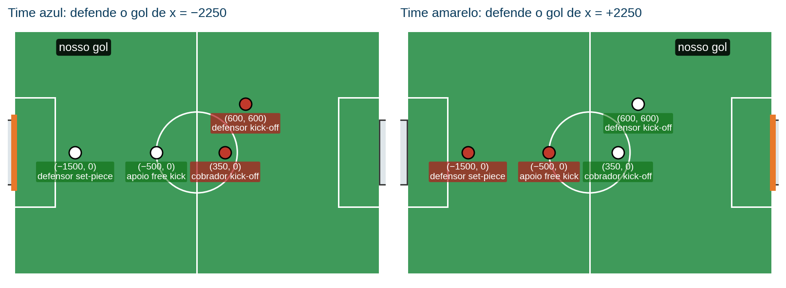

*Figura 13.2 — Os mesmos literais vistos pelos dois times: em verde, na metade própria; em vermelho, na metade errada*

Há ainda um segundo aspecto: o lado é **fixo por cor**. O Game Controller informa, na mensagem, `blue_team_on_positive_half`, que indica de que lado cada time realmente joga (e que muda entre os tempos). O software atual ignora esse campo.

**Solução:** uma chave `side_sign` e um `own_goal_x` derivados do campo do árbitro, e posições **calculadas** (`ComputeLegalSlot`) em vez de literais (Capítulos 15 e 20).

## 13.7 Papéis e goleiro fixos

Como vimos no Capítulo 11: o goleiro é `robot_id == 0` por todo o código (árvores, `GoToPoint`, o controlador e o D\* tratam o robô 0 de modo especial), os papéis iniciais são constantes, e o atribuidor não conhece a fase de jogo nem os robôs ativos. Além disso, `attacker_ball_dist` é calculada no `strategy_node` com um identificador de atacante fixo (2), independente do papel real.

**Solução:** goleiro vindo do Game Controller, papéis conscientes da fase e uma época para detectar papéis antigos (Capítulos 19 e 20).

## 13.8 Interromper uma ação não pára o robô

Quando um ramo de maior prioridade assume, a ação anterior recebe `halt()`. Mas a folha `GoToPoint` tem `onHalted()` **vazio**, e as folhas defensivas (`ShadowBall`, `MarkOpponent`) são síncronas e nem têm esse método. O último `RobotGoal` continua publicado e o controlador o segue. Funciona quando o novo ramo publica seu próprio alvo logo em seguida; mas se o novo ramo não publica nada (por exemplo, uma ação de espera), o robô **continua indo para o alvo antigo**.

Uma segunda consequência do mesmo desenho: quando o `robot_id` do `GoToPoint` não é o do processo, a folha devolve **SUCCESS** sem fazer nada. É o que permite árvores "multi-robô", como as dos desafios, mas esconde erros de configuração.

**Solução:** `onHalted` publicando o alvo "ficar onde está" e uma folha `HoldPosition` para esperas (Capítulos 17 e 21).

## 13.9 Código morto e árvores sobrepostas

- As flags **`is_corner_kick`, `is_kick_in` e `is_opponent_foul`** são lidas pelo mestre mas **nunca escritas** por nenhum código — um comentário no XML diz que são "resolvidas no C++", o que não é verdade. `IsValueTrue` devolve FAILURE quando a chave não existe, e os ramos ficam permanentemente inativos.
- `is_free_kick` só considera `DIRECT_FREE` (8/9) e compara com a cor **real** (`is_yellow_`), sem considerar `invert_sides`.
- **IDs duplicados**: `MainTree` aparece em oito arquivos e `Desafio1/2/3` em dois. Como o registro percorre o diretório numa ordem não especificada, qual definição vale depende do sistema de arquivos; falhas de registro viram apenas aviso no log.
- `HasLineOfSight` é um *stub* que sempre devolve SUCCESS; `a_star_planner` existe mas não é compilado (a opção `astar` cai silenciosamente no D\*); `follow_ball_node.cpp` está inteiramente comentado.

**Solução:** limpar e separar as árvores de produção das legadas (Capítulo 24) e consolidar free kicks, laterais e escanteios em uma só subárvore (Capítulo 18).

## 13.10 Resumo

| Ponto | Consequência | Resolvido em |
|---|---|---|
| TIMEOUT e BALL_PLACEMENT sem ramo | robôs jogam com o jogo parado | Cap. 15, 16, 18 |
| NORMAL_START sem contexto | pênalti/kick-off executados pelo jogo corrido | Cap. 15 |
| STOP com KeepDistance inoperante | atacante age em STOP | Cap. 17, 21 |
| Dados sem idade e sem watchdog | robô se move com a visão caída ou a BT travada | Cap. 17 |
| Sem teto de 0,75 m/s; chute sem clamp em PrecisionKick | faltas de velocidade | Cap. 17 |
| Coordenadas literais e lado fixo | amarelo e azul se comportam diferente; 2º tempo errado | Cap. 15, 20 |
| Goleiro e papéis fixos | sem goleiro alternativo, sem degradação | Cap. 19, 20 |
| `onHalted` vazio | preempção não pára o movimento | Cap. 17, 21 |
| Flags nunca escritas, IDs duplicados | árvores mortas, registro ambíguo | Cap. 18, 24 |


---

# Parte IV — A Master Tree de jogo completo

*A arquitetura proposta para que o time jogue uma partida inteira: um estado de jogo único e confiável, uma árvore mestre com prioridades claras, uma subárvore para cada situação regulamentar e papéis dinâmicos.*

# Capítulo 14 — A arquitetura de jogo completo

A Parte III descreveu o que existe. A Parte IV descreve o que construir para que o time jogue uma **partida inteira**, do primeiro apito ao último. Este capítulo apresenta a visão geral e as decisões arquiteturais; os capítulos seguintes detalham cada peça. Tudo o que aparece a partir daqui é **proposta de projeto**: os nós e componentes novos ainda precisam ser implementados, e as figuras os marcam com **✦**.

## 14.1 O que uma partida inteira exige

Do Capítulo 2 e dos pontos de atenção do Capítulo 13, saem cinco propriedades que a arquitetura precisa garantir:

1. **Cobertura completa dos comandos.** Cada comando do árbitro, em cada estágio, tem um comportamento definido. Nenhum cai em um "default" por acaso.
2. **Segurança acima de tudo.** HALT para os robôs, sempre; dados ausentes ou velhos levam a um estado seguro; limites de velocidade e de chute valem independentemente de qualquer árvore.
3. **Independência de lado e de cor.** O mesmo código e as mesmas árvores servem ao time amarelo e ao azul, e continuam corretos quando os times trocam de lado.
4. **Coordenação entre os robôs.** Papéis exclusivos, trocas estáveis, degradação graciosa quando o número de robôs muda.
5. **Testabilidade.** Cada ramo e cada transição pode ser verificado automaticamente, sem robôs.

## 14.2 Uma árvore para o time, uma por robô, ou ambas?

A primeira decisão é de **onde** mora a inteligência. Há três modelos possíveis.

**Centralizado.** Uma única Behavior Tree comanda os três robôs, como se fosse um técnico. Tem a vantagem de a coordenação ser natural (uma árvore sabe o que todos fazem). Mas exige reescrever as folhas, que hoje assumem "o meu robô"; um tick lento atrasa todos os robôs ao mesmo tempo; e a falha de um processo derruba o time inteiro.

**Distribuído por robô** (o modelo atual). Cada robô tem a sua árvore. É simples, rápido, e a falha de um processo afeta um robô só. Em compensação, a coordenação depende de mensagens externas (como o atribuidor de papéis) e cada árvore precisa reconstruir sozinha o estado do jogo.

**Híbrido** (a proposta). Mantém **uma árvore por robô**, para aproveitar o que existe, mas move para **serviços de equipe**, fora da árvore, tudo o que é *coletivo* ou *crítico*: o estado legal do jogo (`referee_state_node`) e a atribuição de papéis (`role_assigner_node`). A execução continua distribuída; a decisão sobre "o que está acontecendo" e "quem faz o quê" é única.

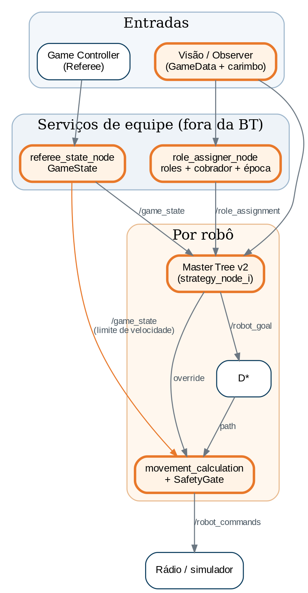

*Figura 14.1 — A arquitetura híbrida: serviços de equipe alimentam a árvore de cada robô; o controlador ganha um SafetyGate*

A Figura 14.1 mostra a arquitetura. Os componentes marcados com ✦ são os novos ou ampliados:

- **`referee_state_node`**: converte o comando bruto do árbitro em um `GameState` tipado, com a fase de jogo, o favorecido, o limite de velocidade e a idade do dado.
- **`role_assigner_node`** ampliado: além de atacante e defensor, publica goleiro, cobrador de reinício e a lista de robôs ativos.
- **Observer com carimbo de tempo**: `GameData` passa a carregar o instante da leitura.
- **Master Tree v2**: a árvore mestre reescrita, com um ramo por fase.
- **SafetyGate**: um filtro de segurança dentro do controlador de movimento.

## 14.3 As camadas de decisão

Dentro do modelo híbrido, as decisões se organizam em camadas de **prioridade decrescente** (Figura 14.2):

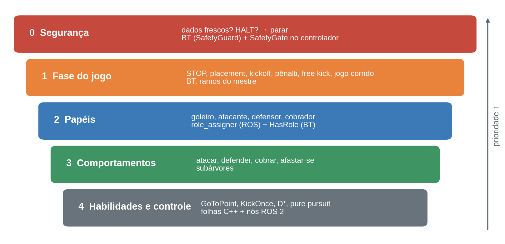

*Figura 14.2 — As cinco camadas de decisão, da mais prioritária à mais concreta*

| Camada | Pergunta | Onde vive |
|---|---|---|
| **0 — Segurança** | Posso confiar nos dados? O árbitro mandou parar? | BT (`SafetyGuard`) **e** SafetyGate no controlador |
| **1 — Fase do jogo** | O que está acontecendo: STOP, kick-off, pênalti, jogo corrido…? | BT (ramos do mestre), alimentada pelo `GameState` |
| **2 — Papéis** | Qual é a minha função agora? | `role_assigner` (ROS) + `HasRole` (BT) |
| **3 — Comportamentos** | Como cumpro essa função nesta fase? | Subárvores (atacar, defender, cobrar…) |
| **4 — Habilidades** | Como me movo e chuto? | Folhas C++, D\*, controlador |

Um critério ajuda a decidir **o que é BT e o que não é**: Behavior Trees são excelentes para **escolher entre comportamentos por prioridade e reagir a mudanças**, mas ruins para **manter estado entre ticks** (memória de contexto, histerese temporal) e para **cálculos coletivos**. Por isso a interpretação do árbitro (que precisa lembrar o contexto do reinício), a atribuição de papéis (com histerese) e a vigilância de dados (que precisa de um relógio) ficam fora da árvore, em componentes ROS 2, e a árvore apenas **consulta** o resultado.

## 14.4 Quem tem a palavra final

Para evitar conflitos, cada tipo de decisão tem **um único dono**:

| Decisão | Dono | Os outros... |
|---|---|---|
| Em que fase do jogo estamos | `referee_state_node` | só lêem `/game_state` |
| Quem é goleiro, atacante, defensor, cobrador | `role_assigner_node` | só lêem `/role_assignment` |
| Qual ação este robô executa | a BT do robô | — |
| O que vai para o robô (velocidade, chute) | o controlador (com SafetyGate) | folhas pedem; não escrevem |
| Se um dado ainda é confiável | a condição `IsDataFresh` e o SafetyGate | — |

Duas consequências diretas: o `strategy_node` **deixa de interpretar** o `Referee` (a `gc_callback` atual é removida) e **nenhuma folha escreve** em `/robot_commands`.

## 14.5 Princípios de projeto

Algumas regras orientam todos os capítulos seguintes:

!!! tip "Princípios"
    1. **Toda guarda de ramo é uma `ReactiveSequence`.** Uma condição precisa ser reavaliada a cada tick; um `Sequence` comum não a reavalia enquanto um filho está em andamento.
    2. **Nenhuma coordenada literal que dependa de lado** nos XML. Posições são calculadas (`ComputeLegalSlot`) a partir da geometria e do lado.
    3. **Toda ação assíncrona tem `onHalted` idempotente** e rápido, e deixa o robô em estado seguro.
    4. **Nunca bloquear dentro de um tick.**
    5. **Falhar alto, não em silêncio:** sem dado, a folha devolve FAILURE com log, não RUNNING mudo.
    6. **A segurança é redundante:** vale na árvore *e* no controlador.
    7. **Seguro por padrão:** se nenhum ramo casa, o robô pára (não joga).

## 14.6 Reaproveitamento

Uma preocupação legítima é quanto do que existe será jogado fora. A resposta: **muito pouco**. As folhas de movimento (`GoToPoint`, `KickBall`, `IsBallClose`, `CalculateInterception`), o D\*, o controlador, o Kalman, o atribuidor de papéis, a árvore do defensor e a lógica do atacante são reaproveitados — com ajustes pontuais (Capítulo 21). O que muda é a **estrutura em torno deles**: o mestre, o estado de jogo, o tratamento de lado e a segurança. A tabela do Apêndice C mostra, para cada regra do regulamento, que componente a trata.
# Capítulo 15 — GameState e o referee_state_node

A peça que destrava todo o resto é um **estado de jogo único, tipado e confiável**. Este capítulo descreve o problema que ele resolve, o conteúdo da mensagem `GameState` e o funcionamento do nó que a produz, o `referee_state_node`.

## 15.1 O problema: um número não é um estado

Hoje cada `strategy_node` lê o campo `command` do `Referee` e as árvores comparam esse inteiro com literais. Isso falha de três maneiras:

- **Comandos não identificam a situação.** `NORMAL_START` (2) tanto pode ser um kick-off quanto um pênalti. Quem lê "o comando atual" não sabe qual.
- **Os comandos dependem da cor.** Para saber se um kick-off é nosso é preciso comparar o comando (4 ou 5) com a nossa cor, em cada ramo, em cada árvore.
- **Nada protege contra mensagens ruins.** Repetições, atrasos e a falta total de mensagens não são tratados; o valor inicial `−1` ("nunca recebi") cai no jogo corrido.

A solução é um componente que **interpreta uma vez, corretamente**, e entrega o resultado já pronto para todos os robôs.

## 15.2 A mensagem GameState

`GameState` é publicado em `/game_state` (QoS confiável e `transient_local`, para que um nó que entre depois receba o último estado). Seus campos:

| Campo | Tipo | Significado |
|---|---|---|
| `header.stamp` | tempo | instante de recepção, no relógio local |
| `command_counter` | `uint32` | contador do `Referee`; usado para descartar repetições |
| `command` | `uint8` | comando cru, só para diagnóstico |
| `phase` | `uint8` (enum) | **a fase de jogo**: `HALT`, `TIMEOUT`, `STOP`, `BALL_PLACEMENT`, `PREPARE_KICKOFF`, `KICKOFF`, `PREPARE_PENALTY`, `PENALTY`, `FREE_KICK`, `RUN` |
| `restart_ctx` | `uint8` (enum) | contexto do reinício: `NONE`, `KICKOFF`, `PENALTY`, `FREE_KICK`, `FORCE` |
| `we_favored` | `bool` | o reinício em curso é **a nosso favor** |
| `stage` | `uint8` | estágio da partida (tempo, intervalo…) |
| `our_goal_positive_x` | `bool` | o nosso gol está no lado de x positivo |
| `designated_position`, `has_designated` | ponto (mm), `bool` | posição designada (ball placement, free kick) |
| `speed_limit_mps` | `float` | teto de velocidade na fase atual |
| `ball_min_distance_mm` | `float` | distância mínima à bola exigida dos adversários (500) |
| `can_place_ball` | `bool` | nosso time pode posicionar a bola |
| `max_allowed_bots` | `uint8` | número de robôs permitidos (cartões) |
| `our_goalkeeper_id` | `uint32` | identificador do nosso goleiro, segundo o árbitro |
| `stale` | `bool` | o Game Controller deixou de enviar mensagens |

As **fases** reproduzem os estados da máquina de estados do regulamento (Capítulo 2). Observe a diferença que isso faz: onde antes havia o inteiro `2`, agora há `KICKOFF` ou `PENALTY`, e `we_favored` diz a quem favorece.

## 15.3 O pipeline do nó

O `referee_state_node` assina o `Referee`, aplica seis passos e publica o `GameState` (Figura 15.1).

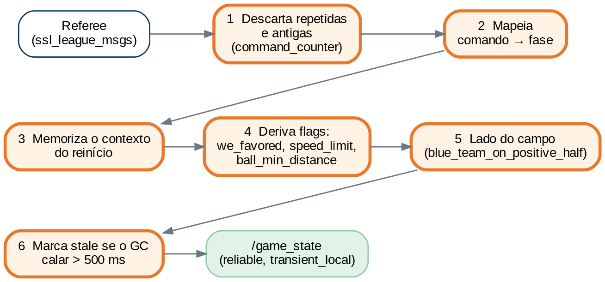

*Figura 15.1 — Os seis passos que transformam um Referee em um GameState*

### 15.3.1 1. Descartar repetições e mensagens antigas

O GC publica o mesmo comando várias vezes por segundo. O nó só processa uma mensagem quando o `command_counter` **avança**; mensagens com contador igual ou menor são ignoradas. Isso impede que uma mensagem atrasada ou duplicada sobrescreva um estado mais novo.

### 15.3.2 2. Mapear o comando para a fase

O mapeamento está na Figura 15.2:

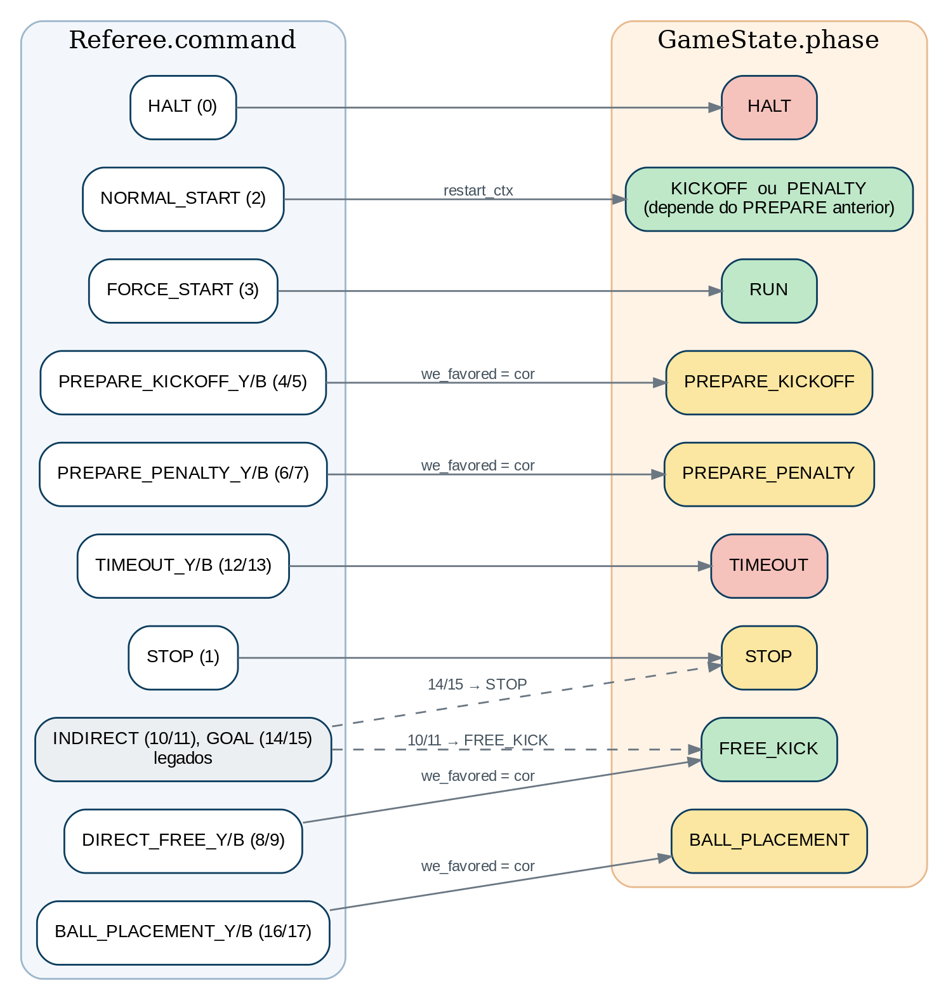

*Figura 15.2 — Como cada comando do árbitro é traduzido para uma fase do jogo*

Os comandos legados (`INDIRECT_FREE` 10/11 e `GOAL` 14/15) são normalizados: os primeiros viram `FREE_KICK`; os segundos, `STOP`.

### 15.3.3 3. Lembrar o contexto do reinício

Este é o passo que resolve o `NORMAL_START`. O nó mantém uma pequena memória:

- ao receber `PREPARE_KICKOFF_*`, guarda `restart_ctx = KICKOFF` e `we_favored` conforme a cor;
- ao receber `PREPARE_PENALTY_*`, guarda `restart_ctx = PENALTY`;
- ao receber `NORMAL_START`, a fase vira `KICKOFF` ou `PENALTY` conforme o contexto guardado, e `we_favored` é herdado;
- ao receber `HALT` ou `STOP`, o contexto **não** é apagado (o HALT é sempre seguido de STOP, e depois pode vir o `NORMAL_START` que o árbitro tinha preparado). O contexto só é substituído por um novo `PREPARE_*`, `DIRECT_FREE` ou `FORCE_START`.

A mensagem do GC também traz o campo `next_command`, que informa o comando que virá depois da parada atual. Ele pode ser usado, no futuro, para pré-posicionar os robôs durante o STOP.

### 15.3.4 4. Derivar as flags

Com a fase e a cor, o nó calcula os campos derivados:

- **`we_favored`**: o sufixo do comando (`_YELLOW`/`_BLUE`) comparado com a cor do nosso time.
- **`speed_limit_mps`**: 0 em `HALT` e `TIMEOUT`; **0,75** nos estados de parada (`STOP`, `BALL_PLACEMENT`, `PREPARE_*`); 1,5 nos estados de jogo (o limite do regulamento). A escolha de aplicar 0,75 também às preparações é conservadora e configurável.
- **`ball_min_distance_mm`**: 500 em `STOP`, `BALL_PLACEMENT`, `PREPARE_*` e, para quem não é o favorecido, em `KICKOFF` e `FREE_KICK`.
- **`can_place_ball`, `max_allowed_bots`, `our_goalkeeper_id`**: copiados de `TeamInfo` do nosso time.

### 15.3.5 5. Resolver o lado do campo

O nó lê `blue_team_on_positive_half` do `Referee` e, com a nossa cor, calcula `our_goal_positive_x`. É isso que permite ao time **trocar de lado entre os tempos** sem nenhuma outra mudança. (O que a estratégia faz com esse valor está no Capítulo 20.)

### 15.3.6 6. Marcar o estado como velho

Um temporizador de 100 ms verifica há quanto tempo chegou a última mensagem. Se passou de 500 ms, o `GameState` é republicado com `stale = true`. Quem consome (a condição `IsDataFresh`, o SafetyGate) trata esse caso como falha de comunicação.

## 15.4 Quando o jogo volta a "correr"

Os estados `KICKOFF` e `FREE_KICK` terminam quando a bola entra em jogo: ela se move pelo menos 0,05 m **ou** passam 10 s (regra 5.4). O nó precisa decidir quando emitir a fase `RUN`. Há duas fontes possíveis: (a) o **próprio Game Controller**, se ele mudar o comando ao detectar a bola em jogo; (b) o **cálculo local**, comparando a posição da bola (entrada `ball_data`) com a posição de partida do reinício.

!!! warning "Uma pergunta que o regulamento não responde"
    O regulamento descreve o *estado* `Run`, mas não diz **qual valor** do campo `command` o Game Controller publica durante ele (se o `DIRECT_FREE` permanece, se vira `NORMAL_START`, ou outro). Por isso o nó implementa a opção (b), parametrizável, e o plano de implementação (Capítulo 24) começa com a **captura de um log real do GC** (a ferramenta `log2bag` do `ssl_ros_bridge` converte logs da liga em *rosbags*) para confirmar o comportamento.

## 15.5 Um exemplo: um pênalti a nosso favor

A tabela mostra o que o nó publica a cada comando recebido, num pênalti a favor do time amarelo, visto pelo nosso time (amarelo):

| Comando recebido | `phase` | `restart_ctx` | `we_favored` | `speed_limit` |
|---|---|---|---|---|
| `HALT` | `HALT` | — | — | 0 |
| `STOP` | `STOP` | — | — | 0,75 |
| `PREPARE_PENALTY_YELLOW` | `PREPARE_PENALTY` | `PENALTY` | **sim** | 0,75 |
| `NORMAL_START` | `PENALTY` | `PENALTY` | **sim** | 1,5 |
| (bola move ≥ 0,05 m, ou 10 s) | `STOP` (o GC pára o jogo) ou `RUN` | — | — | — |

Compare com o sistema atual: ali, o `NORMAL_START` apagava a informação de que era um pênalti nosso.

## 15.6 Configuração e testes

Parâmetros do nó: `is_yellow_team` (a cor), `stale_timeout_ms` (500), `ball_moved_mm` (50), `kick_timeout_s` (10), `stop_speed_mps` (0,75) e `play_speed_mps` (1,5). Por ser um nó pequeno e sem dependência de hardware, ele é a primeira peça a receber testes automatizados: uma tabela de comandos de entrada e fases de saída, mais *replays* de logs reais do GC (Capítulo 23).
# Capítulo 16 — A Master Tree v2

Com o `GameState` em mãos, a árvore mestre pode ser reescrita de forma limpa: **um ramo por fase do jogo**, em ordem de prioridade, sem números mágicos e sem comandos "esquecidos". Este capítulo apresenta a estrutura, justifica as escolhas de nós e acompanha a árvore em ação ao longo de uma sequência de fases.

## 16.1 A estrutura

A raiz da `MainTreeEL` é um `ReactiveFallback` com doze filhos, mostrados na Figura 16.1. Cada ramo (exceto o último) é uma `ReactiveSequence` composta de uma **guarda** (a condição `phase == ...`) e de uma **subárvore** com o comportamento daquela fase.

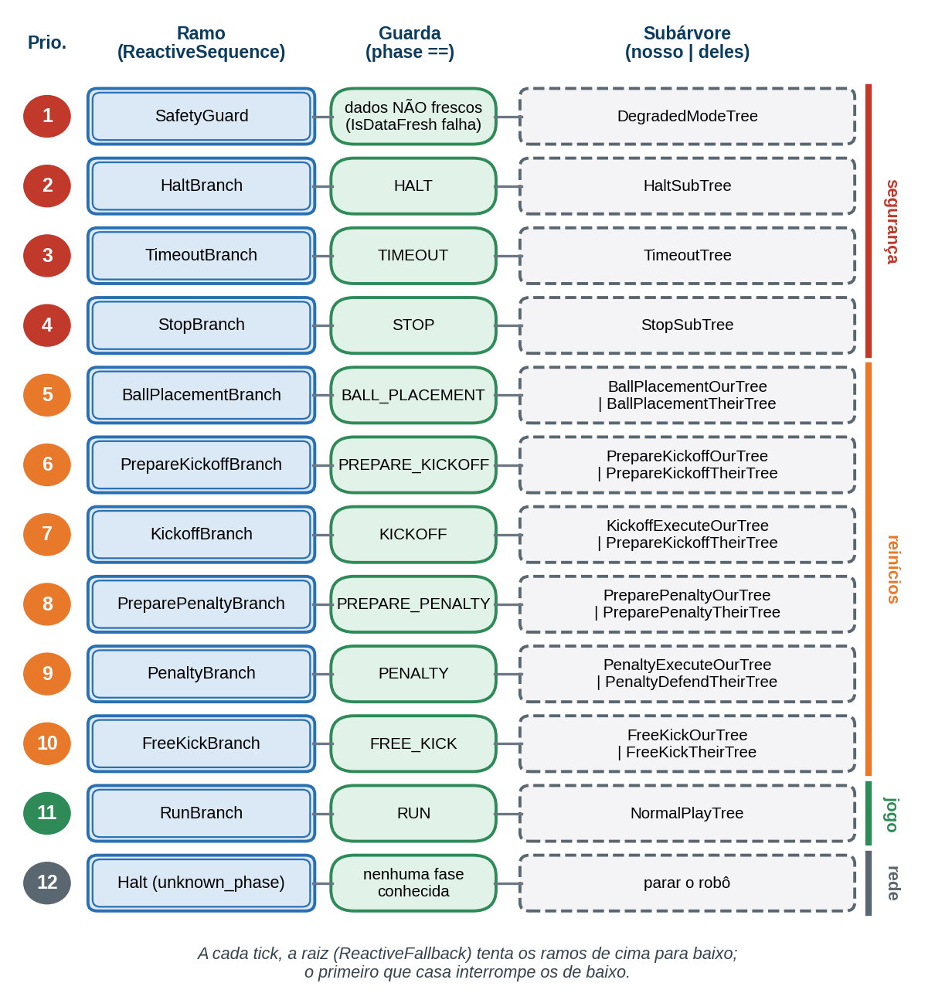

*Figura 16.1 — A Master Tree v2: um ramo por fase, em ordem de prioridade*

| # | Ramo | Guarda | Comportamento |
|---|---|---|---|
| 1 | `SafetyGuard` | os dados **não** estão frescos (`Inverter(IsDataFresh)`) | `DegradedModeTree`: parar |
| 2 | `HaltBranch` | `phase == HALT` | `HaltSubTree` |
| 3 | `TimeoutBranch` | `phase == TIMEOUT` | `TimeoutTree` |
| 4 | `StopBranch` | `phase == STOP` | `StopSubTree` |
| 5 | `BallPlacementBranch` | `phase == BALL_PLACEMENT` | nosso: `BallPlacementOurTree`; deles: `BallPlacementTheirTree` |
| 6 | `PrepareKickoffBranch` | `phase == PREPARE_KICKOFF` | nosso/deles |
| 7 | `KickoffBranch` | `phase == KICKOFF` | nosso: executa; deles: espera |
| 8 | `PreparePenaltyBranch` | `phase == PREPARE_PENALTY` | nosso/deles |
| 9 | `PenaltyBranch` | `phase == PENALTY` | nosso: executa; deles: defende |
| 10 | `FreeKickBranch` | `phase == FREE_KICK` | nosso/deles (inclui lateral, escanteio e tiro de meta) |
| 11 | `RunBranch` | `phase == RUN` | `NormalPlayTree` |
| 12 | `Halt (unknown_phase)` | — | parar |

A ordem não é arbitrária. Os ramos 1 a 4 formam o **bloco de segurança**: se qualquer um se aplica, nada abaixo executa. Os ramos 5 a 10 tratam os **reinícios**, e o ramo 11 é o jogo propriamente dito. O ramo 12 é a **rede de segurança**: se nenhuma fase conhecida casa, o robô **pára** — o oposto do comportamento atual, em que o "default" é jogar.

## 16.2 "Nosso" ou "deles": o padrão do favorecido

Quase todo reinício tem dois lados: o time que **bate** e o time que **defende**. A árvore trata essa dicotomia com um padrão repetido em cada ramo de reinício:

```xml
<ReactiveSequence name="FreeKickBranch">
  <CheckGameState phase="FREE_KICK"/>
  <ReactiveFallback>
    <ReactiveSequence>
      <WeAreFavored/>
      <SubTree ID="FreeKickOurTree" _autoremap="true"/>
    </ReactiveSequence>
    <SubTree ID="FreeKickTheirTree" _autoremap="true"/>
  </ReactiveFallback>
</ReactiveSequence>
```

Lê-se: *"se a fase é FREE_KICK: se somos o favorecido, execute a árvore de quem bate; senão, a de quem defende."* A cor do time **não aparece** em nenhum ramo: ela já foi resolvida pelo `referee_state_node` em `we_favored`. Este é o fim da série de condições `is_yellow ∧ cmd == 4 ∨ ¬is_yellow ∧ cmd == 5` do mestre atual.

Um detalhe elegante: se a subárvore "nossa" **falhar** (por exemplo, um posicionamento de bola que estoura o prazo), a `ReactiveFallback` cai para a subárvore "deles", que é um comportamento seguro de retirada.

## 16.3 Por que as guardas são `ReactiveSequence`

Este é o ponto de projeto mais sutil, e vale um exemplo. Suponha que a guarda do ramo `KickoffBranch` fosse uma `Sequence` comum. Durante um kick-off, o filho `KickoffExecuteOurTree` está em andamento (RUNNING). Quando o jogo passa para `RUN`, o `ReactiveFallback` raiz tenta primeiro os ramos de cima; chega ao `KickoffBranch` e o ticka. Mas a `Sequence` **lembra** que estava no segundo filho e retoma diretamente nele — **sem reavaliar** a guarda `phase == KICKOFF`, que agora seria falsa. O robô continuaria executando o kick-off por um tick a mais do que deveria.

Com uma `ReactiveSequence`, a guarda é reavaliada a cada tick; no instante em que a fase muda, ela falha, a subárvore é interrompida (`halt`) e o fallback passa ao ramo seguinte. É por isso que **toda guarda de ramo** é reativa, sem exceção.

!!! note "O mestre atual já escapa disso, por outro motivo"
    No mestre atual, os ramos usam `Sequence` comum, mas funcionam porque o `ReactiveFallback` raiz reavalia os ramos de *maior prioridade* a cada tick (o HALT é sempre reavaliado). O que **não** é reavaliado é a guarda do **próprio** ramo em andamento. Para a arquitetura de jogo completo, com guardas por fase, a regra "guarda reativa" elimina essa classe de problemas.

## 16.4 A árvore ao longo de uma sequência de fases

A Figura 16.2 acompanha o ramo ativo da Master em uma sequência típica: o jogo corre, o árbitro manda parar, prepara um kick-off nosso, autoriza a jogada e o jogo volta a correr.

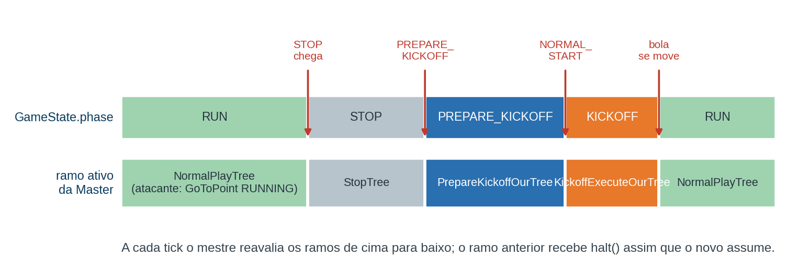

*Figura 16.2 — A fase do jogo (em cima) e o ramo ativo da Master (embaixo) ao longo de uma sequência de comandos*

O que acontece, em cada transição:

1. **`RUN → STOP`.** O atacante está com um `GoToPoint` em andamento. No tick seguinte à mudança de fase, o ramo `StopBranch` (prioridade 4) casa antes do `RunBranch` (11): `NormalPlayTree` é interrompida, o `GoToPoint` recebe `onHalted` (que publica "fique onde está") e a `StopTree` assume, limitando a velocidade e afastando o robô da bola.
2. **`STOP → PREPARE_KICKOFF`.** O ramo 6 casa. Como `we_favored` é verdadeiro, vale `PrepareKickoffOurTree`: o cobrador vai para o círculo central; os outros, para a própria metade.
3. **`PREPARE_KICKOFF → KICKOFF`** (chegou o `NORMAL_START`). O `referee_state_node` lembrou que era kick-off nosso, então a fase é `KICKOFF` com `we_favored`. O cobrador executa `KickOnce`.
4. **`KICKOFF → RUN`** (a bola se moveu). A fase vira `RUN`, o ramo 11 assume, e os papéis normais voltam.

Em nenhum momento a árvore precisou "saber" o histórico: o `GameState` carrega todo o contexto necessário.

## 16.5 Efeitos colaterais e *starvation*

Dois cuidados acompanham o uso de `ReactiveFallback` na raiz:

- **Reticks de folhas síncronas.** Como os ramos de cima são reavaliados a cada tick, as folhas síncronas que eles contêm são reexecutadas 60 vezes por segundo. A ação `Halt`, por exemplo, reenvia o override de parada a cada tick — o que é **necessário** (o override expira em 200 ms) e inofensivo. Folhas com efeito colateral custoso não devem ficar em ramos reativos de alta prioridade.
- ***Starvation***. Um ramo de alta prioridade que devolve SUCCESS **sempre** impede que os de baixo executem. É o comportamento desejado para `HaltBranch` (só casa em HALT), mas seria um erro em um ramo cuja guarda fosse sempre verdadeira.

## 16.6 Três trajetórias de verificação

Para checar o projeto, é útil "executar" mentalmente a árvore em trajetórias completas:

**Trajetória 1 — partida começa e termina em parada.** Sem GC ainda: `IsDataFresh` falha (o `GameState` é `stale` ou inexistente) → `DegradedModeTree` → robôs parados. Chega o primeiro `STOP`: ramo 4. `PREPARE_KICKOFF` nosso → cobrador no círculo. `NORMAL_START` → `KICKOFF` → o cobrador toca a bola. A bola se move → `RUN` → ataque. Chega um `STOP` com o atacante em movimento → `StopTree`. Chega um `HALT` → `HaltTree`: velocidade zero.

**Trajetória 2 — perda de posse e troca de papéis.** Em `RUN`, o adversário rouba a bola. O atribuidor publica novos papéis (`epoch + 1`): o atacante vira defensor. No tick seguinte, `HasRole(attacker)` falha no ramo do atacante, que é interrompido; `HasRole(defender)` casa e a `DefenderTree` assume com `ShadowBall`/`MarkOpponent`. O novo `GoToPoint` ou `ShadowBall` publica um alvo no mesmo tick.

**Trajetória 3 — dado velho com uma ação em andamento.** O atacante está com `GoToPoint` em andamento; a visão cai. `IsDataFresh` passa a falhar (a idade da pose supera 150 ms): o ramo 1 assume e o robô pára. Se a própria árvore estiver travada, o **SafetyGate** do controlador zera os comandos por *watchdog* em até 500 ms. Quando os dados voltam, o ramo 1 deixa de casar, e os ramos de baixo recomeçam (o `onStart` de cada folha recalcula o alvo).

As três trajetórias são sustentadas pela arquitetura; a primeira e a segunda dependem apenas de o `GameState` estar correto, e a terceira, do carimbo de tempo nos dados (Capítulo 20).
# Capítulo 17 — Segurança e parada

Os quatro primeiros ramos da Master Tree formam o **bloco de segurança**: dados confiáveis, HALT, TIMEOUT e STOP. Este capítulo descreve cada um, e também o **SafetyGate**, o mecanismo que garante a segurança *mesmo quando a árvore falha*.

## 17.1 O princípio: segurança em duas camadas

Uma árvore reativa é uma boa defesa — mas depende de que o processo da árvore esteja vivo, ticando e correto. Se o `strategy_node` travar, entrar em *crash* ou ficar preso esperando algo, a árvore **não consegue** mandar o robô parar, e o controlador (como visto no Capítulo 13) continuaria seguindo a última rota. Por isso a segurança é construída em **duas camadas independentes**:

1. **Na árvore**: o ramo `SafetyGuard` e os ramos de HALT/STOP preemptam qualquer comportamento.
2. **No controlador**: o *SafetyGate* aplica limites e zera os comandos por conta própria, usando o `GameState` e um relógio local.

## 17.2 O SafetyGuard e o modo degradado

O primeiro ramo da Master verifica se os dados ainda são confiáveis. A guarda é `Inverter(IsDataFresh)`: o ramo casa **quando os dados não estão frescos**. A condição `IsDataFresh` compara três idades, mantidas na blackboard:

| Dado | Limite padrão | Fonte da idade |
|---|---|---|
| Mensagem do Game Controller (`gc_age_ms`) | 500 ms | carimbo do `GameState` / flag `stale` |
| Pose do próprio robô (`pose_age_ms`) | 150 ms | carimbo de `GameData` |
| Bola (`ball_age_ms`) | 300 ms | carimbo de `GameData` |

(Os limites são propostas iniciais, a calibrar em simulação: a visão chega a cerca de 60 Hz, ou seja, um período de ~17 ms.) Se qualquer idade ultrapassar o limite, `IsDataFresh` devolve FAILURE, o `Inverter` o transforma em SUCCESS, e o ramo executa a `DegradedModeTree`, que contém apenas a ação `Halt` com o motivo `stale_data`.

```xml
<BehaviorTree ID="DegradedModeTree">
  <Halt reason="stale_data"/>
</BehaviorTree>
```

Quando os dados voltam, o ramo deixa de casar e os de baixo recomeçam do `onStart`: cada folha recalcula o alvo com os dados novos. Nenhum estado velho é "retomado".

## 17.3 HALT e TIMEOUT

Os ramos de HALT e TIMEOUT são os mais simples possíveis: uma guarda de fase e a ação `Halt`.

- **`HaltSubTree`** (já existente): `Halt` com o motivo `gc_halt`. A cada tick, a ação publica `MODE_HALT` ao controlador, que zera as velocidades. O regulamento dá 2 s de tolerância para frear; a meta do projeto é parar em menos de 300 ms.
- **`TimeoutTree`** (nova): `Halt` com o motivo `timeout`. Durante o timeout, as equipes podem mexer no hardware; o software só precisa manter o robô quieto.

O fato de serem triviais é proposital: o caminho do HALT precisa ser o mais curto e o menos propenso a falhas de todo o sistema.

## 17.4 STOP

O STOP é o estado mais frequente em uma partida e o que exige mais cuidado. Pelo regulamento, em STOP o robô deve: andar a **menos de 0,75 m/s**, ficar a **pelo menos 0,5 m da bola**, **não tocar a bola** e, ainda, ficar a **0,2 m da área de defesa adversária** (para evitar uma falta de proximidade). A `StopSubTree` proposta (Figura 17.1) implementa isso:


*Figura 17.1 — A StopSubTree proposta*

```xml
<BehaviorTree ID="StopSubTree">
  <ReactiveSequence name="StopLogic">
    <SetMotionLimit limit_mps="0.75"/>
    <ReactiveFallback name="StopAction">
      <ReactiveSequence name="RetreatIfClose">
        <IsBallClose robot_id="{robot_id}" distance_threshold="650.0"/>
        <ComputeLegalSlot slot="retreat" index="0"
                          slot_x="{slot_x}" slot_y="{slot_y}" slot_w="{slot_w}"/>
        <GoToPoint robot_id="{robot_id}" x="{slot_x}" y="{slot_y}"
                   face_x="{ball_x}" face_y="{ball_y}" tolerance="80.0"/>
      </ReactiveSequence>
      <HoldPosition robot_id="{robot_id}"/>
    </ReactiveFallback>
  </ReactiveSequence>
</BehaviorTree>
```

Lendo a árvore:

1. **`SetMotionLimit 0.75`** informa ao SafetyGate o teto de velocidade desta fase (redundante com o `GameState`, mas explícito).
2. **`RetreatIfClose`**: se a bola está a menos de 650 mm (os 500 mm do regulamento mais uma margem de 150 mm), calcula um **ponto legal de recuo** (`ComputeLegalSlot` com o slot `retreat`: um ponto sobre a reta bola→robô, a 650 mm da bola, dentro do campo e fora das áreas) e vai até ele olhando para a bola.
3. **`HoldPosition`**: se já está longe da bola, **fica onde está** — publica um objetivo na própria pose.

O resultado é um robô que se afasta da bola só quando necessário e, o resto do tempo, está parado; e que **nunca** devolve FAILURE por falta de uma porta.

!!! note "E o goleiro?"
    O goleiro usa a mesma `StopSubTree`. O ponto de recuo, para ele, é limitado à própria área (como em qualquer `GoToPoint` do goleiro): se a bola está perto da meta, o goleiro recua para dentro da área mantendo, quando possível, 0,5 m da bola.

## 17.5 O SafetyGate

O SafetyGate é um estágio no final do `movement_calculation_node`, **depois** de todo o cálculo de velocidade (seguimento de rota, repulsão, clamp de área) e **antes** de publicar em `/robot_commands` (Figura 17.2).


*Figura 17.2 — O SafetyGate: quatro verificações independentes sobre o comando final*

Ele aplica quatro regras, todas independentes da árvore:

1. **HALT zera a velocidade.** Se o `GameState` indica `HALT` (ou `TIMEOUT`), o comando é zero, mesmo que um override ou uma rota digam o contrário.
2. **Teto de velocidade por fase.** O módulo do vetor (vx, vy) é limitado a `speed_limit_mps` do `GameState`: 0,75 m/s nos estados de parada, 1,5 m/s no jogo. É este mecanismo que supre a lacuna do limite de STOP.
3. ***Watchdog***. Se o controlador não recebe um objetivo ou um override há mais de 500 ms, zera os comandos e informa `MODE_HALT` no status. Ao contrário do comportamento atual (continuar na última rota), uma árvore silenciosa **pára o robô**.
4. **Limite do chute.** `kick_speed` é limitado a 3,0 m/s para qualquer origem, inclusive folhas legadas que esqueçam de limitar.

As regras 1 e 3 usam apenas informações locais ao controlador (o último `GameState` recebido e um relógio), de modo que funcionam mesmo se o `strategy_node` não existir mais.

!!! warning "Coerência com o override de 200 ms"
    O override de parada (`MODE_HALT`) já expira em 200 ms. Com o watchdog de 500 ms, a ordem é: se a árvore continua renovando o override, o robô fica parado; se pára de renová-lo, o override expira, o controlador volta a seguir a rota **por até 300 ms** e então o watchdog zera tudo. Para eliminar essa janela, o plano de implementação propõe fazer o `MODE_HALT` **não** expirar por TTL, mas apenas ser liberado explicitamente (ou pelo watchdog).

## 17.6 As folhas deste capítulo

| Folha | Tipo | Resumo |
|---|---|---|
| `IsDataFresh` | condição | falha se alguma idade (GC, pose, bola) ultrapassa o limite |
| `CheckGameState` | condição | verdadeira se a fase da blackboard é a pedida |
| `SetMotionLimit` | ação síncrona | informa o teto de velocidade ao SafetyGate |
| `HoldPosition` | ação assíncrona | publica a pose atual como objetivo; fica em RUNNING |
| `ComputeLegalSlot` | ação síncrona | calcula um ponto legal para um "slot" nomeado |

Seus contratos completos estão no Capítulo 21.
# Capítulo 18 — Reinícios: kick-off, pênalti, free kick e ball placement

Os reinícios são onde as regras mais pesam e onde uma pequena imprecisão vira falta. Este capítulo detalha as subárvores dos ramos 5 a 10 da Master: para cada situação, os dois papéis (quem bate e quem defende), as posições exigidas e como a árvore as obtém.

## 18.1 Posições legais sem coordenadas literais

O problema central dos reinícios atuais é o das coordenadas fixas (Capítulo 13). A solução proposta é uma folha que **calcula** a posição de cada robô a partir da geometria do campo, do lado e da bola: `ComputeLegalSlot`.

A folha recebe o nome de um **slot** (uma "vaga" tática) e devolve a posição (`slot_x`, `slot_y`) e a orientação (`slot_w`) para ele. Todos os cálculos usam `own_goal_x` e `side_sign` da blackboard, de modo que **o mesmo slot vale para os dois lados do campo** (Figura 18.1).


*Figura 18.1 — Os mesmos slots para um time que defende a esquerda (acima) e a direita (abaixo)*

| Slot | Onde fica | Regra que cumpre |
|---|---|---|
| `kickoff_kicker` | dentro do círculo central, atrás da bola, voltado ao gol adversário | só o cobrador pode estar no círculo |
| `kickoff_def` | na **própria metade**, fora do círculo (≥ 500 mm do centro, além da margem), alinhado conforme o `index` do robô | todos na própria metade, fora do círculo |
| `penalty_kicker` | atrás da bola, na linha bola–gol adversário | atacante se aproxima sem tocar |
| `penalty_behind` | **≥ 1 m atrás da bola** (com margem), fora da área de defesa | demais robôs afastados |
| `freekick_support` | posição de apoio longe da bola e **≥ 0,2 m da área adversária** | proximidade da área |
| `wall` | linha de defesa entre a bola e o gol, **≥ 0,5 m da bola** | distância no free kick adversário |
| `retreat` | ponto a 650 mm da bola, na reta bola→robô | distância no STOP |

Todos os slots passam por um *filtro final*: se o ponto calculado cai dentro de uma área proibida (a área de defesa para quem não é goleiro, a adversária para todos), é deslocado para o ponto válido mais próximo, com uma margem configurável (`slot_margin_mm`, padrão 150).

## 18.2 Kick-off

### 18.2.1 Preparação (`PREPARE_KICKOFF`)

As duas versões da preparação são parecidas: o goleiro fica na meta; os outros se posicionam na própria metade, fora do círculo central. A diferença é que, **no nosso kick-off**, um robô — o cobrador, indicado pelo atribuidor de papéis (`kicker_id`) — fica **dentro do círculo**, atrás da bola.


*Figura 18.2 — PrepareKickoffOurTree: goleiro, cobrador e demais robôs*

A árvore é um `ReactiveFallback` de três ramos por papel (Figura 18.2): goleiro (`GoalkeeperTree`), cobrador (`ComputeLegalSlot` com `kickoff_kicker` e `GoToPoint` olhando para a bola) e o resto (`kickoff_def`). A versão `PrepareKickoffTheirTree` omite o cobrador. Ela também é usada **durante o kick-off do adversário** (fase `KICKOFF` sem `we_favored`): todos continuam na própria metade, fora do círculo, sem tocar a bola.

### 18.2.2 Execução (`KICKOFF`)

Quando o `NORMAL_START` chega, a fase vira `KICKOFF` e, se somos o favorecido, vale `KickoffExecuteOurTree`: o goleiro continua; o cobrador executa a subárvore `RestartKickerTree`; os outros **permanecem onde estão** (`HoldPosition`) até a bola entrar em jogo, para não violar a regra de que só o cobrador toca na bola.

## 18.3 O cobrador: RestartKickerTree e KickOnce

Os três reinícios em que o nosso time bate — kick-off, pênalti e free kick — compartilham a **mesma sequência de cobrança**, extraída como uma subárvore reutilizável, `RestartKickerTree` (Figura 18.3):


*Figura 18.3 — RestartKickerTree: ir ao pré-chute, olhar o alvo e chutar uma vez*

1. **`UpdateBallPosition`** calcula o ponto de pré-chute (400 mm atrás da bola, na reta bola→alvo), para o alvo configurado nas portas `target_x`/`target_y`.
2. **`GoToPoint`** leva o robô até lá, olhando para o alvo, com `ball_contact_threshold_mm=150` (se a bola for tocada no caminho, falha e recomeça).
3. **`KickOnce`** (nova) executa o chute: pede `MODE_KICK` com a velocidade limitada a 3 m/s, devolve SUCCESS quando a bola **se movimentou pelo menos 50 mm** e FAILURE se passar o prazo de 10 s do regulamento.

A diferença em relação a `KickBall` é que `KickOnce` confirma o **resultado** (a bola se moveu), não só a execução do chute, e carrega o prazo do regulamento.

## 18.4 Pênalti

O pênalti é o reinício com mais restrições e, por isso, tem quatro subárvores.

### 18.4.1 Nosso pênalti

- **`PreparePenaltyOurTree`**: o goleiro na meta; o cobrador no slot `penalty_kicker` (atrás da bola, **sem tocá-la**, olhando para o gol); os demais no slot `penalty_behind` (≥ 1 m atrás da bola).
- **`PenaltyExecuteOurTree`** (`phase == PENALTY`, `we_favored`): o cobrador executa `RestartKickerTree` apontando para o gol adversário; os demais **permanecem parados**. A bola só pode se mover em direção ao gol adversário, o que a cobrança direta ao gol respeita.

### 18.4.2 Pênalti do adversário

- **`PreparePenaltyTheirTree`**: o goleiro executa `PenaltyKeeperLine` (vai à **linha de gol e a toca**, 90 mm — o raio do robô — para dentro do campo); os demais vão ao slot `penalty_behind`.
- **`PenaltyDefendTheirTree`** (Figura 18.4): enquanto a bola **não** entrou em jogo, o goleiro **mantém a linha**; assim que `WaitBallInPlay` indica que a bola se moveu (ou passaram 10 s), o goleiro volta ao comportamento normal (`GoalkeeperTree`) — o regulamento libera o goleiro nesse momento. Os outros robôs seguem parados, ≥ 1 m atrás da bola.


*Figura 18.4 — PenaltyDefendTheirTree: linha de gol até a bola entrar em jogo, depois goleiro normal*

!!! note "Uma ligação importante com o goleiro"
    No pênalti defensivo, o goleiro **não** deve sair da linha para buscar a bola mesmo que ela entre "na área" — algo que o goleiro atual (Capítulo 10) faria. Por isso, as folhas `PenaltyKeeperLine` e `WaitBallInPlay` controlam o goleiro de modo explícito durante essa fase.

## 18.5 Free kick

Falta, lateral, escanteio e tiro de meta chegam todos como `DIRECT_FREE`, e a bola já está na posição designada. A árvore as trata uniformemente (Figura 18.5); ela **substitui** `free_kick.xml`, `corner_kick.xml`, `throw_in.xml` e `kick_in.xml`, que dependiam de flags nunca escritas.


*Figura 18.5 — FreeKickOurTree: goleiro, cobrador e apoio*

- **Goleiro**: comportamento normal.
- **Cobrador**: `RestartKickerTree`, com o alvo escolhido conforme a situação (por padrão, o gol adversário).
- **Apoio**: vai ao slot `freekick_support`, a ≥ 0,2 m da área adversária.

No free kick **do adversário** (`FreeKickTheirTree`), todos os robôs de linha vão ao slot `wall` (≥ 0,5 m da bola), formando uma barreira entre a bola e o gol, e o goleiro defende normalmente. A distância de 0,5 m deve ser mantida até a bola entrar em jogo; a folha `WaitBallInPlay` sinaliza esse momento.

## 18.6 Ball placement

O posicionamento da bola é uma tarefa de duas faces.

### 18.6.1 Do adversário (ou quando desistimos)

Quando o outro time posiciona a bola, nossos robôs só precisam **não atrapalhar**: ficar a ≥ 0,5 m do segmento entre a bola e o alvo (o "estádio" da Figura 2.3), com velocidade abaixo de 0,75 m/s. A `BallPlacementTheirTree` (Figura 18.6) usa `AvoidPlacementCorridor`: se o robô está dentro do corredor, move-se para fora; senão, fica parado.


*Figura 18.6 — BallPlacementTheirTree*

### 18.6.2 Do nosso time

Quando é a nossa vez de posicionar, `BallPlacementOurTree` (Figura 18.7) designa um robô (o `kicker`) para a tarefa: `ComputeLegalSlot`/`ComputePlacementApproach` calcula o ponto de captura atrás da bola (do lado oposto ao alvo), `GoToPoint` leva o robô até lá, e `PlaceBall` empurra a bola até a posição designada em até 30 s, devolvendo SUCCESS quando a bola está a ≤ 0,15 m do alvo e parada, e FAILURE no estouro do prazo (e, então, o GC passa o posicionamento ao adversário). Os outros robôs obedecem à `StopSubTree`.


*Figura 18.7 — BallPlacementOurTree*

!!! tip "Opção de escopo"
    Na SSL-EL, um time pode **optar por não posicionar a bola** pelo resto do jogo, avisando o árbitro. Implementar o posicionamento próprio é a parte mais trabalhosa e de menor retorno imediato. A recomendação é tratá-lo como **pós-MVP** e, no MVP, combinar com o árbitro o *opt-out*, mantendo apenas o comportamento de não interferir (`BallPlacementTheirTree`) para as duas situações.

## 18.7 A bola em jogo

Tanto `KickoffExecute`, `PenaltyDefend` quanto `FreeKick` precisam saber **quando a bola entrou em jogo**. A folha `WaitBallInPlay` encapsula a regra do regulamento (§5.4): verdadeira quando a bola se moveu pelo menos 50 mm desde o início do reinício **ou** passaram 10 s. Ela usa a posição de referência registrada quando a fase mudou. Como a fase `RUN` é emitida pelo `referee_state_node` com a mesma regra, `WaitBallInPlay` é útil para as folhas que precisam reagir *dentro* da fase (como o goleiro do pênalti).
# Capítulo 19 — O jogo corrido

Em `RUN` (que começa com um `FORCE_START` ou quando a bola entra em jogo depois de um reinício), a partida é jogada pelos três papéis. Este capítulo descreve a subárvore `NormalPlayTree`, as adaptações necessárias em cada papel e como o time se degrada quando perde robôs.

## 19.1 NormalPlayTree

A árvore (Figura 19.1) é um `ReactiveFallback` com um ramo por papel:


*Figura 19.1 — NormalPlayTree: um ramo por papel, mais uma rede de segurança*

```xml
<BehaviorTree ID="NormalPlayTree">
  <ReactiveFallback name="Roles">
    <ReactiveSequence name="GoalkeeperRole">
      <HasRole role="goalkeeper"/>
      <SubTree ID="GoalkeeperTree" _autoremap="true"/>
    </ReactiveSequence>
    <ReactiveSequence name="AttackerRole">
      <HasRole role="attacker"/>
      <SubTree ID="AttackerTree" _autoremap="true"/>
    </ReactiveSequence>
    <ReactiveSequence name="DefenderRole">
      <HasRole role="defender"/>
      <SubTree ID="DefenderTree" _autoremap="true"/>
    </ReactiveSequence>
    <Halt reason="idle"/>
  </ReactiveFallback>
</BehaviorTree>
```

Duas mudanças em relação ao mestre atual merecem atenção. Primeiro, a **identificação do papel** passa a ser feita por uma única condição, `HasRole`, que substitui as três verificações diferentes de hoje (`IsRobotId 0`, `IsMyRole attacker`, `IsMyRole defender`) e deixa de depender de um identificador fixo. Segundo, o último filho — `Halt idle` — significa que um robô **sem papel** (por exemplo, um robô extra, ou quando o atribuidor ainda não se manifestou) **fica parado**, em vez de ir fazer algo.

## 19.2 O atacante

A lógica do atacante (Capítulo 9) é reaproveitada integralmente, extraída para a subárvore `AttackerTree`. As mudanças são pequenas:

- **Sem `PrecisionKick`.** Todo chute passa por `KickBall` (ou `KickOnce`), ambos limitados a 3 m/s.
- **`ball_in_enemy_half` consciente do lado.** `UpdateBallPosition` deixa de usar `ball_x > 0` e passa a usar o `side_sign`.
- **Falha em vez de espera muda.** Sem dados, `UpdateBallPosition` e `CalculateInterception` devolvem FAILURE com log (hoje devolvem RUNNING), para que o problema apareça.

## 19.3 O defensor

A `DefenderTree` (Capítulo 10) também é mantida, com três ajustes:

- a verificação de papel passa a ser `HasRole defender`;
- `ShadowBall` e `MarkOpponent` ganham um `onHalted` que publica "fique onde está" (ou são encapsuladas em uma ação assíncrona), para que a preempção realmente pare o robô;
- a velocidade da bola passa a vir da **predição do Kalman** em vez da diferença finita, reduzindo o ruído do posicionamento.

## 19.4 O goleiro

A folha `Goalkeeper` recebe as mudanças mais substanciais, porque o regulamento coloca regras específicas sobre ele:

1. **Identidade vinda do árbitro.** O goleiro é o robô cujo identificador o Game Controller informa (`TeamInfo.goalkeeper`, também em `GameState.our_goalkeeper_id`), e não mais o robô 0. Se esse identificador não corresponde a nenhum robô ativo, **não há goleiro**, e o defensor **não** pode ocupar a área (regra: só o goleiro pode estar na própria área).
2. **Um parâmetro de modo.** A folha ganha a porta `mode` (`normal`, `penalty_def`, `hold`). `penalty_def` mantém a linha de gol (Capítulo 18).
3. **Limite de 10 s com a bola.** Uma condição `BallHeldTimer` detecta a bola **parada dentro da área** por mais de 8 s (margem de 2 s sobre os 10 s do regulamento); ao disparar, o goleiro passa a priorizar o afastamento (o estado 1 do Capítulo 10, com maior urgência).
4. **Falhar em vez de esperar.** Se faltar dado por mais de 500 ms, devolve FAILURE (hoje, RUNNING mudo).

## 19.5 Degradação com menos robôs

O número de robôs em campo **muda** durante a partida: cartões amarelos e vermelhos reduzem o número permitido (a equipe tem 10 s para retirar o excedente), robôs podem ser retirados por defeito, e a visão pode "perder" um robô. O sistema precisa continuar coerente com 3, 2 ou 1 robôs (Figura 19.2).


*Figura 19.2 — Os papéis com 3, 2 e 1 robôs ativos*

| Robôs ativos | Papéis | Observação |
|---|---|---|
| 3 | goleiro, atacante, defensor | operação normal |
| 2 | goleiro + atacante | o atacante **recua** (assume uma postura defensiva) quando a bola está no nosso campo |
| 1 | goleiro | permanece na linha de gol |
| 2 (sem goleiro) | atacante + defensor | o defensor não entra na área; o time joga "sem goleiro" |

A lista de robôs ativos (`active_ids`) é calculada pelo atribuidor de papéis a partir de três fontes: o que a visão vê (com a idade dos dados), o `max_allowed_bots` do árbitro e, no futuro, as flags de erro da telemetria dos robôs. Quando o `max_allowed_bots` fica abaixo do número de robôs ativos, o atribuidor indica **qual** robô deve ser retirado e o mantém parado; a retirada física é feita por um humano da equipe (um dos poucos momentos em que o regulamento permite).

!!! note "Quando um robô é substituído"
    A substituição de robôs, em si (o *robot handler* entra no campo, retira ou coloca robôs) está fora do software. O que o software faz é **reagir**: o atribuidor atualiza `active_ids` e a árvore vê o papel mudar no tick seguinte.
# Capítulo 20 — Papéis, blackboard e contratos de dados

Este capítulo fecha o desenho da Parte IV tratando da "cola" entre os componentes: a mensagem de papéis ampliada, o novo esquema da blackboard, a validação da idade dos dados, o tratamento do lado do campo e um exemplo completo de ponta a ponta.

## 20.1 Papéis ampliados

A mensagem `RoleAssignment`, hoje com `attacker_id` e `defender_id`, passa a trazer o necessário para uma partida inteira:

| Campo | Significado |
|---|---|
| `goalkeeper_id` | identificador do goleiro (do `TeamInfo.goalkeeper` do GC, ou parâmetro; ausente se o robô não está ativo) |
| `attacker_id` | atacante em jogo corrido |
| `defender_id` | defensor em jogo corrido |
| `kicker_id` | quem **bate** o reinício em curso (kick-off, pênalti, free kick, ball placement) |
| `epoch` | inteiro crescente: aumenta a cada mudança de papéis |
| `active_ids[]` | robôs considerados ativos |

### 20.1.1 Cobrador travado

Para reinícios, o `role_assigner_node` escolhe o `kicker_id` pelo **menor custo até o ponto do reinício** (a bola, ou o ponto designado) e o **trava** enquanto a fase for de reinício (`PREPARE_*`, `KICKOFF`, `PENALTY`, `FREE_KICK`, `BALL_PLACEMENT`). A troca só é permitida quando a fase volta a `RUN` ou quando o robô travado deixa de estar ativo. Isso corrige a instabilidade atual, em que o atribuidor poderia trocar o atacante no meio da preparação do kick-off.

### 20.1.2 Época

O campo `epoch` permite que as árvores detectem **papéis velhos**: se a época que a árvore conhece é menor que a da mensagem, houve troca. Na prática, a troca de papéis já é refletida pela guarda `HasRole` (que é reavaliada a cada tick); a `epoch` serve para diagnóstico, registro e para folhas que precisem reiniciar estado interno quando o papel muda.

### 20.1.3 Histerese e exclusividade

As histereses atuais (custo 2,5; tempo 2 s) são **mantidas**, com uma exceção: são **desligadas** durante os reinícios (o cobrador é travado, como visto). A exclusividade — cada identificador tem exatamente um papel por época — é garantida pelo próprio atribuidor, que publica um conjunto coerente por mensagem.

## 20.2 A blackboard proposta

### 20.2.1 O que mudar

A blackboard atual é escrita por callbacks em outra *thread*, o que dá valores relacionados lidos em instantes diferentes (Capítulo 5). A proposta é fazer a atualização **em um único ponto**, na *thread* de tick, no início de cada tick: uma função `refresh()` copia de buffers (um por fonte de dados, preenchidos pelas callbacks sob *mutex*) para a blackboard, **de uma só vez**. Assim, durante um tick, todas as chaves são consistentes entre si.


*Figura 20.1 — Das fontes à blackboard e dela aos nós consumidores*

### 20.2.2 As chaves

| Chave | Tipo | Quem escreve | Quem lê | Validade |
|---|---|---|---|---|
| `phase`, `restart_ctx`, `we_favored` | enum, enum, bool | `refresh()` (de `/game_state`) | `CheckGameState`, `WeAreFavored` | `gc_age_ms` |
| `designated`, `has_designated` | `Pose2D`, bool | idem | árvores de reinício | idem |
| `speed_limit`, `can_place_ball` | double, bool | idem | `SetMotionLimit`, ball placement | idem |
| `own_goal_x`, `opp_goal_x`, `opp_goal_y`, `side_sign` | double, double, double, int | idem + geometria | quase todas | por geometria |
| `field_*`, `penalty_area_*`, `goal_width`, `center_circle_radius` | double (mm) | geometria | folhas de posição | por geometria |
| `role`, `kicker_id`, `role_epoch`, `active_ids` | enum, uint, uint, vetor | `refresh()` (de `/role_assignment`) | `HasRole` | por época |
| `robot_pose` | `Pose2D` | `refresh()` (de `/game_data`) | movimento | `pose_age_ms` |
| `ball`, `ball_vel` | `Pose2D`, `Vector2D` | `refresh()` (de `/game_data` e do Kalman) | defesa, ataque | `ball_age_ms` |
| `gc_age_ms`, `pose_age_ms`, `ball_age_ms` | double | `refresh()` | `IsDataFresh` | — |

As chaves **temporárias** de subárvore (`pkx`, `pky`, `int_*`, `slot_x`…) continuam com o escopo da subárvore e **não** são remapeadas com `_autoremap`, para não poluir a raiz.

### 20.2.3 Convenções

- Nomes em `snake_case`, com sufixo de unidade quando houver ambiguidade (`_ms`, `_mm`).
- Posições em **mm** e ângulos em **rad** na árvore; metros só no `RobotGoal`.
- Preferir **objetos compostos** (`ball` como `Pose2D`, `robot_pose`) a pares de chaves soltas (`ball_x`, `ball_y`), para evitar leituras parciais.

## 20.3 A idade dos dados

A idade é a base da supervisão de segurança. Ela depende de **carimbos de tempo** que hoje não existem:

- `GameData` ganha um `std_msgs/Header` e, para cada robô, o instante da última detecção;
- o `game_observer_node` passa a **expirar** robôs não vistos por alguns quadros (hoje, ficam para sempre) e a publicar **mesmo sem bola** (hoje, não publica);
- o `refresh()` calcula as idades: `pose_age_ms = agora − stamp da pose`, `ball_age_ms`, e `gc_age_ms` (a partir de `GameState.stale` e do seu carimbo).

A condição `IsDataFresh` apenas compara essas idades com os limites; a vigilância "pesada" (watchdog) fica no SafetyGate.

## 20.4 O lado do campo

O `referee_state_node` calcula `our_goal_positive_x` a partir de `blue_team_on_positive_half` e da nossa cor. O `refresh()` traduz isso em duas chaves:

- **`own_goal_x`** = `+L/2` se o nosso gol está em x positivo, `−L/2` caso contrário;
- **`side_sign`** = `+1` se defendemos o gol de x **negativo** (nossa metade é x < 0), `−1` caso contrário.

Com isso, qualquer posição "para o nosso lado do campo" é escrita como `side_sign × (valor positivo)`, e `ComputeLegalSlot` faz esse espelhamento internamente. Nenhum XML precisa conhecer o lado. Na troca de tempo, `blue_team_on_positive_half` inverte, `side_sign` muda de sinal, e todas as posições calculadas a partir daí são automaticamente as do lado novo.

!!! warning "`invert_sides` fica só para o simulador"
    O parâmetro `invert_sides` do observer espelha as **coordenadas** para o simulador Ra. Ele não deve influenciar a **cor** do time nem o **lado lógico** de defesa. Na proposta, `is_yellow` volta a significar apenas a cor real, e o lado lógico vem do árbitro.

## 20.5 Concorrência: como evitar leituras inconsistentes

Resumindo as regras de acesso aos dados:

1. Cada fonte (GC, visão, geometria, papéis) tem um **dono**, que a converte para o tipo interno.
2. As callbacks apenas **copiam** a última mensagem para um buffer protegido por *mutex*.
3. A cada tick, `refresh()` lê todos os buffers e atualiza a blackboard.
4. As folhas leem a blackboard; as folhas só escrevem chaves temporárias da própria subárvore.
5. Uma chave obrigatória ausente leva a FAILURE com log, nunca a um valor padrão silencioso.

## 20.6 Um exemplo de ponta a ponta

O exemplo abaixo percorre uma informação desde a rede até a ação, e a sua interrupção. Os nós `CheckGameState` e `ComputeLegalSlot` ainda não existem (são os nós novos); `GoToPoint` é código existente.

1. **A informação chega.** O Game Controller publica `Referee { command = STOP, command_counter = 57 }`.
2. **O estado é interpretado.** O `referee_state_node` aceita a mensagem (o contador avançou), mapeia `STOP → phase = STOP`, calcula `speed_limit = 0,75` e publica o `GameState`.
3. **O dado chega à árvore.** No início do tick seguinte, `refresh()` copia `phase = "STOP"` e `speed_limit = 0.75` para a blackboard.
4. **Uma condição escolhe o ramo.** `CheckGameState phase="STOP"` lê a chave e devolve SUCCESS; o ramo `StopBranch` torna-se ativo.
5. **Uma ação recebe parâmetros.** A `StopSubTree` calcula `slot_x`, `slot_y` com `ComputeLegalSlot` e passa ao `GoToPoint`: `x="{slot_x}" y="{slot_y}"`.
6. **A subárvore usa remapeamento.** `<SubTree ID="StopSubTree" _autoremap="true"/>` torna `ball_x`, `ball_y`, `robot_id` visíveis dentro dela.
7. **Um evento novo interrompe a ação.** Chega `FORCE_START`: a fase vira `RUN`. No tick seguinte, o `ReactiveFallback` raiz tenta primeiro os ramos de cima; `CheckGameState STOP` falha, o ramo de STOP é interrompido, e `GoToPoint::onHalted()` publica "fique onde está".
8. **O estado é registrado.** O nó de log escreve uma linha: `phase STOP → RUN (cmd_counter=58)`.
# Capítulo 21 — Catálogo dos nós novos e das adaptações

Este capítulo é a **especificação** dos componentes novos e das alterações em componentes existentes, em nível suficiente para serem implementados sem ambiguidade. Convenções: posições em mm e ângulos em rad; toda porta de entrada com valor sensato tem **padrão** (para evitar o erro do Capítulo 5); toda ação assíncrona tem `onHalted` idempotente; toda folha que depende de dados devolve FAILURE com log quando eles faltam.

## 21.1 Os 14 nós novos

### 21.1.1 Condições

**`CheckGameState`** — verdadeira se a fase da blackboard é a pedida.
- Porta `phase` (`string`, obrigatória): `HALT`, `TIMEOUT`, `STOP`, `BALL_PLACEMENT`, `PREPARE_KICKOFF`, `KICKOFF`, `PREPARE_PENALTY`, `PENALTY`, `FREE_KICK` ou `RUN`.
- Lê `phase` da blackboard raiz; se a chave não existe, devolve FAILURE com erro.

**`WeAreFavored`** — verdadeira se `we_favored` é verdadeiro. Sem portas.

**`IsDataFresh`** — verdadeira se todas as idades estão dentro dos limites.
- Portas: `max_gc_ms` (500), `max_pose_ms` (150), `max_ball_ms` (300), todas `double`.
- Lê `gc_age_ms`, `pose_age_ms`, `ball_age_ms`; registra qual dado venceu.

**`HasRole`** — verdadeira se o papel do robô na blackboard é o pedido.
- Porta `role` (`string`): `goalkeeper`, `attacker`, `defender` ou `kicker`.
- Substitui `IsMyRole` e `IsRobotId`.

**`BallHeldTimer`** — falha quando a bola está parada dentro da área por mais de `max_s`.
- Portas: `max_s` (`double`, 8), `area` (`string`, `"own_defense"`).
- Usa `ball`, `ball_vel` e a geometria; serve de gatilho para o goleiro afastar a bola.

**`WaitBallInPlay`** — verdadeira quando a bola se moveu `moved_mm` (50) desde o início do reinício **ou** passaram `timeout_s` (10).

### 21.1.2 Ações síncronas

**`ComputeLegalSlot`** — calcula a posição legal de um slot (Capítulo 18).
- Entradas: `slot` (`string`), `index` (`uint32`, 0).
- Saídas: `slot_x`, `slot_y`, `slot_w` (`double`).
- Parâmetro ROS: `slot_margin_mm` (150).
- Usa `own_goal_x`, `side_sign`, `ball`, `center_circle_radius`, `penalty_area_*`, `designated`, `robot_pose`.

**`ComputePlacementApproach`** — para o ball placement: calcula o ponto de captura (`pickup_x/y`), o de entrega (`drop_x/y`) e a orientação (`approach_w`) a partir da posição designada. Parâmetro: `pickup_offset_mm` (120).

**`SetMotionLimit`** — informa o teto de velocidade ao SafetyGate: porta `limit_mps` (`double`, 1,5), parâmetro `absolute_max_mps` (1,5). Publica em `/robot_motion_limit`.

### 21.1.3 Ações assíncronas

**`HoldPosition`** — mantém o robô onde está: publica `RobotGoal` na pose atual (`straight_line`, `disable_arrival_latch = true`) e fica em RUNNING. `onHalted` não publica nada.

**`PlaceBall`** — empurra a bola até a posição designada.
- Portas: `drop_x`, `drop_y` (`double`), `timeout_s` (30), `tolerance_mm` (150).
- RUNNING; SUCCESS quando a bola está a ≤ `tolerance_mm` do alvo, parada, e o robô a mais de 50 mm; FAILURE no estouro do prazo. `onHalted` solta o override e recua 100 mm.

**`PenaltyKeeperLine`** — leva o goleiro à linha de gol (a 90 mm dela, para dentro) e o mantém. Porta `side` (`string`, `"defend"`); parâmetro `line_offset_mm` (90). RUNNING até a bola entrar em jogo.

**`KickOnce`** — chuta uma vez e confirma o resultado.
- Portas: `robot_id` (`uint32`), `target_x`, `target_y` (`double`), `kick_speed` (2,5; limitado a 3,0), `timeout_s` (10), `ball_moved_mm` (50).
- Envia `MODE_KICK`; SUCCESS quando a bola se moveu `ball_moved_mm`; FAILURE no estouro do prazo. `onHalted` envia `MODE_NONE`.

**`AvoidPlacementCorridor`** — sai do corredor do posicionamento adversário: porta `margin_mm` (550). RUNNING enquanto precisa mover-se, SUCCESS quando já está fora.

## 21.2 As adaptações

| Alvo | O que muda | Por quê |
|---|---|---|
| **`GoToPoint`** | `onHalted` publica a pose atual; `robot_id` diferente da instância devolve FAILURE com erro (ou a porta é removida); robô ausente por mais de 500 ms → FAILURE; nova porta opcional `max_speed` | a preempção precisa parar o robô; erros de configuração não podem ser silenciosos |
| **`KeepDistance`** | `robot_x`/`robot_y` com padrão `{robot_x}`/`{robot_y}`; ou torná-la uma ação que publica o alvo de afastamento | corrige a falha de portas do STOP |
| **`PrecisionKick`** | aposentar (usar `KickOnce`) ou limitar a 3,0 m/s e passar pelo override | limite de chute; escritor único |
| **`Goalkeeper`** | portas `mode` e `max_hold_s`; identidade via `HasRole`; FAILURE sem dados | regras de pênalti e de 10 s |
| **`UpdateBallPosition`** | `ball_in_enemy_half` usa `side_sign`; FAILURE sem dados; marcadores opcionais | independência de lado |
| **`movement_calculation_node`** | SafetyGate: assina `/game_state` e `/robot_motion_limit`; watchdog de 500 ms; clamp de chute; `MODE_HALT` sem TTL | segurança independente da árvore |
| **`strategy_node`** | assina `/game_state` (remove `gc_callback`); `refresh()` por tick; remove papéis iniciais fixos; registra os novos nós; só carrega XMLs de produção | centralizar estado e consistência |
| **`role_assigner_node`** | mensagem ampliada; cobrador travado; goleiro do GC; robôs ativos | papéis conscientes da fase |
| **`game_observer_node` / `GameData`** | carimbo de tempo; expiração de robôs; publica sem bola; fusão com confiança | idade dos dados |

## 21.3 O novo nó ROS 2: referee_state_node

| Item | Especificação |
|---|---|
| Assina | `…/referee_messages` (`ssl_league_msgs/Referee`) e, para detectar a bola em jogo, `ball_data` |
| Publica | `/game_state` (`oxebots_interfaces/GameState`, confiável, `transient_local`) |
| Parâmetros | `is_yellow_team`, `stale_timeout_ms` (500), `ball_moved_mm` (50), `kick_timeout_s` (10), `stop_speed_mps` (0,75), `play_speed_mps` (1,5) |
| Lógica | descarte por `command_counter`; mapeamento comando→fase; contexto de reinício; flags; lado; marcação de `stale` (Capítulo 15) |

## 21.4 A mensagem GameState

```text
std_msgs/Header header
uint32  command_counter
uint8   command
uint8   phase              # HALT TIMEOUT STOP BALL_PLACEMENT PREPARE_KICKOFF
                           # KICKOFF PREPARE_PENALTY PENALTY FREE_KICK RUN
uint8   restart_ctx        # NONE KICKOFF PENALTY FREE_KICK FORCE
bool    we_favored
uint8   stage
bool    our_goal_positive_x
geometry_msgs/Point32 designated_position   # mm
bool    has_designated
float32 speed_limit_mps
float32 ball_min_distance_mm
bool    can_place_ball
uint8   max_allowed_bots
uint32  our_goalkeeper_id
bool    stale
```


---

# Parte V — Implementação

*Como criar uma nova folha, como validar o comportamento do time sem robôs e como dividir o trabalho nas quatro semanas até uma versão jogável.*

# Capítulo 22 — Tutorial: criando uma folha de árvore

Este capítulo guia a criação de uma folha completa, do zero ao XML e ao teste, usando como exemplo a ação **`HoldPosition`** do Capítulo 17 — simples, mas representativa: lê dados do mundo, publica um objetivo e precisa de um `onHalted` correto. O padrão segue o das folhas existentes, como `GoalLineDefendNode`.

!!! tip "Antes de começar"
    Compilar é com você: `./build.sh` no devcontainer. Os trechos abaixo são **exemplos esquemáticos** escritos com a API real da BehaviorTree.CPP 4.x e o padrão do projeto, mas ainda não estão no repositório.

## 22.1 Nó ROS 2 ou nó de árvore?

A confusão mais comum de quem chega é entre dois conceitos que têm "nó" no nome:

- **Nó ROS 2** (`rclcpp::Node`): um **processo** que publica e assina tópicos — `strategy_node`, `role_assigner_node`…
- **Nó de BT** (`BT::TreeNode`): um **objeto C++** dentro da árvore — `GoToPoint`, `Sequence`…

Um nó de BT *não* é um processo. No projeto, as folhas que precisam falar com o ROS 2 **recebem o `rclcpp::Node` do `strategy_node`** e criam seus publicadores e assinantes nele (Figura 22.1).


*Figura 22.1 — Nós de BT vivem dentro de um processo ROS 2 e usam o nó ROS dele*

## 22.2 Passo 1 — Definir o que a folha faz

Para `HoldPosition`: *"Ler a pose atual do robô em `/game_data`, publicar um `RobotGoal` nessa pose e ficar em RUNNING; ao ser interrompida, não fazer nada."*

Perguntas a responder antes de escrever código:

| Pergunta | Resposta para `HoldPosition` |
|---|---|
| Que dado preciso? | a pose do meu robô (`/game_data`) |
| Que comando produzo? | um `RobotGoal` (`/robot_goal`) |
| É síncrona ou assíncrona? | assíncrona (fica em RUNNING) |
| O que faço se faltarem dados? | FAILURE, com log |
| O que faço ao ser interrompida? | nada (idempotente) |

## 22.3 Passo 2 — O cabeçalho

`include/oxebots_strategy/hold_position_node.hpp`:

```cpp
#pragma once

#include <mutex>
#include "behaviortree_cpp/action_node.h"
#include "rclcpp/rclcpp.hpp"
#include "oxebots_interfaces/msg/game_data.hpp"
#include "oxebots_interfaces/msg/robot_goal.hpp"

namespace oxebots_strategy
{

class HoldPositionNode : public BT::StatefulActionNode
{
public:
  HoldPositionNode(const std::string& name, const BT::NodeConfig& config,
                   rclcpp::Node::SharedPtr node);

  static BT::PortsList providedPorts();

  BT::NodeStatus onStart() override;
  BT::NodeStatus onRunning() override;
  void onHalted() override;

private:
  void gameDataCallback(const oxebots_interfaces::msg::GameData::SharedPtr msg);
  bool publishHere();

  rclcpp::Node::SharedPtr node_;
  rclcpp::Publisher<oxebots_interfaces::msg::RobotGoal>::SharedPtr goal_pub_;
  rclcpp::Subscription<oxebots_interfaces::msg::GameData>::SharedPtr game_data_sub_;

  std::mutex mutex_;                                  // callback e tick rodam em threads diferentes
  oxebots_interfaces::msg::GameData::SharedPtr last_data_;
  unsigned int robot_id_{0};
};

}  // namespace oxebots_strategy
```

## 22.4 Passo 3 — A implementação

`src/hold_position_node.cpp`:

```cpp
#include "oxebots_strategy/hold_position_node.hpp"
#include <cmath>

namespace oxebots_strategy
{

HoldPositionNode::HoldPositionNode(const std::string& name, const BT::NodeConfig& config,
                                   rclcpp::Node::SharedPtr node)
  : BT::StatefulActionNode(name, config), node_(node)
{
  // Mesmo QoS das demais folhas de movimento: guarda o último objetivo.
  auto goal_qos = rclcpp::QoS(rclcpp::KeepLast(1)).transient_local().reliable();
  goal_pub_ = node_->create_publisher<oxebots_interfaces::msg::RobotGoal>("/robot_goal", goal_qos);
  game_data_sub_ = node_->create_subscription<oxebots_interfaces::msg::GameData>(
      "/game_data", 10,
      std::bind(&HoldPositionNode::gameDataCallback, this, std::placeholders::_1));
}

BT::PortsList HoldPositionNode::providedPorts()
{
  // O padrão "{robot_id}" lê a chave da blackboard quando o XML não passa a porta.
  return { BT::InputPort<unsigned int>("robot_id", "{robot_id}", "Id do robô") };
}

void HoldPositionNode::gameDataCallback(const oxebots_interfaces::msg::GameData::SharedPtr msg)
{
  std::lock_guard<std::mutex> lock(mutex_);
  last_data_ = msg;
}

bool HoldPositionNode::publishHere()
{
  oxebots_interfaces::msg::GameData::SharedPtr data;
  {
    std::lock_guard<std::mutex> lock(mutex_);
    data = last_data_;
  }
  if (!data) return false;

  for (const auto& ally : data->robots.allies) {
    if (ally.id != robot_id_) continue;

    auto goal = std::make_unique<oxebots_interfaces::msg::RobotGoal>();
    goal->robot_id = robot_id_;
    goal->pose.header.stamp = node_->now();
    goal->pose.header.frame_id = "map";
    goal->planner_type = oxebots_interfaces::msg::RobotGoal::PLANNER_STRAIGHT_LINE;
    goal->disable_arrival_latch = true;                       // nunca "trava" por chegada
    goal->pose.pose.position.x = ally.x / 1000.0;             // mm -> m
    goal->pose.pose.position.y = ally.y / 1000.0;
    goal->pose.pose.orientation.z = std::sin(ally.orientation * 0.5);
    goal->pose.pose.orientation.w = std::cos(ally.orientation * 0.5);
    goal_pub_->publish(std::move(goal));
    return true;
  }
  return false;
}

BT::NodeStatus HoldPositionNode::onStart()
{
  if (!getInput<unsigned int>("robot_id", robot_id_)) {
    RCLCPP_ERROR(node_->get_logger(), "HoldPosition: porta robot_id ausente");
    return BT::NodeStatus::FAILURE;                           // falhar alto, nunca em silêncio
  }
  if (!publishHere()) {
    RCLCPP_WARN_THROTTLE(node_->get_logger(), *node_->get_clock(), 2000,
                         "HoldPosition: sem pose do robô %u", robot_id_);
    return BT::NodeStatus::FAILURE;
  }
  return BT::NodeStatus::RUNNING;
}

BT::NodeStatus HoldPositionNode::onRunning()
{
  return BT::NodeStatus::RUNNING;   // o objetivo publicado continua valendo
}

void HoldPositionNode::onHalted()
{
  // Nada a limpar: não publicamos nenhum override. Idempotente por construção.
}

}  // namespace oxebots_strategy
```

Três decisões de projeto que valem comentário:

- **Falhar alto.** Sem `robot_id` ou sem pose, a folha devolve FAILURE com log; não fica em RUNNING "esperando".
- **Mutex.** A callback roda na *thread* do executor e `onStart` na do tick; o *mutex* evita corrida na troca do ponteiro.
- **`onHalted` vazio e seguro.** Como não há override a soltar, interromper é seguro. Se a folha pedisse um override (como `KickOnce`), o `onHalted` precisaria liberá-lo.

## 22.5 Passo 4 — Registrar na fábrica

Em `strategy_node.cpp`, junto aos demais registros:

```cpp
#include "oxebots_strategy/hold_position_node.hpp"
// ...
factory_.registerNodeType<oxebots_strategy::HoldPositionNode>("HoldPosition", shared_from_this());
```

O nome entre aspas (`"HoldPosition"`) é a **tag** que o XML usará.

## 22.6 Passo 5 — Incluir no build

No `CMakeLists.txt` de `oxebots_strategy`, acrescentar o `.cpp` à lista do executável (a lista começa na linha `add_executable(strategy_node ...)`):

```cmake
add_executable(
  strategy_node
  src/strategy_node.cpp
  ...
  src/hold_position_node.cpp        # <- novo
)
```

As dependências (`behaviortree_cpp`, `oxebots_interfaces`, `rclcpp`) já estão presentes. Como as folhas são compiladas dentro do executável, um `.cpp` esquecido nessa lista só aparece como erro de *link* na compilação.

## 22.7 Passo 6 — Usar no XML

```xml
<ReactiveFallback name="StopAction">
  <!-- ... recuar se estiver perto da bola ... -->
  <HoldPosition robot_id="{robot_id}"/>
</ReactiveFallback>
```

Como a porta tem padrão `{robot_id}`, o atributo poderia ser omitido: `<HoldPosition/>`.

## 22.8 Passo 7 — Testar

Um teste unitário não precisa de robôs: basta uma fábrica e uma mensagem simulada.

```cpp
TEST(HoldPosition, PublishesCurrentPoseAndStaysRunning) {
  rclcpp::init(0, nullptr);
  auto ros = std::make_shared<rclcpp::Node>("test_node");
  BT::BehaviorTreeFactory factory;
  factory.registerNodeType<oxebots_strategy::HoldPositionNode>("HoldPosition", ros);

  auto bb = BT::Blackboard::create();
  bb->set("robot_id", 1u);
  auto tree = factory.createTreeFromText(
      R"(<root BTCPP_format="4"><BehaviorTree ID="T"><HoldPosition/></BehaviorTree></root>)", bb);

  // publica um GameData com o robô 1 em (500, -200) e processa as callbacks...
  EXPECT_EQ(tree.tickOnce(), BT::NodeStatus::RUNNING);
  // verifica que /robot_goal recebeu x = 0.5, y = -0.2
  tree.haltTree();                  // deve ser seguro chamar mais de uma vez
  tree.haltTree();
}
```

O padrão (criar fábrica, registrar, criar árvore a partir de texto, ticar, `haltTree`) vale para qualquer folha. Também é útil: `ros2 topic echo /robot_goal` em simulação e o Groot2 na porta do robô.

## 22.9 Passo 8 — Simular e documentar

Com o sistema rodando em simulação (`ros2 launch oxebots_bringup ssl-new.launch.py bt_xml:=<arquivo>.xml`), verifique no Groot2 o ramo ativo, e confirme no RViz que o robô permanece parado. Por fim, registre a folha no catálogo (Apêndice B): ID, classe, portas com tipo e padrão, condições de SUCCESS/FAILURE/RUNNING e comportamento no `halt`.

## 22.10 Quando usar publisher, serviço ou ação

Uma dúvida frequente é qual mecanismo ROS 2 usar para falar com outro nó:

| Necessidade | Mecanismo | Exemplo no projeto |
|---|---|---|
| Um valor que vale até mudar (último vence), sem resposta | **publisher** | `/robot_goal` |
| Pedido de modo físico, com TTL e retorno de status | **publisher** + assinatura de status | `RobotMotionOverride` / `RobotMotionStatus` |
| Estado compartilhado que todos precisam ver, mesmo quem entra depois | **assinatura `transient_local`** | `/field_geometry`, `/game_state` |
| Operação rara com resposta imediata | **serviço** | `SetDesiredKeeper`, `SubstituteBot` |
| Tarefa longa com feedback e **cancelamento** por outro processo | **action** | (não usado hoje) |

Uma *action* só vale a pena se outro processo executa a tarefa. Hoje, a árvore já cancela por `halt` + override, e o controlador fecha o laço; por isso as folhas do projeto são publicadores.
# Capítulo 23 — Testes e validação

Uma árvore "carregar sem erro" não significa que ela funciona. Este capítulo propõe uma estratégia de testes em camadas — das verificações mais baratas (um arquivo XML) às mais caras (uma partida inteira) — e a lista de cenários que cobrem as regras do regulamento.

## 23.1 A pirâmide de testes

A Figura 23.1 organiza os tipos de teste: muitos testes pequenos e rápidos na base, poucos testes grandes e lentos no topo.


*Figura 23.1 — A pirâmide de testes proposta*

| Camada | Ferramenta | O que prova |
|---|---|---|
| **Validação estática dos XMLs** | script que carrega todos os XML numa `BehaviorTreeFactory` com os nós registrados | IDs únicos; nós registrados; portas existentes; **portas de entrada obrigatórias sem valor** (o problema do `KeepDistance`); subárvores resolvíveis |
| **Unitário** | gtest + `BehaviorTreeFactory` (sem robôs) | retornos de cada folha (SUCCESS/FAILURE/RUNNING), `onHalted` idempotente, dados ausentes |
| **Blackboard** | gtest | `refresh()`, idades, `side_sign`, chaves ausentes |
| **Integração ROS 2** | `launch_testing` | HALT zera os comandos em tempo; cancelamento; QoS; SafetyGate |
| **Master Tree** | gtest com a árvore real e nós falsos | o ramo ativo para cada fase; preempção entre fases |
| **Papéis** | gtest com `GameData` sintético | exclusividade, histerese, época, cobrador travado, degradação |
| **Conformidade regulamentar** | cenários no grSim com o Game Controller real | cada regra do regulamento (tabela abaixo) |
| **Partida completa** | `./run_match.sh` | todas as transições, sem faltas por causa do software |
| **Regressão** | *replay* de *rosbags* | mesma entrada → mesmos ramos ativos |
| **Robustez** | falhas injetadas | comportamento seguro com a visão ou o GC caídos |

## 23.2 Validar primeiro: o validador estático

O custo-benefício mais alto está na base. Um script de ~100 linhas que carregue os XMLs de `behavior_trees/` e valide as regras acima teria detectado, de uma só vez: o `KeepDistance` sem portas (e o `AimAt`), os IDs duplicados, e qualquer nó novo esquecido no registro. Ele deve rodar a cada mudança (e, idealmente, antes de cada *commit*). O resultado esperado, depois das correções do Capítulo 21, é **zero avisos**.

## 23.3 Teste de semântica da biblioteca

Boa parte da segurança do projeto depende de **semânticas** da BehaviorTree.CPP: que `ReactiveSequence` halta os filhos seguintes, que `RetryUntilSuccessful(-1)` com filho síncrono faz uma tentativa por tick, que `Parallel` interrompe os filhos ao decidir, que `getInput` falha com porta sem valor. Como parte dessas semânticas foi confirmada na série 4.6 e a instalada é a 4.10, um conjunto de pequenos testes ("harness") que reproduza cada caso das figuras do Capítulo 4 **na versão do container** elimina a dúvida e protege contra mudanças em atualizações.

## 23.4 Cenários de conformidade

Cada cenário descreve uma situação de jogo, a entrada, o ramo esperado e o que se mede:

| ID | Situação | Entrada | Esperado |
|---|---|---|---|
| SC-01 | Partida inicia sem nenhum comando do árbitro | só dados de visão | robôs **parados** (`DegradedModeTree`) |
| SC-02 | HALT com robôs a 1 m/s | `HALT` | velocidade zero em ≤ 300 ms |
| SC-03 | STOP durante um ataque | `STOP` | v < 0,75 m/s; ≥ 0,5 m da bola; sem chute em curso |
| SC-04 | STOP seguido de FORCE_START | `STOP`, `FORCE_START` | jogo retomado com os papéis |
| SC-05 | Kick-off nosso | `PREPARE_KICKOFF` → `NORMAL_START` | todos na própria metade; só o cobrador no círculo e toca a bola. **Repetir para amarelo e azul** |
| SC-06 | Kick-off do adversário | idem | ninguém no círculo; ≥ 0,5 m da bola |
| SC-07 | Free kick nosso, bola perto da área adversária | `DIRECT_FREE` | cobra em ≤ 10 s; apoio ≥ 0,2 m da área |
| SC-08 | Free kick do adversário | `DIRECT_FREE` | ≥ 0,5 m da bola |
| SC-09 | Pênalti nosso | `PREPARE_PENALTY` → `NORMAL_START` | demais ≥ 1 m atrás da bola; bola só rumo ao gol adversário |
| SC-10 | Pênalti do adversário | idem | goleiro na linha de gol; demais ≥ 1 m atrás |
| SC-11 | Ball placement do adversário | `BALL_PLACEMENT` | ≥ 0,5 m do corredor; v < 0,75 |
| SC-12 | Ball placement nosso | idem | bola a ≤ 0,15 m do alvo em ≤ 30 s |
| SC-13 | TIMEOUT | `TIMEOUT_*` | robôs parados |
| SC-14 | STOP chega com um `GoToPoint` em andamento | `STOP` | o objetivo antigo **não** persiste |
| SC-15 | Troca de ataque para defesa | perda de posse | defensor assume em ≤ 1 tick |
| SC-16 | Troca de papéis com ação em andamento | RA troca papéis | o ramo antigo recebe `halt` |
| SC-17 | Goleiro ausente | `goalkeeper_id` inativo | o defensor **não** entra na área |
| SC-18 | Dois robôs disputando a mesma função | custos iguais | histerese e exclusividade |
| SC-19 | Destino inacessível | alvo dentro de obstáculo | rota vazia ⇒ o robô pára |
| SC-20 | Perda de visão por 1 s | corte do bridge | robôs param em ≤ 500 ms |
| SC-21 | GC repetido/fora de ordem | mensagens duplicadas e reordenadas | estado correto; antigo não sobrescreve |
| SC-22 | Troca de lado no 2º tempo | `blue_team_on_positive_half` inverte | defendem o gol certo |
| SC-23 | Cartão amarelo | `max_allowed_bots` 3 → 2 | degradação para 2 robôs |
| SC-24 | Muitos chutes | 10+ chutes | `kick_speed ≤ 3,0` em 100% |
| SC-25 | Bola na área própria | bola parada > 8 s | goleiro limpa antes de 10 s |
| SC-26 | Árvore travada | `SIGSTOP` no `strategy_node` | velocidade zero em ≤ 500 ms (SafetyGate) |

## 23.5 Critérios de aceitação globais

Os limiares abaixo são **propostas** a calibrar em simulação; não são exigências do regulamento (que dá, por exemplo, 2 s para frear o HALT):

1. **HALT**: velocidade zero em `/robot_commands` em até **300 ms**.
2. **STOP**: ≥ 99% das amostras com |v| ≤ 0,75 m/s; distância à bola ≥ 0,5 m em até 2 s.
3. **Chute**: `kick_speed ≤ 3,0 m/s` em **100%** dos comandos gravados.
4. **Áreas**: nenhum robô, exceto o goleiro, com o centro dentro da própria área (mais 90 mm); nenhum a < 0,2 m da área adversária em STOP/free kick.
5. **Ramos**: em cada fase, o ramo ativo corresponde ao esperado (tópico `/strategy/active_branch`).
6. **Dados velhos**: robô parado em ≤ 500 ms, **mesmo com a árvore travada**.
7. **Papéis**: troca de papel em ≤ 1 tick; nunca dois robôs com o mesmo papel exclusivo por mais de um ciclo do atribuidor.
8. **Partida completa**: duas partidas simuladas de 5 min cada, sem eventos de falta atribuíveis ao software.

Alguns itens dependem de laboratório (latência real do rádio, atrito do carpete, visão real); os 1 a 7 e o 8 podem ser comprovados em simulação.

## 23.6 Observabilidade para os testes

Dois instrumentos tornam os testes possíveis e a depuração rápida:

- **Um tópico de ramo ativo.** Um nó de log escreve, a cada **transição** de ramo da Master, uma linha com a fase, o ramo e o motivo (a guarda que mudou), e o publica em `/strategy/active_branch`. Responde "que ramo estava ativo, por que e por que foi interrompido".
- **Gravação de *rosbags***. Gravando `…/referee_messages`, `/game_data`, `/field_geometry` e `/role_assignment`, é possível **reexecutar** a árvore com a mesma entrada e comparar a sequência de ramos com uma sequência "dourada" — o teste de regressão mais valioso.

## 23.7 Definição de pronto

Uma subárvore ou folha só está **pronta** quando: o contrato está documentado; a implementação está integrada e registrada; o XML passa no validador estático; há teste de comportamento; há teste de `halt` e de falha de dados; a interface foi revisada; existe evidência de execução (log ou *bag*); e os catálogos deste manual foram atualizados.
# Capítulo 24 — Plano de implementação

Este capítulo transforma a arquitetura em trabalho: as frentes em que a equipe pode se dividir, a ordem das dependências, o que é obrigatório para jogar (o MVP) e um cronograma de **quatro semanas**. O backlog detalhado (49 tarefas, com contratos e critérios de aceite) acompanha o manual em `docs/manual/anexos/backlog.csv`.

## 24.1 Frentes de trabalho

Como não há uma lista de pessoas definida, o plano fala em **frentes** (perfis de trabalho). Cada uma pode ser assumida por uma ou mais pessoas:

| Frente | Escopo | Tarefas (prefixo) |
|---|---|---|
| **GC** — Game Controller | `GameState`, `referee_state_node`, lançamento | G01–G06 |
| **MASTER** — Arquitetura | `MainTreeEL`, condições novas, observabilidade, limpeza | A01–A06 |
| **DADOS** — Blackboard | `GameData` com carimbo, `refresh()`, lado, fim das coordenadas literais | D01–D04 |
| **MOV** — Movimento | SafetyGate, `GoToPoint`, `KeepDistance`, `PrecisionKick`, D\* | M01–M06 |
| **ESTRAT** — Estratégia | Stop, reinícios, placement, ataque, defesa | E01–E10 |
| **GK** — Goleiro | goleiro, pênalti | K01–K02 |
| **PAPEIS** — Papéis | atribuidor ampliado, degradação | P01–P04 |
| **TESTE** — Testes | validador, *harness*, *replay*, cenários, partidas | T01–T09 |
| **DOC** — Documentação | READMEs, catálogos | X01–X02 |

## 24.2 O MVP: o que é obrigatório para jogar

Distinguem-se três níveis de prioridade:

- **P0 — segurança e legalidade**: sem isso, o time comete faltas ou perde o controle. Inclui o `GameState` correto, os ramos de HALT/STOP/TIMEOUT, o SafetyGate (velocidade, watchdog, chute), o tratamento de lado e a validação mínima.
- **P1 — MVP jogável**: a Master integrada, ataque e defesa por papéis, o goleiro, os reinícios obrigatórios e a bateria de testes de integração.
- **P2 — evolução**: ball placement próprio, passe coordenado, uso do *team client* do GC, ajuste fino de histereses.

Dos reinícios, **kick-off, free kick e pênalti são obrigatórios**; o posicionamento próprio da bola é opcional por regra (a categoria permite o *opt-out*).

## 24.3 Dependências e o caminho crítico

O grafo abaixo mostra a precedência entre as tarefas mais importantes (Figura 24.1):


*Figura 24.1 — Dependências entre as tarefas principais (laranja: contratos; verde: marcos)*

Alguns pontos orientam a organização do trabalho:

- **O que destrava o resto**: o contrato do `GameState` (G01), o esquema de blackboard e lado (D03) e o SafetyGate (M01). São as primeiras tarefas.
- **Componentes compartilhados**: `GoToPoint` (M03), `KickOnce`/`RestartKickerTree` (E08), `ComputeLegalSlot` e `HasRole`. Cada um tem uma frente dona; as demais usam **dublês** (publicar um `GameState` falso com `ros2 topic pub`, injetar uma blackboard em um teste) para não esperar.
- **Contratos a fechar antes de codar** (semana 1): `GameState.msg`, `RoleAssignment` ampliada, portas de `ComputeLegalSlot`, `KickOnce` e `CheckGameState`, o esquema de blackboard (Capítulo 20), o campo `max_speed` do `RobotGoal` e o tópico `/robot_motion_limit`.
- **Conflitos de arquivo**: `strategy_node.cpp` é tocado por várias tarefas (A01, A05, D03, P02): um dono (MASTER) e *pull requests* pequenos. As mudanças de mensagens (G01, D01, P02) devem entrar em **um único PR de interfaces** no início da semana 1, porque obrigam a recompilar o `oxebots_interfaces` e todos que dependem dele.
- **Caminho crítico**: G01 → G02 → condições novas (A01) → StopTree (E01) → Master v2 esqueleto (A02) → Kick-off (E05) → Pênalti/Free kick (E06, E07) → Master completa (A06) → Conformidade (T07) → Partidas (T09).

## 24.4 Cronograma de quatro semanas


*Figura 24.2 — Cronograma indicativo, por semana e por frente*

**Semana 1 — Contratos e base segura.** Congelar as interfaces e entregar o núcleo de segurança.
- `GameState.msg` e `referee_state_node` com dedupe, contexto de reinício, lado e `stale` (G01–G05).
- `GameData` com carimbo, esquema da blackboard e `side_sign` (D01, D03).
- SafetyGate e correções do movimento (M01–M04).
- Master v2 com SafetyGuard, HALT, TIMEOUT e STOP funcionando (A01, A02, E01, E02).
- Validador estático, *harness* de semântica e captura de um log real do GC (T01–T03).
- **Marco**: o robô pára com HALT, obedece ao STOP e entra em modo seguro sem dados.

**Semana 2 — Núcleo de jogo.** Reinícios básicos, papéis e goleiro.
- Kick-off, free kick unificado e `BallPlacementTheirTree` (E03, E05, E07, E08).
- Atacante e defensor reorganizados (E09, E10), goleiro por `HasRole` (K01), papéis conscientes da fase (P01, P02).
- Limpeza dos IDs duplicados, observabilidade, atualização de READMEs (A03–A05, D02, X01).
- **Marco**: kick-off e free kick corretos para os dois lados; ataque e defesa por papéis.

**Semana 3 — Integração e regras.** Fechar o regulamento e a robustez.
- Pênalti completo, goleiro do pênalti (E06, K02), degradação de papéis (P03).
- Montagem final da Master (A06) e testes de integração e de ramos (T05, T06).
- (Se houver capacidade) ball placement próprio (E04, M05).
- **Marco**: todas as fases implementadas; cenários SC-01 a SC-26 executáveis.

**Semana 4 — Ponta a ponta e estabilização.**
- Checklist de conformidade, testes de robustez, partidas completas e correções (T07–T09).
- Ajuste fino de histereses (P04), manutenção dos catálogos (X02).
- **Marco**: os critérios de aceitação globais do Capítulo 23 atendidos.

!!! warning "Sobre o escopo"
    Este cronograma pressupõe **pelo menos cinco pessoas** em paralelo, uma por frente principal. Com menos de quatro, o escopo é inviável em quatro semanas. A ordem de corte recomendada, sem sacrificar a segurança nem a legalidade, é: ball placement próprio (E04, M05), *team client* (G06), ajuste fino de papéis (P04) e, por último, a redução dos testes P1 aos cenários P0.

## 24.5 Riscos principais

| Risco | Efeito | Mitigação |
|---|---|---|
| Comando em `Run` desconhecido (Capítulo 15) | fase `RUN` detectada errado | capturar um log real do GC na semana 1 e manter o cálculo local parametrizável |
| Mudança de mensagens | recompilar todo o stack; *bags* antigos incompatíveis | um único PR de interfaces; manter campos antigos |
| Semântica 4.6 × versão instalada 4.10 | segurança baseada em comportamento não confirmado | *harness* de semântica (T01) |
| Submódulos em *branches* de feature | build não reproduzível | fixar tags antes da competição (D02) |
| Árvore ou controlador travado | robô se move sem comando | SafetyGate (M01) |
| Visão real com ruído e confiança não calibrada | decisões instáveis | calibrar `min_ball_confidence`; usar o Kalman também para a defesa |
| Escopo maior que a equipe | cronograma estoura | ordem de corte acima |

## 24.6 Como começar

1. Escolha uma tarefa da sua frente em `backlog.csv` e leia o contrato nos Capítulos 15 a 21.
2. Combine, com as frentes vizinhas, os contratos de interface da semana 1.
3. Implemente com *dublês* para não depender de ninguém; escreva o teste junto.
4. Valide o XML com o validador estático; rode o cenário correspondente (Capítulo 23).
5. Atualize este manual (o catálogo do Apêndice B) no mesmo *pull request*.


---

# Apêndices — Material de referência

*Glossário, catálogo de nós e mensagens, o mapeamento das regras do regulamento para a arquitetura, os XMLs propostos e a referência de parâmetros e comandos.*

# Apêndice A — Glossário

**Ação assíncrona (stateful).** Folha de árvore que pode devolver RUNNING e continuar nos ticks seguintes; implementa `onStart`, `onRunning` e `onHalted`.

**Ação síncrona.** Folha que termina no mesmo tick em que é executada.

**Árbitro automático (autoref).** Programa que detecta infrações e as reporta ao Game Controller.

**Atacante.** Papel do robô que disputa e conduz a bola em jogo corrido.

**Ball placement.** Posicionamento da bola, depois de uma parada, na posição designada, feito pelos robôs de uma das equipes.

**Behavior Tree (BT).** Árvore de comportamento: estrutura hierárquica que representa decisões por prioridade, executada por ticks.

**Blackboard.** Dicionário compartilhado entre os nós de uma árvore; a memória da BT.

**Carga (ponto de).** Ponto 120 mm além do centro da bola, do lado do gol, usado como alvo ao conduzi-la.

**Captura (ponto de).** Ponto 115 mm atrás da bola, na reta bola–gol, onde o atacante encosta alinhado.

**Cobrador (kicker).** Robô que bate um reinício.

**Comando do árbitro.** Ordem emitida pelo Game Controller (HALT, STOP, NORMAL_START…).

**Condição.** Folha que consulta o mundo e devolve SUCCESS ou FAILURE, sem efeito.

**Controlador (movement_calculation_node).** Nó que transforma a rota em velocidades e é o único escritor de `/robot_commands`.

**D\* Lite.** Algoritmo de planejamento de caminhos incremental, usado para rotas livres de colisão.

**Decorador.** Nó de controle com um único filho que modifica seu comportamento ou resultado.

**Defensor.** Papel do robô de linha que cobre o gol sem disputar a bola.

**Estágio.** Etapa da partida (primeiro tempo, intervalo, prorrogação…); distinto do comando.

**Evento.** Ocorrência registrada pelo árbitro automático, como uma falta.

**Fábrica (BehaviorTreeFactory).** Objeto que registra os tipos de nó e cria árvores a partir de XML.

**Fase (phase).** Estado de jogo derivado pelo `referee_state_node`, correspondente aos estados da máquina de estados do regulamento.

**Fallback.** Nó de controle que tenta os filhos em ordem até um ter sucesso.

**Free kick.** Reinício com chute livre; faltas, laterais, escanteios e tiros de meta chegam como `DIRECT_FREE`.

**Game Controller (GC).** Software que traduz as decisões do árbitro em mensagens de rede.

**Goleiro.** Robô que pode entrar na própria área de defesa.

**Groot2.** Ferramenta visual para observar a árvore em execução.

**Guarda.** Condição que habilita um ramo; nesta arquitetura, sempre o primeiro filho de uma `ReactiveSequence`.

**Halt (nó).** Ação que pede ao controlador a parada do robô. **`halt()`** (método): interrupção de um nó em andamento pelo seu pai.

**Histerese.** Mecanismo que evita oscilação de uma decisão usando limiares diferentes para entrar e para sair de um estado.

**Kick-off.** Reinício no centro do campo, no início dos tempos e depois de um gol.

**Lookahead.** Distância (100 mm) do ponto da rota que o controlador persegue.

**Mestre (Master Tree).** Árvore principal, que seleciona o comportamento conforme a fase do jogo.

**NORMAL_START.** Comando que autoriza o kick-off ou o pênalti preparados.

**Override.** Pedido de modo físico (parar, chutar, alinhar) enviado ao controlador por `/robot_motion_override`.

**Papel.** Função de um robô: goleiro, atacante, defensor, cobrador.

**Parallel.** Nó de controle que executa todos os filhos a cada tick.

**Porta.** Parâmetro de entrada ou saída de uma folha, passado como atributo XML.

**Preempção.** Interrupção de um ramo em andamento por um de maior prioridade.

**Pure pursuit.** Método de seguimento de rota que persegue um ponto à frente na rota.

**ReactiveFallback / ReactiveSequence.** Variantes que reavaliam os filhos desde o primeiro a cada tick.

**Reinício.** Retomada do jogo depois de uma parada (kick-off, pênalti, free kick, force start).

**RUNNING / SUCCESS / FAILURE.** Os três resultados possíveis de um nó a cada tick.

**SafetyGate.** Estágio do controlador que aplica limites de segurança independentes da árvore.

**Sequence.** Nó de controle que executa os filhos em ordem, parando no primeiro que falha.

**STOP.** Comando que exige velocidade < 0,75 m/s e distância ≥ 0,5 m da bola.

**SubTree.** Referência a outra árvore pelo nome, para reuso.

**Tick.** Pulso de decisão que percorre a árvore; 60 por segundo no projeto.

**Transient local.** QoS do ROS 2 em que o publicador guarda o último valor para quem entra depois.

**Watchdog.** Vigilância que zera os comandos se nenhum dado novo chega em um prazo.
# Apêndice B — Referência de nós, mensagens e tópicos

## B.1 Catálogo das folhas existentes

As 29 folhas registradas em `strategy_node.cpp`. "Usos" é o número de ocorrências nos XMLs do repositório. Tipos: **Cond** = condição; **Sync** = ação síncrona; **SA** = ação assíncrona (stateful).

### B.1.1 Movimento e chute

| Folha | Tipo | Portas de entrada (tipo, padrão) | Saídas | Retornos | `onHalted` | Usos |
|---|---|---|---|---|---|---|
| `GoToPoint` | SA | `robot_id` (uint), `x`, `y` (double), `face_x`, `face_y` (double, opcionais), `tolerance` (−1), `planner` ("dstar"), `ball_contact_threshold_mm` (−1), `ignore_area` (false), `ball_side_check` (false) | — | RUNNING; SUCCESS na tolerância; FAILURE por contato/lado/portas | vazio | 93 |
| `KickBall` | SA | `robot_id` (uint), `kick_speed` (3,0; limitado a 3,0) | — | RUNNING; SUCCESS quando o chute conclui | libera o override | 17 |
| `AlignToBall` | SA | `robot_id`, `angle_threshold_deg` (10), `max_angular_speed` (3), `p_gain` (4) | — | RUNNING; SUCCESS alinhado | libera o override | 0 |
| `PrecisionKick` | SA | `robot_id`, `target_x`, `target_y`, `kick_speed` (3,5; **sem limite**) | — | RUNNING; SUCCESS 150 ms após o chute | comando zero | 4 |
| `Goalkeeper` | SA | `robot_id` (uint32, 0), `kick_speed` (3,0) | — | sempre RUNNING | libera o chute | 4 |

### B.1.2 Dados da bola e ataque

| Folha | Tipo | Portas de entrada | Saídas | Retornos | Usos |
|---|---|---|---|---|---|
| `UpdateBallPosition` | SA | `robot_id`, `goal_x`, `goal_y` | `ball_x`, `ball_y`, `pre_kick_x/y`, `is_ready_to_kick`, `ball_in_enemy_half` | SUCCESS; RUNNING sem dados | 44 |
| `CalculateInterception` | SA | `robot_id`, `goal_x` (0), `goal_y` (0), `carry_distance_mm` (−120), `carry_face_lookahead_mm` (400) | `intercept_x/y`, `intercept_pk_x/y`, `intercept_pk_safe_x/y`, `intercept_capture_x/y`, `intercept_carry_x/y`, `intercept_carry_face_x/y`, `is_ready_to_kick` | SUCCESS; RUNNING sem predição | 4 |
| `IsBallClose` | Cond | `robot_id`, `distance_threshold` (180), `angle_threshold_deg` (−1) | — | SUCCESS/FAILURE | 24 |
| `IsBallInOurHalf` | Cond | `ball_x` | — | SUCCESS/FAILURE (histerese 100 mm) | 3 |
| `IsBallInArea` | Cond | `ball_x`, `ball_y` | — | SUCCESS/FAILURE | 0 |

### B.1.3 Defesa

| Folha | Tipo | Portas de entrada | Retornos | Usos |
|---|---|---|---|---|
| `IsBallInOpponentField` | Cond | `ball_x`, `is_yellow` | SUCCESS/FAILURE | 1 |
| `IsOpponentControllingBall` | Cond | `opponent_controlling` | SUCCESS/FAILURE | 1 |
| `ShadowBall` | Sync | `ball` (Pose2D), `ball_vel` (Vector2D), `my_goal_x`, `follow_distance` (1200), `predict_time` (0,3), `penalty_area_depth`, `y_limit` (900) | SUCCESS (publica o alvo) | 2 |
| `MarkOpponent` | Sync | `ball`, `my_goal_x`, `block_distance` (400), `penalty_area_depth`, `y_limit` (1200) | SUCCESS | 1 |
| `GoToClamped` | SA | `x`, `y`, `my_goal_x`, `penalty_area_depth` | sempre RUNNING | 0 |
| `GoalLineDefend` | SA | `robot_id`, `ball_y` | RUNNING | 0 |
| `LateralClear` | SA | `robot_id`, `ball_x`, `ball_y` | RUNNING; SUCCESS ao concluir | 0 |
| `PositionBisector` | SA | `robot_id`, `ball_x`, `ball_y`, `goal_width` | RUNNING | 0 |
| `SmotherSave` | SA | `robot_id`, `ball_x`, `ball_y` | RUNNING | 0 |

### B.1.4 Utilitários e condições simples

| Folha | Tipo | Portas | O que faz | Usos |
|---|---|---|---|---|
| `CheckGCCommand` | Cond | `expected` (int) | `gc_command == expected` | 31 |
| `IsValueTrue` | Cond | `value` (bool) | FAILURE se ausente ou falso | 30 |
| `IsThisNodeID` | Cond | `id` (uint) | o robô do processo é `id` | 30 |
| `IsMyRole` | Cond | `role` (string: `attacker` / `defender`) | compara `robot_id` com `attacker_id`/`defender_id` | 24 |
| `IsRobotId` | Cond | `robot_id` (uint32) | `robot_id` da blackboard é igual | 7 |
| `Halt` | Sync | `reason` (string) | pede `MODE_HALT`; sempre SUCCESS | 36 |
| `KeepDistance` | Sync | `robot_id`, `distance`, `ball_x`, `ball_y`, `robot_x`, `robot_y` (todas obrigatórias) | calcula ponto de recuo em `target_x/y` | 4 |
| `AimAt` | Sync | `robot_id`, `target_x`, `target_y`, `robot_x`, `robot_y` | calcula `target_angle` | 2 |
| `HasLineOfSight` | Cond | `robot_id`, `target_x`, `target_y` | *stub*: sempre SUCCESS | 2 |
| `CalculateKickOffPose` | Sync | `robot_id` | posição fixa x = −1000 | 0 |

## B.2 Mensagens principais

### B.2.1 `GameData`

| Campo | Tipo | Observação |
|---|---|---|
| `robots.allies[]`, `robots.enemies[]` | `RobotGameData { x, y, orientation, id }` | mm, rad |
| `ball` | `BallPosition { x, y, z, confidence }` | mm |

(Proposta: acrescentar `header` e o carimbo de cada robô — Capítulo 20.)

### B.2.2 `RobotGoal`

| Campo | Tipo | Observação |
|---|---|---|
| `robot_id` | int32 | |
| `pose` | `PoseStamped` | **metros**; orientação por quaternion |
| `planner_type` | uint8 | 0 = D\*, 1 = A\* (hoje equivale ao D\*), 2 = linha reta |
| `disable_arrival_latch` | bool | verdadeiro quando `tolerance ≤ 0` |

### B.2.3 `RobotMotionOverride` e `RobotMotionStatus`

| Mensagem | Campos principais |
|---|---|
| `RobotMotionOverride` | `robot_id`; `mode` (0 NONE, 1 ALIGN_TO_BALL, 2 ALIGN_TO_ANGLE, 3 KICK, 4 HALT); `target_angle`; `angle_threshold_deg`; `max_angular_speed`; `p_gain`; `kick_speed` |
| `RobotMotionStatus` | `robot_id`; `active_mode`; `aligned`; `kick_fire_count` |

### B.2.4 `RobotCmd` / `RobotCmdData`

`id`, `kick_speed` (m/s; zero fora do chute), `x_velocity`, `y_velocity` (m/s, referencial global), `angular_velocity` (rad/s).

### B.2.5 `RoleAssignment`

Atual: `attacker_id`, `defender_id`. Proposta: acrescenta `goalkeeper_id`, `kicker_id`, `epoch`, `active_ids[]`.

### B.2.6 Predições

`BallPrediction`: `x, y, vx, vy, ax, ay`. `RobotPrediction`: listas `allies[]`/`enemies[]` de `RobotPredictionData` com `id, x, y, vx, vy, ax, ay, orientation, vorientation`.

## B.3 Tópicos

| Tópico | Tipo | Quem publica | Quem assina |
|---|---|---|---|
| `…/vision_messages` | `VisionWrapper` | `ssl_vision_bridge` | `game_observer_node` |
| `…/referee_messages` | `ssl_league_msgs/Referee` | `gc_multicast_bridge` | `strategy_node`, observer (e `referee_state_node` na proposta) |
| `/game_data` | `GameData` | observer | quase todos |
| `/field_geometry` | `SSLGeometryData` (TL) | observer | `strategy_node`, folhas, D\*, controlador |
| `/map` | `OccupancyGrid` (TL) | observer | D\* |
| `ball_data`, `robot_data` | `BallPosition`, `RobotPosition` | observer | Kalman |
| `ball_predicted`, `robot_predicted` | `BallPrediction`, `RobotPrediction` | Kalman | `CalculateInterception`, `trajectory_setpoint_node` |
| `/role_assignment` | `RoleAssignment` | `role_assigner_node` | `strategy_node` |
| `/robot_goal` | `RobotGoal` (TL) | folhas de movimento | D\*, controlador, setpoint |
| `/robot_<i>/path` | `nav_msgs/Path` | D\* | controlador |
| `/robot_motion_override` | `RobotMotionOverride` | `Halt`, `KickBall`, `Goalkeeper`, `AlignToBall` | controlador |
| `/robot_motion_status` | `RobotMotionStatus` | controlador | `KickBall`, `AlignToBall` |
| `/robot_commands` | `RobotCmd` | controlador (e `PrecisionKick`) | driver, setpoint |
| `/robot_trajectory_setpoints` | `RobotTrajectorySetpoint` | `trajectory_setpoint_node` | rádio (modo ponto) |
| `/robot_telemetry` | `RobotTelemetry` | rádio NRF24 | (ninguém na estratégia) |
| `/game_state` *(proposto)* | `GameState` (TL) | `referee_state_node` | `strategy_node`, controlador |
| `/robot_motion_limit` *(proposto)* | a definir | `SetMotionLimit` | SafetyGate |
| `/strategy/active_branch` *(proposto)* | `std_msgs/String` | `strategy_node` | rosbag, depuração |
# Apêndice C — As regras do regulamento e onde cada uma é tratada

Esta tabela relaciona as 30 regras do regulamento SSL-EL (edição de 2024-08-05) que afetam o software ao componente da arquitetura que as trata e ao cenário de teste que as verifica (Capítulo 23). *Cobertura hoje* indica o estado do sistema **atual** (Parte III): **Coberto** significa que existe um mecanismo no código (ainda sem teste automatizado); **Parcial**, que existe, mas com lacunas; **Não coberto**, que nada o trata; **Fora do software**, que depende de hardware ou de pessoas.

| ID | Regra | Seção (página) | Como é tratada na arquitetura | Teste | Prio. | Cobertura hoje |
|---|---|---|---|---|---|---|
| R-01 | Máx. 3 robôs por time; um pode ser goleiro | §3.1 p.6 | RA assume até 3; funcionar com 2/1 (degradação) (S16/RA) | SC-23 | P1 | Parcial |
| R-02 | Id do goleiro escolhido antes; mutável só com bola fora de jogo ou no campo adversário; via GC | §4.3.5 p.12 | usar `TeamInfo.goalkeeper`; sem `robot_id==0` fixo (S17/GC) | SC-17 | P1 | Não coberto |
| R-03 | Autonomia total; sem entrada humana na partida | §3.2.6 p.9 | nenhum requisito de software além de não depender de operador (—) | inspeção | P2 | Fora do software |
| R-04 | Forma ≤Ø0,18×0,15 m; dribbler não ativável | §3.2.2-3 p.7 | hardware/firmware (—) | inspeção | P2 | Fora do software |
| R-05 | HALT: nenhum robô move/manipula; 2 s para frear | §5.1.2 p.14 | `HaltTree` + `MODE_HALT` + SafetyGate (S02/M01) | SC-02 | P0 | Parcial |
| R-06 | STOP: <0,75 m/s; ≥0,5 m da bola; sem manipular | §5.1.1 p.14 | `StopTree` + speed cap (S04/M01) | SC-03 | P0 | Parcial |
| R-07 | Estágios e tempos; relógio pausa em stop/halt | §4.4.1 p.12-13 | usar `stage`/`stage_time_left` (hoje `gc_stage` não é lido por nenhuma árvore) (GameState) | unit | P2 | Não coberto |
| R-08 | Ball placement (nosso): ≤30 s, bola parada, ≤0,15 m do alvo; EL pode desabilitar | §5.2 p.14-16 | `BallPlacementOurTree` ou desabilitar (S05) | SC-12 | P1 | Não coberto |
| R-09 | Time que não posiciona: ≥0,5 m da linha bola→alvo | §8.3.3 p.26 | `BallPlacementTheirTree` (S06) | SC-11 | P0 | Não coberto |
| R-10 | TIMEOUT: equipes livres; robôs parados | §4.4.2 p.13; Referee 12/13 | `TimeoutTree` (S03) | SC-13 | P0 | Não coberto |
| R-11 | Kick-off: metade própria, fora do círculo; só o cobrador no círculo | §5.3.2 p.16 | `PrepareKickoff{Our,Their}` (S07/S08) | SC-05,06 | P0 | Parcial |
| R-12 | NORMAL_START: só o atacante manipula; não retoma partida diretamente | §5.3.1 p.16 | `restart_ctx` no GameState (G02) | SC-05,09 | P0 | Não coberto |
| R-13 | Free kick: adversários ≥0,5 m; 1 cobrador; ponto ≥0,2 m linhas e ≥1 m área | §5.3.3 p.17 | `FreeKick{Our,Their}` (S14/S15) | SC-07,08 | P0 | Parcial |
| R-14 | FORCE_START: ambos podem manipular | §5.3.4 p.17 | `NormalPlayTree` (S16) | SC-04 | P1 | Coberto |
| R-15 | Pênalti: goleiro defensor na linha de gol; demais ≥1 m atrás; bola só rumo ao gol adv.; 10 s | §5.3.5 p.17-18 | `Penalty*` + `PenaltyKeeperLine` (S10-S13/K02) | SC-09,10 | P0 | Parcial |
| R-16 | Bola em jogo após mover ≥0,05 m ou 10 s | §5.4 p.18 | `WaitBallInPlay` (S09/S14) | unit | P1 | Não coberto |
| R-17 | Cartões amarelo/vermelho reduzem robôs; remover em 10 s | §5.5 p.19 | `max_allowed_bots` no RA; parar o robô a retirar (RA/P03) | SC-23 | P1 | Não coberto |
| R-18 | Throw-in/goal kick/corner/aimless são free kicks | §6 p.20-21; §5.3.3 | fundir árvores em `FreeKick*` (S14/S15) | SC-07 | P1 | Parcial |
| R-19 | Bola não pode ficar >10 s na área de defesa (goleiro) | §8.3.1 p.24 | `BallHeldTimer`+`Goalkeeper` (S17) | SC-25 | P1 | Não coberto |
| R-20 | Sem progresso 10 s ⇒ stop e force start (GC) | §8.1 p.22 | tratado pelo GC; software só reage ao STOP (—) | SC-04 | P1 | Coberto |
| R-21 | Atacantes ≥0,2 m da área adversária em stop/free kick (2 s de graça) | §8.3.1 p.23-24 | clamp de área + `ComputeLegalSlot` (S04/S14) | SC-07 | P0 | Parcial |
| R-22 | Não-goleiro fora da própria área; tocar a bola dentro ⇒ pênalti | §8.3.1 p.24 | clamp em `GoToPoint`/controlador/defensor (S19) | SC-15 | P0 | Coberto |
| R-23 | Não tocar a bola dentro da área adversária | §8.3.2 p.25 | clamp de alvo (`clampFromPenaltyArea`) (S18) | SC-24 | P0 | Coberto |
| R-24 | Velocidade do robô ≤1,5 m/s | §8.3.2 p.25 | `max_linear_speed`=1,0 (default do código) + SafetyGate (M01) | log de v | P0 | Coberto |
| R-25 | Bola acelerada ≤3 m/s (3D) | §8.3.2 p.25 | clamp de `kick_speed`; `PrecisionKick` viola (M02) | SC-24 | P0 | Parcial |
| R-26 | Colisão entre robôs de times diferentes | §8.3.2 p.25 | D* com obstáculos inflados; sem teste (M06) | SC-19 | P1 | Parcial |
| R-27 | Robot too fast in stop (0,75; 2 s de graça; 1×/robô/stop) | §8.3.3 p.25-26 | SafetyGate (M01) | SC-03 | P0 | Não coberto |
| R-28 | Defensor ≥0,5 m da bola em kickoff/free kick adversário | §8.3.3 p.25 | `FreeKickTheir`/`PrepareKickoffTheir` (S08/S15) | SC-06,08 | P0 | Parcial |
| R-29 | Shoot-out, emergency stop, challenge flags, substituição pelo GC | §10 p.27-28; §11-12; §9 | fora do MVP (—) | — | P2 | Não coberto |
| R-30 | Padrão de visão, rádio, cores, hardware | §3.2.4-5 p.7-8 | hardware/organização (—) | inspeção | P2 | Fora do software |

Resumo: 5 regras cobertas, 11 parciais, 11 não cobertas e 3 fora do escopo do software.
# Apêndice D — Os arquivos XML propostos

Os arquivos abaixo são a **especificação** das árvores da Parte IV. Eles só se tornam executáveis quando os nós novos (marcados com ✦ nas figuras) estiverem implementados e registrados; os nós existentes que usam estão listados no cabeçalho de cada arquivo. As cópias para uso estão em `docs/manual/anexos/xml-proposto/`.

## D.1 A árvore mestre (`MainTreeEL`)

Arquivo `master_strategy_el.xml` — referente ao Capítulo 16.

```xml
<?xml version="1.0"?>
<!--
  PROPOSTA — especificação NÃO EXECUTÁVEL até que os nós NOVOS existam e estejam registrados:
  CheckGameState, WeAreFavored, IsDataFresh, HasRole, ComputeLegalSlot, HoldPosition, SetMotionLimit,
  KickOnce, WaitBallInPlay, PlaceBall, ComputePlacementApproach, AvoidPlacementCorridor,
  PenaltyKeeperLine, BallHeldTimer. Nós EXISTENTES usados: ReactiveFallback, ReactiveSequence,
  Sequence, Fallback, Inverter, SubTree, Halt, GoToPoint, IsBallClose, UpdateBallPosition, Goalkeeper.
  Regra: TODA guarda de ramo é ReactiveSequence (reavaliada a cada tick).
  Ver o Capítulo 16 do manual.
-->
<root BTCPP_format="4" main_tree_to_execute="MainTreeEL">
  <BehaviorTree ID="MainTreeEL">
    <ReactiveFallback name="MasterEL">

      <!-- 0. Segurança: dado velho/ausente -> parado -->
      <ReactiveSequence name="SafetyGuard">
        <Inverter>
          <IsDataFresh max_gc_ms="500" max_pose_ms="150" max_ball_ms="300"/>
        </Inverter>
        <SubTree ID="DegradedModeTree" _autoremap="true"/>
      </ReactiveSequence>

      <!-- 1. HALT -->
      <ReactiveSequence name="HaltBranch">
        <CheckGameState phase="HALT"/>
        <SubTree ID="HaltSubTree" _autoremap="true"/>
      </ReactiveSequence>

      <!-- 2. TIMEOUT -->
      <ReactiveSequence name="TimeoutBranch">
        <CheckGameState phase="TIMEOUT"/>
        <SubTree ID="TimeoutTree" _autoremap="true"/>
      </ReactiveSequence>

      <!-- 3. STOP -->
      <ReactiveSequence name="StopBranch">
        <CheckGameState phase="STOP"/>
        <SubTree ID="StopSubTree" _autoremap="true"/>
      </ReactiveSequence>

      <!-- 4. BALL PLACEMENT -->
      <ReactiveSequence name="BallPlacementBranch">
        <CheckGameState phase="BALL_PLACEMENT"/>
        <ReactiveFallback name="PlacementOurOrTheir">
          <ReactiveSequence name="PlacementOur">
            <WeAreFavored/>
            <SubTree ID="BallPlacementOurTree" _autoremap="true"/>
          </ReactiveSequence>
          <SubTree ID="BallPlacementTheirTree" _autoremap="true"/>
        </ReactiveFallback>
      </ReactiveSequence>

      <!-- 5. PREPARE KICKOFF -->
      <ReactiveSequence name="PrepareKickoffBranch">
        <CheckGameState phase="PREPARE_KICKOFF"/>
        <ReactiveFallback>
          <ReactiveSequence>
            <WeAreFavored/>
            <SubTree ID="PrepareKickoffOurTree" _autoremap="true"/>
          </ReactiveSequence>
          <SubTree ID="PrepareKickoffTheirTree" _autoremap="true"/>
        </ReactiveFallback>
      </ReactiveSequence>

      <!-- 6. KICKOFF (NORMAL_START com restart_ctx=KICKOFF) -->
      <ReactiveSequence name="KickoffBranch">
        <CheckGameState phase="KICKOFF"/>
        <ReactiveFallback>
          <ReactiveSequence>
            <WeAreFavored/>
            <SubTree ID="KickoffExecuteOurTree" _autoremap="true"/>
          </ReactiveSequence>
          <SubTree ID="PrepareKickoffTheirTree" _autoremap="true"/>
        </ReactiveFallback>
      </ReactiveSequence>

      <!-- 7. PREPARE PENALTY -->
      <ReactiveSequence name="PreparePenaltyBranch">
        <CheckGameState phase="PREPARE_PENALTY"/>
        <ReactiveFallback>
          <ReactiveSequence>
            <WeAreFavored/>
            <SubTree ID="PreparePenaltyOurTree" _autoremap="true"/>
          </ReactiveSequence>
          <SubTree ID="PreparePenaltyTheirTree" _autoremap="true"/>
        </ReactiveFallback>
      </ReactiveSequence>

      <!-- 8. PENALTY (NORMAL_START com restart_ctx=PENALTY) -->
      <ReactiveSequence name="PenaltyBranch">
        <CheckGameState phase="PENALTY"/>
        <ReactiveFallback>
          <ReactiveSequence>
            <WeAreFavored/>
            <SubTree ID="PenaltyExecuteOurTree" _autoremap="true"/>
          </ReactiveSequence>
          <SubTree ID="PenaltyDefendTheirTree" _autoremap="true"/>
        </ReactiveFallback>
      </ReactiveSequence>

      <!-- 9. FREE KICK (inclui lateral, escanteio, tiro de meta) -->
      <ReactiveSequence name="FreeKickBranch">
        <CheckGameState phase="FREE_KICK"/>
        <ReactiveFallback>
          <ReactiveSequence>
            <WeAreFavored/>
            <SubTree ID="FreeKickOurTree" _autoremap="true"/>
          </ReactiveSequence>
          <SubTree ID="FreeKickTheirTree" _autoremap="true"/>
        </ReactiveFallback>
      </ReactiveSequence>

      <!-- 10. JOGO CORRIDO (FORCE_START / Run) -->
      <ReactiveSequence name="RunBranch">
        <CheckGameState phase="RUN"/>
        <SubTree ID="NormalPlayTree" _autoremap="true"/>
      </ReactiveSequence>

      <!-- 11. Estado desconhecido: parado (seguro por padrão) -->
      <Halt reason="unknown_phase"/>

    </ReactiveFallback>
  </BehaviorTree>
</root>
```

## D.2 Subárvores comuns: modo degradado, HALT, TIMEOUT, cobrador e recuo

Arquivo `common.xml` — referente ao Capítulos 17 e 18.

```xml
<?xml version="1.0"?>
<!-- PROPOSTA (não executável até os nós novos existirem). Subárvores comuns: S01, S02, S03, S20, S21 -->
<root BTCPP_format="4">

  <BehaviorTree ID="DegradedModeTree">
    <Halt reason="stale_data"/>
  </BehaviorTree>

  <!-- ID mantido do arquivo existente halt.xml -->
  <BehaviorTree ID="HaltSubTree">
    <Halt reason="gc_halt"/>
  </BehaviorTree>

  <BehaviorTree ID="TimeoutTree">
    <Halt reason="timeout"/>
  </BehaviorTree>

  <!-- Ports: target_x, target_y (alvo do chute), kick_speed (<=3.0) -->
  <BehaviorTree ID="RestartKickerTree">
    <Sequence name="AlignThenKick">
      <UpdateBallPosition robot_id="{robot_id}" goal_x="{target_x}" goal_y="{target_y}"
                          ball_x="{ball_x}" ball_y="{ball_y}"
                          pre_kick_x="{pkx}" pre_kick_y="{pky}"
                          is_ready_to_kick="{rk_ready}" ball_in_enemy_half="{rk_adv}"/>
      <GoToPoint robot_id="{robot_id}" x="{pkx}" y="{pky}"
                 face_x="{target_x}" face_y="{target_y}" tolerance="50.0"
                 ball_contact_threshold_mm="150.0"/>
      <!-- TODO(NV): KickOnce (clamp 3.0 m/s, timeout 10 s, SUCCESS quando a bola move >= 50 mm) -->
      <KickOnce robot_id="{robot_id}" target_x="{target_x}" target_y="{target_y}"
                kick_speed="2.5" timeout_s="10.0"/>
    </Sequence>
  </BehaviorTree>

  <!-- Port: slot (kickoff_def | wall | retreat | ...) -->
  <BehaviorTree ID="RetreatToLegalPositionTree">
    <ReactiveSequence name="Retreat">
      <ComputeLegalSlot slot="{slot}" index="0" slot_x="{slot_x}" slot_y="{slot_y}" slot_w="{slot_w}"/>
      <GoToPoint robot_id="{robot_id}" x="{slot_x}" y="{slot_y}"
                 face_x="{ball_x}" face_y="{ball_y}" tolerance="80.0"/>
    </ReactiveSequence>
  </BehaviorTree>

</root>
```

## D.3 A subárvore de STOP

Arquivo `stop.xml` — referente ao Capítulo 17.

```xml
<?xml version="1.0"?>
<!-- PROPOSTA. Substitui behavior_trees/stop.xml (ID mantido: StopSubTree). Corrige o problema do STOP descrito no Capítulo 13. -->
<root BTCPP_format="4">
  <BehaviorTree ID="StopSubTree">
    <ReactiveSequence name="StopLogic">
      <!-- Regra §5.1.1: < 0,75 m/s (SafetyGate aplica o teto no controlador) -->
      <SetMotionLimit limit_mps="0.75"/>
      <ReactiveFallback name="StopAction">
        <!-- Perto da bola (< 0,5 m + margem): recua para ponto legal -->
        <ReactiveSequence name="RetreatIfClose">
          <IsBallClose robot_id="{robot_id}" distance_threshold="650.0"/>
          <ComputeLegalSlot slot="retreat" index="0" slot_x="{slot_x}" slot_y="{slot_y}" slot_w="{slot_w}"/>
          <GoToPoint robot_id="{robot_id}" x="{slot_x}" y="{slot_y}"
                     face_x="{ball_x}" face_y="{ball_y}" tolerance="80.0"/>
        </ReactiveSequence>
        <!-- Caso contrário fica parado (publica goal na pose atual) -->
        <HoldPosition robot_id="{robot_id}"/>
      </ReactiveFallback>
    </ReactiveSequence>
  </BehaviorTree>
</root>
```

## D.4 Kick-off, pênalti e free kick

Arquivo `restarts.xml` — referente ao Capítulo 18.

```xml
<?xml version="1.0"?>
<!-- PROPOSTA (não executável): kickoff, pênalti, free kick. Sem coordenadas literais:
     posições vêm de ComputeLegalSlot (independente de lado: own_goal_x/side_sign na blackboard). -->
<root BTCPP_format="4">

  <BehaviorTree ID="PrepareKickoffOurTree">
    <ReactiveFallback name="Roles">
      <ReactiveSequence><HasRole role="goalkeeper"/><SubTree ID="GoalkeeperTree" _autoremap="true"/></ReactiveSequence>
      <ReactiveSequence>
        <HasRole role="kicker"/>
        <ComputeLegalSlot slot="kickoff_kicker" index="0" slot_x="{slot_x}" slot_y="{slot_y}" slot_w="{slot_w}"/>
        <GoToPoint robot_id="{robot_id}" x="{slot_x}" y="{slot_y}" face_x="{ball_x}" face_y="{ball_y}" tolerance="50.0"/>
      </ReactiveSequence>
      <ReactiveSequence>
        <ComputeLegalSlot slot="kickoff_def" index="0" slot_x="{slot_x}" slot_y="{slot_y}" slot_w="{slot_w}"/>
        <GoToPoint robot_id="{robot_id}" x="{slot_x}" y="{slot_y}" face_x="{ball_x}" face_y="{ball_y}" tolerance="50.0"/>
      </ReactiveSequence>
    </ReactiveFallback>
  </BehaviorTree>

  <!-- Também usada como espera durante o KICKOFF adversário -->
  <BehaviorTree ID="PrepareKickoffTheirTree">
    <ReactiveFallback name="Roles">
      <ReactiveSequence><HasRole role="goalkeeper"/><SubTree ID="GoalkeeperTree" _autoremap="true"/></ReactiveSequence>
      <ReactiveSequence>
        <ComputeLegalSlot slot="kickoff_def" index="0" slot_x="{slot_x}" slot_y="{slot_y}" slot_w="{slot_w}"/>
        <GoToPoint robot_id="{robot_id}" x="{slot_x}" y="{slot_y}" face_x="{ball_x}" face_y="{ball_y}" tolerance="50.0"/>
      </ReactiveSequence>
    </ReactiveFallback>
  </BehaviorTree>

  <BehaviorTree ID="KickoffExecuteOurTree">
    <ReactiveFallback name="Roles">
      <ReactiveSequence><HasRole role="goalkeeper"/><SubTree ID="GoalkeeperTree" _autoremap="true"/></ReactiveSequence>
      <ReactiveSequence>
        <HasRole role="kicker"/>
        <SubTree ID="RestartKickerTree" _autoremap="true" target_x="{opp_goal_x}" target_y="{opp_goal_y}"/>
      </ReactiveSequence>
      <HoldPosition robot_id="{robot_id}"/>
    </ReactiveFallback>
  </BehaviorTree>

  <BehaviorTree ID="PreparePenaltyOurTree">
    <ReactiveFallback name="Roles">
      <ReactiveSequence><HasRole role="goalkeeper"/><SubTree ID="GoalkeeperTree" _autoremap="true"/></ReactiveSequence>
      <ReactiveSequence>
        <HasRole role="kicker"/>
        <ComputeLegalSlot slot="penalty_kicker" index="0" slot_x="{slot_x}" slot_y="{slot_y}" slot_w="{slot_w}"/>
        <GoToPoint robot_id="{robot_id}" x="{slot_x}" y="{slot_y}" face_x="{opp_goal_x}" face_y="{opp_goal_y}" tolerance="50.0"/>
      </ReactiveSequence>
      <ReactiveSequence>
        <ComputeLegalSlot slot="penalty_behind" index="0" slot_x="{slot_x}" slot_y="{slot_y}" slot_w="{slot_w}"/>
        <GoToPoint robot_id="{robot_id}" x="{slot_x}" y="{slot_y}" tolerance="50.0"/>
      </ReactiveSequence>
    </ReactiveFallback>
  </BehaviorTree>

  <BehaviorTree ID="PreparePenaltyTheirTree">
    <ReactiveFallback name="Roles">
      <ReactiveSequence><HasRole role="goalkeeper"/><PenaltyKeeperLine side="defend"/></ReactiveSequence>
      <ReactiveSequence>
        <ComputeLegalSlot slot="penalty_behind" index="0" slot_x="{slot_x}" slot_y="{slot_y}" slot_w="{slot_w}"/>
        <GoToPoint robot_id="{robot_id}" x="{slot_x}" y="{slot_y}" tolerance="50.0"/>
      </ReactiveSequence>
    </ReactiveFallback>
  </BehaviorTree>

  <BehaviorTree ID="PenaltyExecuteOurTree">
    <ReactiveFallback name="Roles">
      <ReactiveSequence><HasRole role="goalkeeper"/><SubTree ID="GoalkeeperTree" _autoremap="true"/></ReactiveSequence>
      <ReactiveSequence>
        <HasRole role="kicker"/>
        <SubTree ID="RestartKickerTree" _autoremap="true" target_x="{opp_goal_x}" target_y="{opp_goal_y}"/>
      </ReactiveSequence>
      <HoldPosition robot_id="{robot_id}"/>
    </ReactiveFallback>
  </BehaviorTree>

  <BehaviorTree ID="PenaltyDefendTheirTree">
    <ReactiveFallback name="Roles">
      <ReactiveSequence>
        <HasRole role="goalkeeper"/>
        <!-- Linha de gol até a bola entrar em jogo; depois volta ao goleiro normal -->
        <ReactiveFallback>
          <ReactiveSequence><Inverter><WaitBallInPlay moved_mm="50.0" timeout_s="10.0"/></Inverter><PenaltyKeeperLine side="defend"/></ReactiveSequence>
          <SubTree ID="GoalkeeperTree" _autoremap="true"/>
        </ReactiveFallback>
      </ReactiveSequence>
      <HoldPosition robot_id="{robot_id}"/>
    </ReactiveFallback>
  </BehaviorTree>

  <!-- Funde free_kick/corner_kick/throw_in/kick_in. designated_x/y vem do GameState. -->
  <BehaviorTree ID="FreeKickOurTree">
    <ReactiveFallback name="Roles">
      <ReactiveSequence><HasRole role="goalkeeper"/><SubTree ID="GoalkeeperTree" _autoremap="true"/></ReactiveSequence>
      <ReactiveSequence>
        <HasRole role="kicker"/>
        <SubTree ID="RestartKickerTree" _autoremap="true" target_x="{opp_goal_x}" target_y="{opp_goal_y}"/>
      </ReactiveSequence>
      <ReactiveSequence>
        <ComputeLegalSlot slot="freekick_support" index="0" slot_x="{slot_x}" slot_y="{slot_y}" slot_w="{slot_w}"/>
        <GoToPoint robot_id="{robot_id}" x="{slot_x}" y="{slot_y}" face_x="{ball_x}" face_y="{ball_y}" tolerance="80.0"/>
      </ReactiveSequence>
    </ReactiveFallback>
  </BehaviorTree>

  <BehaviorTree ID="FreeKickTheirTree">
    <ReactiveFallback name="Roles">
      <ReactiveSequence><HasRole role="goalkeeper"/><SubTree ID="GoalkeeperTree" _autoremap="true"/></ReactiveSequence>
      <ReactiveSequence>
        <ComputeLegalSlot slot="wall" index="0" slot_x="{slot_x}" slot_y="{slot_y}" slot_w="{slot_w}"/>
        <GoToPoint robot_id="{robot_id}" x="{slot_x}" y="{slot_y}" face_x="{ball_x}" face_y="{ball_y}" tolerance="80.0"/>
      </ReactiveSequence>
    </ReactiveFallback>
  </BehaviorTree>

</root>
```

## D.5 Ball placement do adversário

Arquivo `ball_placement_their.xml` — referente ao Capítulo 18.

```xml
<?xml version="1.0"?>
<!-- PROPOSTA. S06. Regra §8.3.3 p.26: >= 0,5 m da linha bola->alvo. -->
<root BTCPP_format="4">
  <BehaviorTree ID="BallPlacementTheirTree">
    <ReactiveSequence name="AvoidCorridor">
      <SetMotionLimit limit_mps="0.75"/>
      <ReactiveFallback>
        <!-- Sai do corredor (estádio) quando necessário -->
        <AvoidPlacementCorridor margin_mm="550.0"/>
        <HoldPosition robot_id="{robot_id}"/>
      </ReactiveFallback>
    </ReactiveSequence>
  </BehaviorTree>
</root>
```

## D.6 Ball placement nosso

Arquivo `ball_placement_our.xml` — referente ao Capítulo 18.

```xml
<?xml version="1.0"?>
<!-- PROPOSTA. S05 (pós-MVP / opcional: EL pode desabilitar o ball placement, p.16). -->
<root BTCPP_format="4">
  <BehaviorTree ID="BallPlacementOurTree">
    <ReactiveFallback name="PlacementRoles">
      <ReactiveSequence name="PlacerRole">
        <HasRole role="kicker"/>
        <ComputePlacementApproach designated_x="{designated_x}" designated_y="{designated_y}"
                                  pickup_x="{pickup_x}" pickup_y="{pickup_y}"
                                  drop_x="{drop_x}" drop_y="{drop_y}" approach_w="{approach_w}"/>
        <GoToPoint robot_id="{robot_id}" x="{pickup_x}" y="{pickup_y}"
                   face_x="{drop_x}" face_y="{drop_y}" tolerance="50.0"/>
        <PlaceBall drop_x="{drop_x}" drop_y="{drop_y}" timeout_s="30.0" tolerance_mm="150.0"/>
      </ReactiveSequence>
      <!-- Demais robôs: respeitam STOP -->
      <SubTree ID="StopSubTree" _autoremap="true"/>
    </ReactiveFallback>
  </BehaviorTree>
</root>
```

## D.7 Jogo corrido

Arquivo `normal_play.xml` — referente ao Capítulo 19.

```xml
<?xml version="1.0"?>
<!-- PROPOSTA. S16 NormalPlayTree. AttackerTree = extração de master_strategy_carry.xml linhas 76-135
     (sem PrecisionKick; KickBall com kick_speed <= 3.0). GoalkeeperTree/DefenderTree existentes
     (com AD de 08). Substitui IsMyRole/IsRobotId por HasRole. -->
<root BTCPP_format="4">
  <BehaviorTree ID="NormalPlayTree">
    <ReactiveFallback name="Roles">
      <ReactiveSequence name="GoalkeeperRole">
        <HasRole role="goalkeeper"/>
        <SubTree ID="GoalkeeperTree" _autoremap="true"/>
      </ReactiveSequence>
      <ReactiveSequence name="AttackerRole">
        <HasRole role="attacker"/>
        <SubTree ID="AttackerTree" _autoremap="true"/>
      </ReactiveSequence>
      <ReactiveSequence name="DefenderRole">
        <HasRole role="defender"/>
        <SubTree ID="DefenderTree" _autoremap="true"/>
      </ReactiveSequence>
      <Halt reason="idle"/>
    </ReactiveFallback>
  </BehaviorTree>
  <!-- TODO: BehaviorTree ID="AttackerTree" = corpo de AttackerRole do carry (RetryUntilSuccessful(-1) +
       ReactiveSequence: UpdateBallPosition, CalculateInterception, ReactiveFallback ChaseAndKick) -->
</root>
```
# Apêndice E — Parâmetros e comandos de execução

## E.1 Subindo o sistema

Todos os comandos abaixo são executados dentro do *devcontainer* do projeto, com o workspace compilado (`./build.sh`) e o ambiente carregado (`source install/setup.bash`).

```bash
# Simulação no grSim (padrão), RViz aberto
ros2 launch oxebots_bringup ssl-new.launch.py

# Escolhendo a cor do time pelo arquivo de configuração
ros2 launch oxebots_bringup ssl-new.launch.py team_color:=blue
ros2 launch oxebots_bringup ssl-new.launch.py team_color:=yellow

# Simulador ER-Force / Ra (inverte os lados por padrão)
ros2 launch oxebots_bringup ssl-new.launch.py mode:=ra

# Jogo real com rádio NRF24 (velocidade ou ponto)
ros2 launch oxebots_bringup ssl-new.launch.py mode:=game
ros2 launch oxebots_bringup ssl-new.launch.py mode:=game command_mode:=point

# Testar outra árvore, sem RViz
ros2 launch oxebots_bringup ssl-new.launch.py bt_xml:=simple_attack.xml use_rviz:=False

# Partida completa simulada, azul × amarelo (domínios ROS 0 e 1)
./run_match.sh
./run_match.sh rviz_team:=blue
```

## E.2 Argumentos do launch

| Argumento | Valores | Padrão | Efeito |
|---|---|---|---|
| `mode` | `grsim`, `ra`, `game` | `grsim` | driver de comunicação |
| `command_mode` | `velocity`, `point` | `velocity` | formato do comando do rádio |
| `invert_sides` | `True`, `False`, vazio | automático (`True` só em `ra`) | espelha o campo |
| `config_file` | caminho `.yaml` | `match_config.yaml` | arquivo de configuração |
| `team_color` | `blue`, `yellow` | vazio | atalho para o YAML do time |
| `bt_xml` | nome de `.xml` | valor do YAML | árvore principal |
| `use_rviz` | `True`, `False` | `True` | abre o RViz |
| `match` | `True`, `False` | `False` | dois times, domínios 0 e 1 |
| `rviz_team` | `none`, `blue`, `yellow`, `both` | `none` | RViz por time (com `match`) |
| `enable_blue`, `enable_yellow` | `True`, `False` | `True` | liga/desliga cada time (com `match`) |

## E.3 Parâmetros dos nós de estratégia

| Nó | Parâmetro | Padrão | Descrição |
|---|---|---|---|
| `strategy_node` | `bt_xml_path` | `master_strategy_carry.xml` (YAML) | árvore principal |
| | `is_yellow_team` | `false` | cor do time |
| | `invert_sides` | `false` | espelhamento do campo |
| | `robot_id` | 1 (definido por robô no launch) | robô comandado |
| | `execution_rate` | 60,0 Hz | frequência do tick |
| | `gc_topic` | `/gc_multicast_bridge/referee_messages` | comando do árbitro |
| | `possession_distance` | 220,0 mm | limiar de posse do adversário |
| `movement_calculation_node` | `max_linear_speed` | 1,0 m/s | teto de velocidade linear |
| | `p_gain_linear` | 2,0 | ganho linear |
| | `max_angular_speed` | 4,0 rad/s | teto angular |
| | `p_gain_angular` | 3,0 | ganho angular |
| | `angle_tolerance` | 0,1 rad | tolerância angular |
| | `lookahead_distance` | 100,0 mm | distância de perseguição |
| `d_star_planner_node` | `planning_rate_hz` | 10,0 | taxa de replanejamento |
| | `planning_rate_hz_close` | 40,0 | taxa perto da bola |
| | `close_ball_distance_m` | 0,4 | limiar de "perto da bola" |
| | `robot_safety_radius` | 0,20 m | raio de segurança dos aliados |
| | `ball_safety_radius` | 0,15 m | raio de segurança da bola |
| | `occupancy_threshold` | 80 | limiar de ocupação |
| | `max_expansions` | 100000 | limite de expansões do planejador |
| `role_assigner_node` | `goalkeeper_id` | 0 | goleiro (excluído do sorteio) |
| | `w1`, `w2` | 2,0; 1,0 | pesos de distância e alinhamento |
| | `hysteresis` | 2,5 | histerese de custo |
| | `time_hysteresis` | 2,0 s | tempo mínimo entre trocas |
| `game_observer_node` | `team_size` | 3 | robôs por time |
| | `map_resolution` | 0,05 m | resolução da grade |
| | `robot_inflation_radius` | 150,0 mm | inflação dos robôs na grade |
| | `min_ball_confidence` | 0,3 | confiança mínima da bola |
| `kalman_filter_node` | `ball_friction_accel` | 800,0 mm/s² | atrito do carpete |
| | `ball_kick_threshold_mm` | 80,0 | limiar de detecção de chute |
| | `ball_process_noise`, `ball_pos_measurement_noise` | 2000,0; 3,0 | ruídos do modelo da bola |
| | `robot_pos_process_noise`, `robot_pos_measurement_noise` | 4000,0; 3,0 | ruídos do modelo do robô |
| `trajectory_setpoint_node` | `radio_publish_rate_hz`, `lookahead_safety_factor`, `max_lookahead_mm` | — | modo ponto do rádio |

## E.4 Portas de rede

| Serviço | Endereço padrão |
|---|---|
| SSL-Vision | multicast `224.5.23.2`, porta `10020` (jogo real: `10006`) |
| Game Controller | multicast `224.5.23.1`, porta `10003` |
| grSim (controle) | UDP `127.0.0.1:10301` (azul) / `10302` (amarelo) |
| Groot2 (por robô) | `1667 + id` (azul), `1677 + id` (amarelo) |

## E.5 Parâmetros propostos (Parte IV)

| Componente | Parâmetro | Valor inicial |
|---|---|---|
| `referee_state_node` | `stale_timeout_ms` | 500 |
| | `ball_moved_mm` | 50 |
| | `kick_timeout_s` | 10 |
| | `stop_speed_mps` / `play_speed_mps` | 0,75 / 1,5 |
| `IsDataFresh` | `max_gc_ms` / `max_pose_ms` / `max_ball_ms` | 500 / 150 / 300 |
| SafetyGate | watchdog | 500 ms |
| | teto de chute | 3,0 m/s |
| `ComputeLegalSlot` | `slot_margin_mm` | 150 |
| `KickOnce` | `kick_speed` / `timeout_s` | 2,5 / 10 |
| `BallHeldTimer` | `max_s` | 8 |
